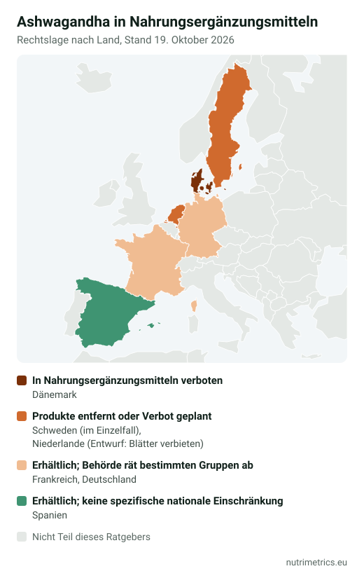

## Die kurze Antwort

Ashwagandha (*Withania somnifera*, Schlafbeere) ist besser untersucht als die meisten Stress-Pflanzen, und die Ergebnisse sind **positiv, aber bescheiden**. Gleichzeitig sieht das **Bundesinstitut für Risikobewertung (BfR)** Hinweise auf Leberschäden und Effekte auf Schilddrüse und Hormone und kann keine sichere Tagesmenge angeben. Wenn du schwanger bist, stillst, Leber- oder Schilddrüsenprobleme hast oder Medikamente nimmst, sprich vorher mit deiner Ärztin oder deinem Arzt. Wenn du es ausprobieren willst: **reiner Wurzelextrakt**, Dosis wie in den Studien, und nur für einen begrenzten Zeitraum.

## Was das BfR sagt

Das BfR hat im September 2024 eine Bewertung veröffentlicht. Kernaussage: Aus den vorliegenden Daten lässt sich **keine sichere tägliche Aufnahmemenge** ableiten. Gründe sind:

* Fallberichte über **Leberschäden**, darunter akutes Leberversagen;
* Hinweise auf Wirkungen auf **Schilddrüse**, **Sexualhormone**, Cortisol und Blutzucker;
* fehlende Sicherheitsdaten für **Schwangerschaft und Stillzeit** sowie eine traditionelle Verwendung als Abtreibungsmittel;
* mögliche **Wechselwirkungen** mit Mitteln gegen Diabetes und Bluthochdruck sowie Immunsuppressiva.

Das BfR rät deshalb **Kindern, Schwangeren, Stillenden und Menschen mit aktueller oder früherer Lebererkrankung** von Ashwagandha-Präparaten ab und mahnt auch für alle anderen zur Vorsicht.

## Was die Studien zeigen

| Anwendung                   | Ergebnis                                                                                                                                                  | Qualität der Belege                                      |
| --------------------------- | --------------------------------------------------------------------------------------------------------------------------------------------------------- | -------------------------------------------------------- |
| Empfundener Stress          | Eine Übersicht von 2021 mit 7 Studien (491 Erwachsene, 6–8 Wochen) fand weniger Stress, Angst und Cortisol als mit Placebo                                | Kleine, kurze Studien, alle aus Indien                   |
| Schlaf                      | Eine Metaanalyse von 2021 mit 5 Studien fand einen **kleinen, aber signifikanten** Effekt, stärker ab 600 mg täglich, ab 8 Wochen und bei Schlafstörungen | Moderat für Schlaf insgesamt, niedrig für Schlafqualität |
| Generalisierte Angststörung | Eine internationale Expertengruppe empfiehlt vorläufig 300–600 mg Wurzelextrakt und fordert mehr Forschung                                                | Begrenzt                                                 |

Laut NIH gibt es zwei Grundprobleme: **Die Extrakte unterscheiden sich stark** (Wurzel oder Blatt, Gehalt an Withanoliden), und zur Sicherheit **über drei Monate hinaus** gibt es kaum Daten.

**Keine zugelassene Angabe:** Gesundheitsbezogene Angaben für Pflanzen sind in der EU seit Jahren „on hold“ und wurden nie zugelassen. Aussagen wie „reduziert Stress“ oder „verbessert den Schlaf“ auf der Packung gehen über das hinaus, was das EU-Recht erlaubt.

## Rechtslage in Europa (Oktober 2026)

| Land        | Status                                                                                                                                                    |
| ----------- | --------------------------------------------------------------------------------------------------------------------------------------------------------- |
| Dänemark    | Seit 2023 in Nahrungsergänzungsmitteln verboten                                                                                                           |
| Schweden    | Mehrere hoch dosierte Produkte im Einzelfall vom Markt genommen                                                                                           |
| Niederlande | RIVM rät zur Meidung (2024). Ein Entwurf verbietet die **Blätter** und verlangt Warnhinweise bei **Wurzel**-Produkten; Kommentierung bis 7. Dezember 2026 |
| Frankreich  | Die ANSES empfahl 2024, dass bestimmte Gruppen, darunter Schwangere und Stillende, darauf verzichten                                                      |
| Deutschland | Erlaubt; BfR rät den genannten Gruppen ab (2024)                                                                                                          |
| Spanien     | Als Nahrungsergänzungsmittel erhältlich; keine spezifische nationale Einschränkung gefunden                                                               |

Stand: 19. Oktober 2026. Eine einheitliche EU-Regel gibt es nicht; die Lage ändert sich schnell.

## So wählst du ein Produkt aus, falls du es nehmen willst

1. **Nur Wurzel.** Die jüngsten Einschränkungen in den Niederlanden und Indien zielen auf die Blätter. KSM-66 ist reiner Wurzelextrakt; Sensoril und Shoden enthalten Wurzel und Blatt.
2. **Dosis wie in den Studien.** Meist 300–600 mg standardisierter Extrakt pro Tag. Mehr ist nicht nachweislich besser.
3. **Withanolide angegeben.** Ein gutes Etikett nennt den Withanolid-Gehalt (zum Beispiel 5 %).
4. **Etikett des Herstellers prüfen, nicht die Shop-Angabe.** In unserer Datenbank gab ein Shop 500 mg KSM-66 pro Kapsel an – ungewöhnlich für diesen Extrakt (meist 300 oder 600 mg).
5. **Enddatum setzen.** Nur für einen begrenzten Zeitraum, etwa 8–12 Wochen wie in den Studien. Bei dunklem Urin, Juckreiz, ungewöhnlicher Müdigkeit oder Gelbfärbung von Haut oder Augen sofort absetzen und ärztlich abklären lassen.

Unser [Zielfinder](/de/zielfinder/) vergleicht die Beleglage für Ashwagandha mit anderen Optionen für Stress und Schlaf, etwa L-Theanin oder Magnesium.
