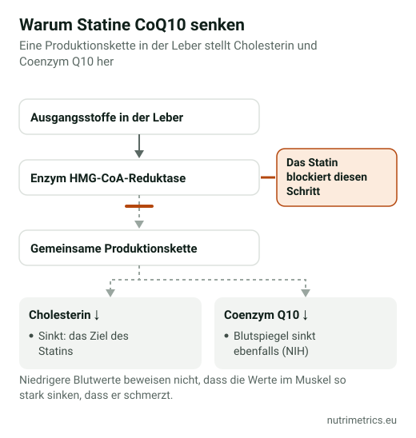

## Die kurze Antwort

Statine senken den Coenzym-Q10-Spiegel, also klingt es logisch, dass Nachfüllen statinbedingte Muskelschmerzen lindert. Die Studien klären das nicht: Die neuere, größere Auswertung fand keinen Nutzen, und europäische wie britische Leitlinien empfehlen es nicht. Schaden wird es dir kaum – aber es ersetzt nicht das Gespräch mit deiner Ärztin oder deinem Arzt über die Schmerzen.

## Warum die Idee logisch klingt

Statine senken das Cholesterin, indem sie ein Enzym in der Leber blockieren. Über denselben Stoffwechselweg entsteht auch **Coenzym Q10**, das Zellen zur Energiegewinnung brauchen, und die US-amerikanischen NIH bestätigen, dass Statine den Q10-Spiegel im Blut senken. Die Theorie: Weniger Q10 in den Muskelzellen verursacht Schmerzen und Schwäche, ein Präparat könnte das ausgleichen. Ein niedrigerer Blutspiegel beweist aber nicht, dass der Spiegel im Muskel relevant sinkt.

## Was die Studien zeigen

| Auswertung | Studien und Personen | Ergebnis |
| --- | --- | --- |
| Qu et al., *J Am Heart Assoc*, 2018 | 12 Studien, 575 Personen | Weniger Muskelschmerzen, Schwäche, Krämpfe und Müdigkeit mit Coenzym Q10. Stark schwankende Ergebnisse; keine Veränderung der CK, eines Markers für Muskelschäden |
| Kennedy et al., *Atherosclerosis*, 2020 | 7 Studien, 321 Personen mit Statin-Muskelschmerzen | **Kein Nutzen** bei Muskelschmerzen, und wer Q10 nahm, blieb nicht häufiger bei seinem Statin |

Die Studien waren klein und kurz, meist ein bis drei Monate, mit unterschiedlichen Dosen. Wenn zwei sorgfältige Auswertungen ähnlicher Studien zu gegensätzlichen Ergebnissen kommen, lautet die ehrliche Zusammenfassung: Ein Nutzen ist unsicher und wahrscheinlich klein.

## Was die Leitlinien sagen

- **Europäische Atherosklerose-Gesellschaft (2015):** rät von Coenzym Q10 bei Statin-Muskelbeschwerden ab, weil Belege für die Wirksamkeit fehlen.
- **NICE (England):** „Empfehlen Sie keine Coenzym-Q10-Präparate zur Behandlung und Vorbeugung statinbedingter Muskelbeschwerden."
- **EU-Gesundheitsaussagen:** Die EFSA hat 2010 Aussagen zu Coenzym Q10 für Energie, Blutdruck, Cholesterin, körperliche Leistung und mehr geprüft. **Keine wurde zugelassen.**

## Wenn du es trotzdem probieren willst

Sprich vorher mit deiner Ärztin oder deinem Arzt, vor allem wenn du weitere Medikamente nimmst. Wenn nichts dagegen spricht:

- **Dosis:** Präparate liefern meist 100–200 mg pro Tag. Eine abgestimmte Dosis für Statin-Beschwerden gibt es nicht.
- **Form:** **Ubichinon** ist die Standardform; **Ubiquinol** wird als „aktiv" vermarktet und ist teurer, ohne gute Belege, dass es hier besser wirkt.
- **Zum Essen:** Nimm es zu einer fetthaltigen Mahlzeit.
- **Frist:** Die Studien liefen ein bis drei Monate. Wenn sich bis dahin nichts geändert hat, hör auf.

| Produkt (unsere Datenbank) | Form | Coenzym Q10 pro Tag laut Etikett |
| --- | --- | --- |
| Vitamaze Coenzym Q10 200 mg | Ubichinon | 200 mg |
| natural elements Coenzym Q10 | Ubichinon (fermentiert) | 200 mg (2 Kapseln) |
| Solgar Ubiquinol 100 mg | Ubiquinol | 100 mg |
| Vitabay Coenzym Q10 Ubiquinol 200 mg | Ubiquinol | 400 mg (2 Kapseln) |

Achtung beim Vitabay-Etikett: Zwei Kapseln täglich ergeben 400 mg, das Doppelte des üblichen Bereichs.

## Sicherheit

Die NIH berichten von keinen schweren Nebenwirkungen, aber Coenzym Q10 **kann mit dem Gerinnungshemmer Warfarin wechselwirken**. Wenn du Marcumar oder einen anderen Gerinnungshemmer nimmst – oder andere verschreibungspflichtige Medikamente –, frag vorher in der Arztpraxis oder Apotheke.

## Was du bei Statin-Muskelschmerzen tun solltest

Sprich mit deiner Ärztin oder deinem Arzt, statt das Statin eigenmächtig abzusetzen. Muskelschmerzen haben viele mögliche Ursachen, die sich abklären lassen, und die Behandlung lässt sich anpassen. Statine werden verschrieben, um das Risiko für Herzinfarkt und Schlaganfall zu senken – wer sie ohne Rücksprache absetzt, verliert diesen Schutz.

Alle geprüften Coenzym-Q10-Produkte vergleichst du auf unserer [Coenzym-Q10-Seite](/de/nahrungsergaenzung/coenzym-q10/); welche Aussagen erlaubt sind, zeigt unsere [Tabelle der zugelassenen Health Claims](/de/ratgeber/zugelassene-health-claims-tabelle/).
