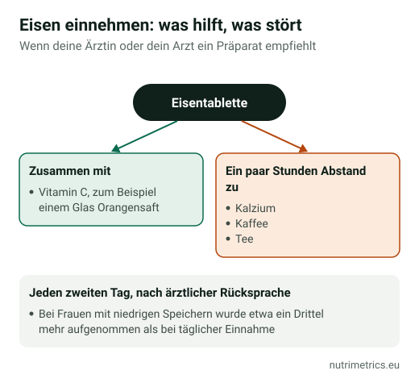

## Die kurze Antwort

Wer sich ohne klaren Grund müde fühlt, dem hilft Eisen **nur bei einem Mangel**. Bevor du etwas kaufst, lass in deiner Hausarztpraxis den **Ferritinwert** bestimmen: Das ist günstig und die einzige Möglichkeit, es zu wissen. Bei einem Mangel hat Eisen eine der klarsten Beleglagen aller Präparate gegen Müdigkeit. Ohne Mangel bringt es nichts – und der Überschuss sammelt sich im Körper an.

## Wer ein erhöhtes Risiko hat

Laut NIH haben vor allem diese Gruppen ein erhöhtes Risiko:

- Frauen mit **starker Regelblutung**;
- **Schwangere**;
- häufige **Blutspenderinnen und Blutspender**;
- Menschen mit **Darmerkrankungen** (etwa Zöliakie) oder nach Magen-Darm-Operationen;
- Menschen mit Herzschwäche oder Krebserkrankungen.

**Vegetarische und vegane** Ernährung liefert nur Nicht-Häm-Eisen, das schlechter aufgenommen wird, und sollte deshalb gut geplant sein.

## Den Bluttest verstehen

| Ferritin | Was der Wert meist bedeutet (laut NIH) |
| --- | --- |
| Unter 10 µg/l | Eisenmangelanämie |
| Unter 30 µg/l | Eisenmangel |
| Über 30 µg/l | Mangel unwahrscheinlich – Entzündungen können Ferritin aber erhöhen |

Deine Ärztin oder dein Arzt bewertet den Wert zusammen mit dem **Hämoglobin**. Ein Eisenmangel ist auch **ohne Blutarmut** möglich: Das Hämoglobin ist normal, aber die Speicher sind leer.

## Wie viel es wirklich bringt

In einer 2012 im Fachjournal *CMAJ* veröffentlichten Studie nahmen 198 Frauen zwischen 18 und 53 Jahren mit **unerklärter Müdigkeit, ohne Blutarmut und mit Ferritin unter 50 µg/l** zwölf Wochen lang 80 mg Eisen täglich oder ein Placebo. Die Erschöpfungswerte sanken mit Eisen um **47,7 %**, mit Placebo um **28,8 %**. Ein echter Effekt – bei Menschen mit niedrigen Speichern, mit hoher Dosis und unter Studienbedingungen.

Die EU erlaubt die Angabe, dass Eisen **zur Verringerung von Müdigkeit und Ermüdung beiträgt**, außerdem zur normalen Bildung roter Blutkörperchen und von Hämoglobin und zum normalen Sauerstofftransport. Keine Angabe besagt, dass Eisen Menschen mit vollen Speichern Energie gibt.

## Warum nicht „auf Verdacht“?

- **Das BfR** empfiehlt höchstens **6 mg** Eisen pro Tagesdosis in frei verkäuflichen Nahrungsergänzungsmitteln. Männer, Frauen nach den Wechseljahren und Schwangere sollten Eisen nur nach ärztlicher Rücksprache nehmen; von einer vorbeugenden Einnahme rät die Verbraucherzentrale ab.
- **Die EFSA** konnte keine tolerierbare Höchstmenge ableiten und hat 2024 eine **sichere Zufuhr von 40 mg Eisen pro Tag** insgesamt für Erwachsene festgelegt.
- **Überschuss bleibt im Körper:** Der Körper kann Eisen kaum ausscheiden. Menschen mit **Hämochromatose**, einer erblichen Eisenspeicherkrankheit, dürfen kein Eisen einnehmen.
- **Kinder:** Laut NIH gehören versehentlich eingenommene Eisenpräparate zu den häufigsten Ursachen tödlicher Vergiftungen bei Kindern unter 6 Jahren. Außer Reichweite aufbewahren.

Ein Beispiel aus unserer Datenbank: **Solgar Gentle Iron** liefert **25 mg** Eisen (als Bisglycinat) pro Kapsel. Das ist eine Dosis zur Behandlung eines Mangels – rund viermal so viel, wie das BfR für ein frei verkäufliches Präparat empfiehlt. Nur mit Befund und ärztlichem Rat verwenden.

## So nimmst du Eisen, wenn es empfohlen wird

1. **Nüchtern oder mit einer leichten Mahlzeit**, wenn du es verträgst; mit Essen, wenn es den Magen reizt.
2. **Mit Vitamin C** (etwa einem Glas Orangensaft), das die Aufnahme von Nicht-Häm-Eisen verbessert.
3. **Mit Abstand zu Kalzium, Kaffee und Tee** von mindestens ein paar Stunden.
4. **Jeden zweiten Tag**, wenn deine Ärztin oder dein Arzt zustimmt: In einer Studie mit Frauen mit niedrigen Eisenspeichern wurde dabei rund ein Drittel mehr Eisen aufgenommen als bei täglicher Einnahme.
5. **Nach einigen Monaten erneut testen**, um zu prüfen, ob das Ferritin steigt, und Eisen nicht länger als nötig zu nehmen.

Häufige Nebenwirkungen: Verstopfung, Übelkeit und dunkler Stuhl. Schwarzer Stuhl ist bei Eisen normal – Bauchschmerzen oder schwarzer Stuhl ohne Eisen-Einnahme gehören ärztlich abgeklärt.

**Wechselwirkungen:** Frag ärztlich oder in der Apotheke nach, wenn du L-Thyroxin, Levodopa oder Magensäureblocker wie Omeprazol nimmst.

Unser [Zielfinder](/de/zielfinder/) zeigt weitere Wirkstoffe mit Angaben zu Müdigkeit, etwa Vitamin B12 oder Magnesium, und wann sie sinnvoll sind.
