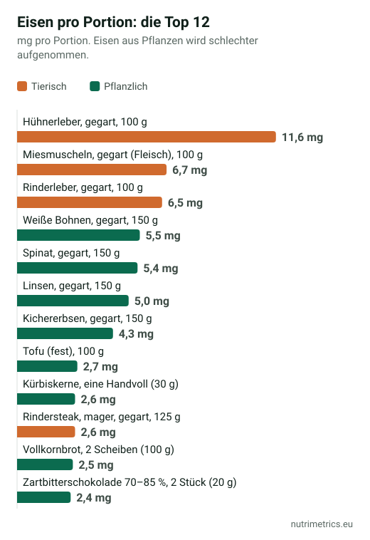
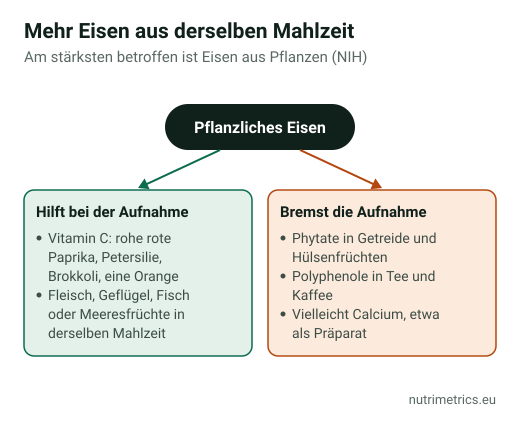

## Die kurze Antwort

Die meisten Erwachsenen können ihren Eisenbedarf über das Essen decken, aber bei keinem Nährstoff kommt es so sehr darauf an, **wie** Sie essen. Laut NIH nimmt der Körper aus Mischkost 14–18 % des Eisens auf, aus vegetarischer Kost 5–12 %. Ein Linseneintopf mit roher Paprika liefert mehr verwertbares Eisen als derselbe Eintopf ohne. Ein Präparat nur, wenn ein Bluttest einen Mangel bestätigt.

## Wie viel Eisen Sie brauchen

| Wer | Referenzzufuhr laut EFSA |
| --- | --- |
| Erwachsene Männer | 11 mg/Tag |
| Frauen nach den Wechseljahren | 11 mg/Tag |
| Frauen im gebärfähigen Alter | 16 mg/Tag |

Der NRV auf Etiketten beträgt **14 mg**. Laut NIH brauchen Menschen, die sich vegetarisch ernähren, **1,8-mal so viel** Eisen, weil sie es schlechter aufnehmen.

## Wie viel jede Portion liefert

Sortiert nach Eisen **pro Portion**. Die Spalte „Herkunft“ ist wichtig: Ein Teil des Eisens in Fleisch, Fisch und Meeresfrüchten ist Häm-Eisen, das besser aufgenommen wird; bei pflanzlichem Eisen hängt viel davon ab, was Sie dazu essen. Die letzte Spalte zeigt, ob das Lebensmittel die EU-Schwelle für „Eisenquelle“ (15 % des NRV pro 100 g) oder „hoher Eisengehalt“ (30 %) erreicht.

| Lebensmittel | Portion | Eisen (mg) | % NRV | Herkunft | EU-Schwelle (pro 100 g) |
| --- | --- | --- | --- | --- | --- |
| Hühnerleber, gegart | 100 g | 11,6 | 83 % | tierisch | hoher Gehalt |
| Miesmuscheln, gegart (Fleisch) | 100 g | 6,7 | 48 % | tierisch | hoher Gehalt |
| Rinderleber, gegart | 100 g | 6,5 | 47 % | tierisch | hoher Gehalt |
| Weiße Bohnen, gegart | 150 g | 5,5 | 40 % | pflanzlich | Quelle |
| Spinat, gegart | 150 g | 5,4 | 38 % | pflanzlich | Quelle |
| Linsen, gegart | 150 g | 5,0 | 36 % | pflanzlich | Quelle |
| Kichererbsen, gegart | 150 g | 4,3 | 31 % | pflanzlich | Quelle |
| Tofu (fest) | 100 g | 2,7 | 19 % | pflanzlich | Quelle |
| Kürbiskerne | eine Handvoll (30 g) | 2,6 | 19 % | pflanzlich | hoher Gehalt |
| Rindersteak, mager, gegart | 125 g | 2,6 | 18 % | tierisch | — |
| Vollkornbrot | 2 Scheiben (100 g) | 2,5 | 18 % | pflanzlich | Quelle |
| Zartbitterschokolade 70–85 % | 2 Stück (20 g) | 2,4 | 17 % | pflanzlich | hoher Gehalt |
| Haferflocken | 50 g | 2,1 | 15 % | pflanzlich | hoher Gehalt |
| Sardinen in Öl, abgetropft | 1 Dose (60 g) | 1,8 | 13 % | tierisch | Quelle |
| Schweinefilet, gegart | 125 g | 1,4 | 10 % | tierisch | — |
| Hähnchenbrust, gegart | 125 g | 1,3 | 9 % | tierisch | — |
| Ei | 1 mittleres (60 g) | 1,1 | 8 % | tierisch | — |

**Was die Tabelle zeigt:**

- **Leber** steht ganz oben, ist aber auch sehr reich an Vitamin A. Der NHS rät, in der Schwangerschaft darauf zu verzichten.
- **Hülsenfrüchte schlagen Fleisch bei der Menge.** 150 g gegarte weiße Bohnen oder Linsen liefern rund 5 mg, ein Rindersteak von 125 g 2,6 mg. Das Fleisch gewinnt bei der Aufnahme.
- **Spinat** liefert 5,4 mg pro Portion, laut NIH wird sein Eisen aber schlecht aufgenommen.
- **Miesmuscheln** sind nach Leber die tierische Quelle mit dem meisten Eisen: 6,7 mg pro 100 g Muschelfleisch.
- **Blutwurst** fehlt in der Tabelle, weil die Datenbanken weit auseinanderliegen: zwischen rund 6 und 18 mg pro 100 g.

## So nehmen Sie mehr Eisen aus derselben Mahlzeit auf

Laut NIH gilt:

1. **Vitamin C hilft**, pflanzliches Eisen aufzunehmen. Essen Sie rohe Paprika, Petersilie, Brokkoli oder eine Orange zu Hülsenfrüchten.
2. **Fleisch, Geflügel, Fisch und Meeresfrüchte** verbessern ebenfalls die Aufnahme des pflanzlichen Eisens aus derselben Mahlzeit. Ein Linseneintopf mit etwas Rindfleisch ist eine gute Kombination.
3. **Phytate** aus Getreide und Hülsenfrüchten und **manche Polyphenole**, etwa aus Tee und Kaffee, bremsen die Aufnahme. Trinken Sie Tee oder Kaffee besser nicht zu eisenreichen Mahlzeiten.
4. **Calcium** könnte sie ebenfalls verringern. Wenn Sie ein Calciumpräparat nehmen, dann nicht zur eisenreichsten Mahlzeit.

## Zwei Rezepte mit Zahlen

### Linseneintopf mit Paprika (4 Portionen)

**Zutaten:** 300 g Tellerlinsen (trocken), 1 Möhre (150 g), 1 Zwiebel (100 g), 300 g festkochende Kartoffeln, 1 große rote Paprika (150 g), 1 Lorbeerblatt, 1 l Gemüsebrühe, 2 EL Rapsöl, 1 Schuss Essig, Salz und Pfeffer.

1. Zwiebel, Möhre und **die Hälfte der Paprika** würfeln und im Öl andünsten.
2. Linsen, Kartoffelwürfel, Lorbeer und Brühe dazugeben und 30–35 Minuten köcheln lassen.
3. Mit Essig abschmecken und **die andere Hälfte der Paprika roh** fein gewürfelt darüberstreuen: So bleibt ihr Vitamin C erhalten.

**Pro Portion:** rund **5,4 mg Eisen** (39 % des NRV) und mindestens 24 mg Vitamin C allein aus der rohen Paprika.

### Rindfleisch-Paprika-Pfanne mit Brokkoli (2 Portionen)

**Zutaten:** 300 g mageres Rindfleisch (Hüfte) in Streifen, 1 rote Paprika (150 g), 200 g Brokkoliröschen, 1 Zwiebel (100 g), 2 EL Rapsöl, 1 Schuss Sojasauce und Pfeffer.

1. Den Brokkoli 4 Minuten dämpfen.
2. Das Fleisch bei sehr starker Hitze 2 Minuten anbraten und herausnehmen.
3. Zwiebel und Paprikastreifen 3 Minuten braten, Fleisch und Brokkoli zurück in die Pfanne geben, mit Sojasauce ablöschen und servieren.

**Pro Portion:** rund **3,4 mg Eisen** (24 %), **7,2 mg Zink** (72 %) und mindestens 65 mg Vitamin C allein aus dem Brokkoli.

## Wer auf Eisen achten sollte

Laut NIH haben **Schwangere**, **Säuglinge und Kleinkinder**, **Frauen mit starker Periode**, **häufige Blutspender** und Menschen mit **bestimmten Magen-Darm-Erkrankungen, Krebs oder Herzinsuffizienz** ein höheres Risiko für einen Mangel. Wenn Sie zu einer dieser Gruppen gehören und sich müde fühlen, lassen Sie den Ferritinwert bestimmen, bevor Sie etwas kaufen. Mehr dazu in [Eisen und Müdigkeit](/de/ratgeber/eisen-muedigkeit/).

## Wenn das Essen nicht reicht

- **Wenn der Bluttest einen Mangel bestätigt**, sagt Ihnen Ihr Arzt, welche Dosis Sie wie lange nehmen sollen. Produkte vergleichen Sie auf unserer Seite zu [Eisen](/de/nahrungsergaenzung/eisen/).
- **Bei Hämochromatose** nehmen Sie kein Eisenpräparat.
- **Bewahren Sie Eisenpräparate außer Reichweite von Kindern auf.**

Dieser Ratgeber gehört zur Serie [Das beste Supplement liegt auf dem Teller](/de/ratgeber/bestes-supplement-auf-dem-teller/).

## So haben wir gerechnet

Die Werte pro 100 g stammen aus der Datenbank FoodData Central des USDA (SR Legacy). Für Blutwurst haben wir sie mit der spanischen Datenbank BEDCA verglichen, die für Morcilla 18 mg pro 100 g angibt, gegenüber rund 6 mg beim USDA. Vollkornbrot: Wert für Weizenvollkornbrot. Portionen, Prozentwerte und Rezeptwerte berechnet NutriMetrics. Der % NRV beruht auf dem Bezugswert von 14 mg aus der Verordnung (EU) 1169/2011. Die tatsächlichen Gehalte schwanken je nach Sorte, Herkunft und Zubereitung.
