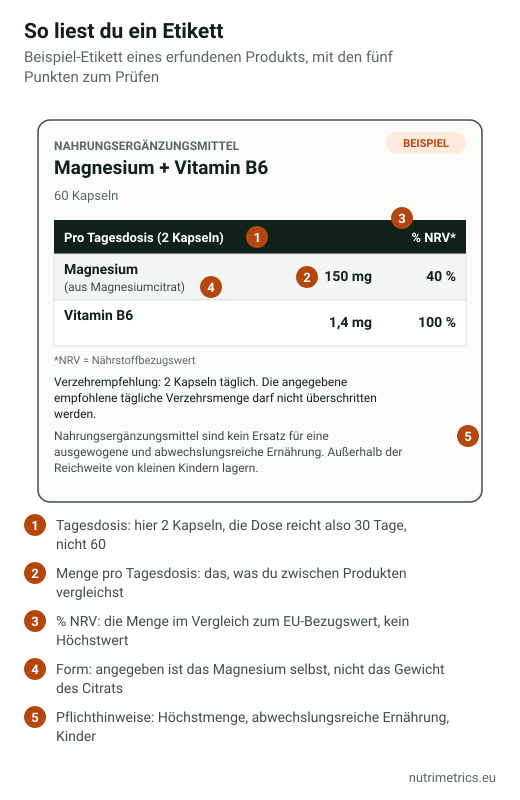

## Die kurze Antwort

Prüfe drei Dinge in der Nährwerttabelle: **die Menge jedes Wirkstoffs pro Tagesdosis**, **wie viele Tagesdosen die Packung enthält** und **ob eine Menge über den Höchstwerten liegt** – in Deutschland lohnt der Vergleich mit den BfR-Empfehlungen. Dann lies die Versprechen auf der Packung: Legal sind nur Angaben aus dem EU-Register, und keine darf sich auf Krankheiten beziehen.

## Was auf dem Etikett stehen muss

Nach der Richtlinie 2002/46/EG, in Deutschland umgesetzt durch die Nahrungsergänzungsmittelverordnung (NemV), muss das Etikett enthalten:

| Pflichtangabe | Wofür sie dir nützt |
| --- | --- |
| Die Bezeichnung **„Nahrungsergänzungsmittel“** | Abgrenzung zum Arzneimittel |
| Die **Nährstoffe oder sonstigen Stoffe**, die das Produkt kennzeichnen | Was du kaufst |
| Die **Menge jedes Stoffs pro empfohlener Tagesdosis** | Produkte vergleichen, Grenzwerte prüfen |
| Bei Vitaminen und Mineralstoffen der **%NRV** | Menge im Verhältnis zum Bezugswert |
| Die **empfohlene Tagesdosis** und der Warnhinweis, sie **nicht zu überschreiten** | Wie viele Einheiten eine Dosis sind |
| Der Hinweis, dass es **kein Ersatz für eine abwechslungsreiche Ernährung** ist | — |
| Der Hinweis, es **außerhalb der Reichweite kleiner Kinder** aufzubewahren | — |

Dazu kommen die allgemeinen Lebensmittelangaben: Zutatenliste, Allergene, Füllmenge, Mindesthaltbarkeitsdatum, Los-Nummer sowie Name und Anschrift des Verantwortlichen.

## Schritt 1: Tagesdosis statt Kapsel

Viele Produkte brauchen **2, 3 oder sogar 6 Kapseln**, um die groß beworbene Menge zu erreichen. Prüfe, wie viele Einheiten eine „Tagesdosis“ sind, und teile die Packung durch diese Zahl: Eine Dose mit 120 Kapseln und 3 Kapseln pro Tag reicht **40 Tage**, nicht 120.

## Schritt 2: Mineralstoff statt Verbindung

Bei Mineralstoffen zählt die **elementare** Menge. „1.000 mg Magnesiumbisglycinat“ liefern meist etwa 140 mg Magnesium. Die Tabelle muss das Magnesium nennen; wenn die Vorderseite das Gewicht der Verbindung hervorhebt, lass dich von der großen Zahl nicht täuschen. Mehr in [Welches Magnesium ist das beste?](/de/ratgeber/welches-magnesium-ist-das-beste/)

## Schritt 3: %NRV richtig verstehen

Der **Nährstoffbezugswert (NRV)** ist ein EU-Referenzwert, kein Höchstwert und keine persönliche Empfehlung. Zum Vergleich:

| Nährstoff | NRV (100 %) | BfR-Empfehlung pro Tagesdosis | EFSA-Höchstmenge für Erwachsene |
| --- | --- | --- | --- |
| Vitamin D | 5 µg | 20 µg | 100 µg pro Tag |
| Zink | 10 mg | 6,5 mg | 25 mg pro Tag |
| Magnesium | 375 mg | 250 mg | 250 mg pro Tag aus Präparaten |
| Eisen | 14 mg | 6 mg | Keine Höchstmenge; sichere Menge 40 mg pro Tag |
| Vitamin B6 | 1,4 mg | — | 12 mg pro Tag |

Beim Magnesium liegt schon 100 % NRV (375 mg) **über** den 250 mg, die EFSA und BfR für Präparate ansetzen. Ein hoher %NRV ist kein Qualitätsmerkmal, sondern manchmal ein Grund, genauer hinzusehen. Die vollständige Liste steht in den [Höchstmengenempfehlungen des BfR](https://www.bfr.bund.de/cm/343/hoechstmengenempfehlungen-des-bfr.pdf).

## Schritt 4: Typische Fallen erkennen

- **Dosis steigt, wenn man das Etikett ausreizt.** Aus unserer Datenbank: Berocca Energía empfiehlt 1 Tablette täglich, das Etikett erlaubt aber 2. Bei 2 Tabletten erreicht Vitamin B6 **16,4 mg** – über der EFSA-Höchstmenge von 12 mg.
- **„Mischungen“ ohne Einzelmengen.** Das Recht verlangt die Menge jedes Stoffs mit ernährungsbezogener oder physiologischer Wirkung. Steht nur die Gesamtmenge einer „Spezialmischung“ da, weißt du nicht, wie viel wovon drin ist.
- **Nicht standardisierte Extrakte.** Bei Pflanzen auf Extraktart und Gehalt achten (etwa „5 % Withanolide“ bei Ashwagandha). Ohne diese Angabe sagt „500 mg Extrakt“ wenig.
- **Zahlen vorn, die nicht zur Tabelle passen.** Es gilt immer die Tabelle.

## Schritt 5: Die Versprechen prüfen

Ein Nahrungsergänzungsmittel darf nur [zugelassene gesundheitsbezogene Angaben](/de/ratgeber/zugelassene-health-claims-tabelle/) verwenden – im zugelassenen Wortlaut und ab der Mindestmenge. Außerdem darf es nicht behaupten, eine Krankheit zu **verhüten, behandeln oder heilen**. „Nie wieder schlaflos“, „Detox“ oder „stärkt die Abwehr gegen Viren“ sind Zeichen dafür, dass ein Etikett zu weit geht.

In Deutschland muss jedes Nahrungsergänzungsmittel beim **BVL** angezeigt werden. Eine Anzeige ist aber keine Zulassung und kein Beweis, dass ein Produkt wirkt.

Unser [Zielfinder](/de/zielfinder/) zeigt für jedes Produkt in unserer Datenbank die echte Tagesdosis und ob sie die als wirksam geltende Menge erreicht.
