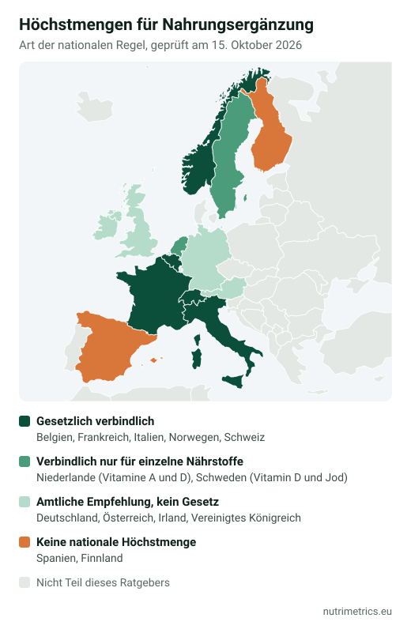

## Die Lage in Deutschland

In Deutschland gibt es **keine gesetzlich festgelegten Höchstmengen** für Vitamine und Mineralstoffe in Nahrungsergänzungsmitteln. Das bestätigt das Bundesamt für Verbraucherschutz und Lebensmittelsicherheit (BVL). Es gibt nur Empfehlungen des Bundesinstituts für Risikobewertung (BfR). Sie sind nicht rechtsverbindlich, die Lebensmittelüberwachung der Länder nutzt sie aber, wenn sie Produkte beurteilt.

Vor dem Verkauf genehmigt niemand ein Nahrungsergänzungsmittel. Hersteller müssen es vor dem ersten Inverkehrbringen beim BVL **anzeigen**, das BVL prüft und bewertet es aber nicht. Für die Sicherheit ist der Hersteller selbst verantwortlich. Laut den Marktchecks der Verbraucherzentralen halten sich nur wenige Hersteller an die BfR-Werte.

### Die BfR-Empfehlungen im Überblick

Höchstmenge pro Tagesdosis eines Nahrungsergänzungsmittels für Personen ab 15 Jahren, verglichen mit dem Sicherheitswert der EFSA (tolerierbare Höchstmenge für die gesamte Aufnahme aus Ernährung und Präparaten).

| Nährstoff | BfR-Empfehlung pro Tagesdosis | EFSA-Sicherheitswert (Erwachsene) |
| --- | --- | --- |
| Vitamin D | 20 µg | 100 µg |
| Vitamin B6 | 0,9 mg | 12 mg |
| Folsäure | 200 µg; 400 µg bei Kinderwunsch und in der Schwangerschaft | 1.000 µg |
| Vitamin A | möglichst keins, höchstens 200 µg | 3.000 µg |
| Vitamin C | 250 mg | kein Wert festgelegt |
| Vitamin B12 | 25 µg | kein Wert festgelegt |
| Magnesium | 250 mg, auf mindestens zwei Portionen verteilt | 250 mg (nur aus Präparaten und angereicherten Lebensmitteln) |
| Zink | 6,5 mg | 25 mg |
| Eisen | 6 mg | kein Wert; 40 mg gelten als sichere Aufnahme |
| Selen | 40 µg | 255 µg |
| Jod | 100 µg; 150 µg für Schwangere und Stillende | 600 µg |
| Calcium | 500 mg | 2.500 mg |

BfR-Werte nach der Übersicht der Verbraucherzentrale (Stand 19. August 2026); EFSA-Werte aus der EFSA-Übersicht von 2024.

**Warum die BfR-Werte so niedrig sind:** Das BfR geht vom EFSA-Sicherheitswert aus und zieht ab, was Jugendliche von 15 bis 17 Jahren mit sehr hoher Aufnahme schon über die Ernährung bekommen. Diese Gruppe gilt als besonders empfindlich. Was übrig bleibt, darf zusätzlich zur Ernährung aufgenommen werden. Für angereicherte Lebensmittel schlägt das BfR eigene Werte vor. Mehr zu Vitamin D findest du in [Vitamin D im Winter](/de/ratgeber/vitamin-d-im-winter/), zu Magnesium in [Welches Magnesium ist das beste?](/de/ratgeber/welches-magnesium-ist-das-beste/).

## Warum die Grenzen von Land zu Land verschieden sind

Die EU hat 2002 festgelegt, welche Vitamine und Mineralstoffe in Nahrungsergänzungsmitteln stecken dürfen und in welchen chemischen Formen. Sie hat auch angekündigt, gemeinsame Höchstmengen festzulegen. Dieser zweite Schritt fehlt bis heute, also füllt jedes Land die Lücke selbst.

Das Ergebnis sind drei Arten von Märkten:

- **Gesetzlich verbindlich.** Die Höchstmenge steht in einer Verordnung und gilt für jedes Produkt, das dort hergestellt oder angemeldet wird: Belgien, Frankreich, Italien, die Niederlande (nur Vitamine A, D und B6), Schweden (nur Vitamin D und Jod), Norwegen und die Schweiz.
- **Amtliche Empfehlung.** Eine Behörde veröffentlicht „sichere" Werte, die die Überwachung nutzt, die aber kein Gesetz sind: Deutschland (BfR), Österreich, Irland und das Vereinigte Königreich (NHS).
- **Keine nationale Höchstmenge.** Spanien und Finnland setzen keine allgemeinen Grenzen; die Behörden beurteilen jedes Produkt einzeln anhand der EFSA-Sicherheitswerte.

**Kommen EU-weite Höchstmengen?** Die EU-Kommission bereitet sie vor. Ihre Planung sieht die Annahme für das erste Quartal 2028 vor. Im Oktober 2026 erklärte sie jedoch, dass in diesem Jahr keine öffentliche Konsultation mehr geplant ist, und nannte keinen neuen Zeitplan. Danach dürften lange Übergangsfristen folgen. Bis dahin gelten die nationalen Regeln.

## Höchstmenge pro Tagesdosis, Land für Land

Höchstmenge pro empfohlener Tagesdosis eines Nahrungsergänzungsmittels für Erwachsene. „—" heißt: keine nationale Höchstmenge.

[[max-levels:all]]

Werte am 15. Oktober 2026 mit den nationalen Quellen und dem Vergleich der Verbraucherzentrale (September 2025) abgeglichen, britische Werte am 30. Oktober 2026 mit dem NHS. Mehrere Länder haben eigene, niedrigere Grenzen für Kinder und Jugendliche.

### Melatonin

[[country-status:melatonin]]

Die Rechtslage in Deutschland im Detail: [Melatonin: Dosierung, Wirkung und Rechtslage](/de/ratgeber/melatonin-dosierung-rechtslage/).

## Die größten Unterschiede in Zahlen

- **Vitamin D:** Eine Tablette mit 4.000 IE (100 µg), die in Irland oder im Vereinigten Königreich legal verkauft wird, enthält das Fünffache der deutschen und österreichischen Empfehlung und liegt über den verbindlichen Grenzen in Belgien, den Niederlanden, Italien, Frankreich, Schweden, Norwegen und der Schweiz.
- **Zink:** Die Schweiz erlaubt 5,3 mg pro Tag und das BfR empfiehlt 6,5 mg, während Irland und das Vereinigte Königreich mit 25 mg rechnen. Eine übliche 25-mg-Tablette enthält fast das Vierfache der BfR-Empfehlung.
- **Vitamin B6:** Die BfR-Empfehlung von 0,9 mg steht neben 10 mg im Vereinigten Königreich und 25 mg in Irland. Der irische Wert stammt aus der Zeit, bevor die EFSA 2023 ihren Sicherheitswert für B6 von 25 auf 12 mg gesenkt hat.
- **Magnesium:** Belgien und Italien erlauben 450 mg, fast das Doppelte der 250 mg, die die EFSA für Magnesium aus Präparaten ansetzt. Der EFSA-Wert soll Durchfall vermeiden, keine schweren Schäden.

## Warum ein Produkt über der Grenze legal sein kann

Das wissen die wenigsten Käufer: In der EU gilt der **Grundsatz der gegenseitigen Anerkennung** (Artikel 34 bis 36 des Vertrags über die Arbeitsweise der EU, heute geregelt durch die **Verordnung (EU) 2019/515**). Ist ein Produkt in einem Mitgliedstaat rechtmäßig auf dem Markt, darf ein anderer Mitgliedstaat es nicht einfach verbieten, nur weil seine eigenen Regeln anders sind.

In der Praxis:

1. Eine Marke meldet in Belgien ein Vitamin-D-Präparat mit 75 µg an, das dort erlaubt ist.
2. Sie verkauft dasselbe Produkt in Italien, wo die verbindliche Grenze bei 50 µg liegt.
3. Die italienische Behörde kann es nur mit einer **begründeten Entscheidung für genau dieses Produkt** stoppen, die ein echtes Gesundheitsrisiko belegt. Seit 2020 kann sich der Verkäufer dabei auf eine „Erklärung über die gegenseitige Anerkennung" nach der Verordnung 2019/515 stützen.

**Und in Deutschland?** Hier spielt das eine kleinere Rolle, weil die BfR-Werte ohnehin nicht verbindlich sind: Auch deutsche Hersteller dürfen darüber liegen. Die Überwachungsbehörden der Länder können nur im Einzelfall einschreiten, etwa wenn sie ein Produkt für nicht sicher halten oder als Arzneimittel einstufen.

Der Europäische Gerichtshof hat im Fall *Noria Distribution* (C-672/15, 2017) bestätigt, dass Länder eigene Höchstmengen festlegen dürfen, solange es keine EU-Werte gibt. Diese müssen aber auf einer wissenschaftlichen Risikobewertung beruhen, nicht auf pauschaler Vorsicht.

Außerhalb der EU sieht es anders aus:

- **Norwegen** wendet denselben Grundsatz über das EWR-Abkommen an.
- **Schweden** hat ein eigenes Ventil: Ein Unternehmen kann eine Ausnahme von den Grenzen für Vitamin D (80 µg) und Jod (200 µg) beantragen, wenn es zeigt, dass die höhere Dosis sicher ist.
- **Die Schweiz** erkennt EU-konforme Produkte nach ihrem „Cassis-de-Dijon-Prinzip" an, Lebensmittel brauchen dafür aber vorher eine Bewilligung des Bundesamts für Lebensmittelsicherheit und Veterinärwesen (BLV).
- **Großbritannien:** Seit dem Brexit gibt es keine gegenseitige Anerkennung mit der EU. Nordirland wendet weiter das EU-Lebensmittelrecht an.

Was das für dich heißt: Die Dosis auf dem Etikett zeigt, was dort erlaubt war, wo das Produkt **zuerst** auf den Markt kam, nicht unbedingt, was in Deutschland als sicher gilt. Produkte von außerhalb der EU, etwa US-Marken auf Marktplätzen, genießen keinen Schutz durch die gegenseitige Anerkennung.

## Wofür die Nährstoffe gut sind – und was zu viel bewirken kann

Die Wirkungen beschränken sich auf das, was die zugelassenen EU-Angaben erlauben (siehe [zugelassene Health Claims](/de/ratgeber/zugelassene-health-claims-tabelle/)). Das ist keine medizinische Beratung. Sprich vor hohen Dosen mit deiner Ärztin, deinem Arzt oder in der Apotheke, vor allem wenn du Medikamente nimmst, schwanger bist oder es um Kinder geht.

### Vitamin D

- **Wirkung:** trägt zur normalen Aufnahme von Calcium und Phosphor bei, zur Erhaltung normaler Knochen, Zähne und Muskelfunktion und zu einer normalen Funktion des Immunsystems.
- **Zu viel:** reichert sich im Körperfett an und kann den Calciumspiegel im Blut erhöhen (Hyperkalzämie), was Nieren und Herz schaden kann. Das Risiko kommt von hoch dosierten Präparaten, nicht von Sonne oder Essen.

### Vitamin B6

- **Wirkung:** trägt zu einem normalen Energiestoffwechsel, einer normalen Funktion des Nervensystems und zur Verringerung von Müdigkeit bei.
- **Zu viel:** Eine hohe Aufnahme über lange Zeit wird mit Nervenschäden (Kribbeln und Taubheit in Händen und Füßen) in Verbindung gebracht. Deshalb hat die EFSA ihren Sicherheitswert 2023 auf 12 mg halbiert. Achte auf B6 in Magnesium- und „Schlaf"-Kombinationen.

### Folsäure

- **Wirkung:** trägt zur normalen Blutbildung und zum Wachstum des mütterlichen Gewebes in der Schwangerschaft bei; 400 µg pro Tag vor und in der frühen Schwangerschaft senken das Risiko für Neuralrohrdefekte.
- **Zu viel:** Hohe Mengen können einen Vitamin-B12-Mangel verdecken, sodass Nervenschäden unbemerkt fortschreiten.

### Magnesium

- **Wirkung:** trägt zu einer normalen Muskel- und Nervenfunktion, zum Energiestoffwechsel, zum Elektrolytgleichgewicht und zur Verringerung von Müdigkeit bei.
- **Zu viel:** Magnesium aus Präparaten wirkt über etwa 250 mg vor allem abführend (Durchfall, Krämpfe). Wer eine Nierenerkrankung hat, sollte es nur nach ärztlicher Rücksprache nehmen.

### Zink

- **Wirkung:** trägt zu einer normalen Funktion des Immunsystems, zur Fruchtbarkeit, zur Erhaltung von Haut, Haaren und Nägeln und zum Schutz der Zellen vor oxidativem Stress bei.
- **Zu viel:** Eine hohe Aufnahme über lange Zeit hemmt die Aufnahme von Kupfer und kann zu Blutarmut und weniger weißen Blutkörperchen führen. Mehr in [Zink und Vitamin C bei Erkältung](/de/ratgeber/zink-vitamin-c-erkaeltung/).

### Selen

- **Wirkung:** trägt zu einer normalen Schilddrüsenfunktion, einer normalen Funktion des Immunsystems, zur Erhaltung von Haaren und Nägeln und zum Schutz der Zellen vor oxidativem Stress bei.
- **Zu viel:** Erste Anzeichen sind Haarausfall und brüchige Nägel. Schon zwei, drei Paranüsse am Tag liefern viel Selen.

### Jod

- **Wirkung:** trägt zu einer normalen Produktion von Schilddrüsenhormonen und zu einer normalen kognitiven Funktion bei.
- **Zu viel:** kann eine Über- oder Unterfunktion der Schilddrüse auslösen, vor allem bei Menschen mit Schilddrüsenerkrankungen. Kelp- und Algenpräparate können sehr viel Jod enthalten.

## So liest du ein Etikett

1. Schau auf die Menge **pro Tagesdosis**, nicht pro Tablette oder pro 100 g.
2. Vergleiche sie mit der BfR-Empfehlung oben und mit dem EFSA-Sicherheitswert.
3. Zähle denselben Nährstoff aus allen Produkten zusammen: Ein Multivitamin, eine Vitamin-D-Tablette und angereicherte Milch können die Aufnahme verdoppeln.
4. Liegt ein Produkt über dem EFSA-Sicherheitswert, sprich mit deiner Ärztin oder deinem Arzt, auch wenn der Verkauf legal ist.

Mehr dazu in [Etikett von Nahrungsergänzung lesen](/de/ratgeber/etikett-nahrungsergaenzungsmittel-lesen/). Produkte mit Magnesium, Vitamin D und Zink vergleichen wir auf den Seiten zu [Magnesium](/de/nahrungsergaenzung/magnesium/), [Vitamin D](/de/nahrungsergaenzung/vitamin-d/) und [Zink](/de/nahrungsergaenzung/zink/).

*Dieser Ratgeber ist eine allgemeine Information, keine medizinische Beratung. Grenzwerte ändern sich; wir prüfen die Quellen dieses Artikels alle sechs Monate.*
