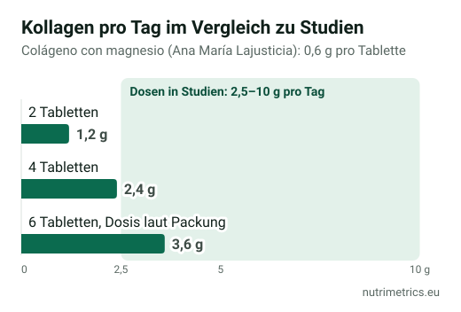

## Die kurze Antwort

Kollagen mit Magnesium und Kollagen mit Hyaluronsäure verkaufen sich gut, aber **keiner der beworbenen Hauptstoffe hat eine zugelassene EU-Angabe**. Was die Packung legal versprechen darf, kommt vom **Magnesium** (Knochen, Muskeln, Müdigkeit) oder vom zugesetzten **Vitamin C** (Kollagenbildung). Die Belege für Kollagen und Haut sind umstritten, für orale Hyaluronsäure dünn. Wer diese Produkte kauft, bezahlt vor allem für das Magnesium – der Rest ist eine Wette.

## Was jedes Produkt versprechen darf

| Produkt                    | Stoff mit zugelassener Angabe                               | Was auf der Packung stehen darf                                                                                            |
| -------------------------- | ----------------------------------------------------------- | -------------------------------------------------------------------------------------------------------------------------- |
| Kollagen mit Magnesium     | Magnesium                                                   | Trägt zur Erhaltung normaler Knochen, zu einer normalen Muskelfunktion und zur Verringerung von Müdigkeit und Ermüdung bei |
| Kollagen mit Hyaluronsäure | Keiner, außer bei zugesetzten Vitaminen oder Mineralstoffen | Nichts zu Haut oder Gelenken, außer was zugesetztes Vitamin C oder ein anderer Nährstoff erlaubt                           |
| Kollagen mit Vitamin C     | Vitamin C                                                   | Trägt zu einer normalen Kollagenbildung für eine normale Funktion von Haut, Knorpel und Knochen bei                        |

Die EFSA hat eine Gelenk-Angabe für Kollagenhydrolysat geprüft und keinen Ursache-Wirkungs-Zusammenhang festgestellt; die EU hat sie 2012 abgelehnt. Deshalb setzen so viele Kollagenprodukte Magnesium oder Vitamin C zu. Mehr in unserer [Tabelle der zugelassenen Health Claims](/de/ratgeber/zugelassene-health-claims-tabelle/).

## Was die Studien zeigen

| Stoff                      | Wichtigste Studie                                | Ergebnis                                                                                                                                                                                                           |
| -------------------------- | ------------------------------------------------ | ------------------------------------------------------------------------------------------------------------------------------------------------------------------------------------------------------------------ |
| Kollagen (Haut)            | Metaanalyse 2025, 23 Studien, 1.474 Teilnehmende | Insgesamt schien sich Feuchtigkeit und Elastizität zu bessern – aber **nur in industriefinanzierten Studien**. Unabhängige und hochwertigere Studien fanden keinen Effekt. Die Industrie bestreitet die Auswertung |
| Orale Hyaluronsäure (Haut) | Metaanalyse 2025, 7 Studien                      | Verbesserungen bei Feuchtigkeit, Elastizität und Faltentiefe, in **wenigen, kleinen und uneinheitlichen** Studien                                                                                                  |
| Kollagen (Gelenke)         | Studien mit 5–10 g täglich                       | Gemischte Ergebnisse; möglicher kleiner Nutzen                                                                                                                                                                     |

Das ehrliche Fazit: Kollagen für die Haut ist derzeit eine **umstrittene Wette**. Die Kritiker der Metaanalyse haben teilweise recht – „Kollagen“ umfasst sehr verschiedene Rohstoffe und Dosierungen –, doch wenn nur von Herstellern bezahlte Studien positiv ausfallen, ist Vorsicht angebracht.

## Das Detail, auf das kaum jemand achtet: die Dosis

Viele Tabletten-Produkte liefern **nur wenige Gramm Kollagen** pro Tagesdosis, während Studien meist **2,5–10 g** verwenden. Ein Beispiel aus unserer Datenbank (ein spanisches Produkt): *Colágeno con magnesio* von Ana María Lajusticia gibt **6 Tabletten täglich** für **3,6 g Kollagen und 185 mg Magnesium** an.

Zwei praktische Folgen:

1. **Weniger Tabletten als angegeben** heißt sehr wenig Kollagen.
2. **Nimmst du zusätzlich ein Magnesiumpräparat**, musst du beides addieren. EFSA und BfR setzen **250 mg pro Tag** als Höchstmenge für Magnesium aus Präparaten an; mit 185 mg aus diesem Produkt bleiben nur 65 mg Spielraum. Darüber steigt das Risiko für Durchfall.

## Was ist also sinnvoll?

| Wenn du vor allem … willst    | Am sinnvollsten                                                                               |
| ----------------------------- | --------------------------------------------------------------------------------------------- |
| Magnesium, Kollagen als Extra | Kollagen mit Magnesium – und das gesamte Magnesium des Tages zählen                           |
| Mehr Feuchtigkeit in der Haut | Keins hat eine zugelassene Angabe. Orale Hyaluronsäure hat etwas Belege, Kollagen umstrittene |
| Etwas für die Gelenke         | Schwache Belege für Kollagen. Bei anhaltenden Schmerzen ärztlich abklären lassen              |
| Den besten Preis              | **Kosten pro Gramm Kollagen** und pro mg Magnesium vergleichen, nicht den Dosenpreis          |

Unsere Ratgeber [Welches Magnesium ist das beste?](/de/ratgeber/welches-magnesium-ist-das-beste/) und [Magnesium zum Schlafen](/de/ratgeber/magnesium-zum-schlafen/) erklären, was Magnesium leistet und wie viel sinnvoll ist.

**Sprich vorher mit deiner Ärztin oder deinem Arzt**, wenn du eine Nierenerkrankung hast oder dauerhaft Antibiotika, Bisphosphonate oder Magensäureblocker nimmst.
