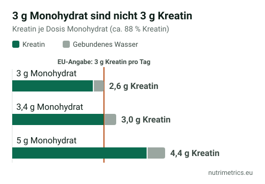

## Die kurze Antwort

Wenn du Krafttraining machst, Sport mit kurzen, intensiven Belastungen treibst (Sprints, Fußball, Padel, HIIT) oder über 55 bist und mit Gewichten trainierst, ist Kreatin-Monohydrat das Supplement mit den meisten Belegen. Nimm **3–5 g täglich**, jeden Tag, mit oder ohne Ladephase. Kauf **Monohydrat**: Es ist am besten untersucht und am günstigsten. „Fortschrittlichere“ Varianten haben keinen Vorteil gezeigt.

## Was Kreatin laut EU versprechen darf

Kreatin gehört zu den wenigen Sport-Supplements mit zugelassenen gesundheitsbezogenen Angaben:

| Zugelassene Angabe (sinngemäß)                                                                                             | Für wen                                                 | Bedingung                                                                 |
| -------------------------------------------------------------------------------------------------------------------------- | ------------------------------------------------------- | ------------------------------------------------------------------------- |
| Kreatin erhöht die körperliche Leistung bei Schnellkrafttraining im Rahmen kurzzeitiger intensiver körperlicher Betätigung | Erwachsene, die intensiv trainieren                     | 3 g Kreatin pro Tag                                                       |
| Die tägliche Aufnahme von Kreatin kann die Wirkung von Krafttraining auf die Muskelkraft verstärken                        | Erwachsene über 55, die regelmäßig Krafttraining machen | 3 g täglich, Training mindestens 3-mal pro Woche mit steigender Belastung |

Die zweite Angabe wurde 2017 nach einer Bewertung der EFSA zugelassen. Die EFSA stellte fest, dass Kreatin **nur an Trainingstagen nicht dieselbe Wirkung** hatte: Entscheidend ist die tägliche Einnahme.

Muskelaufbau, „Fettverbrennung“, Gedächtnis oder Hormongesundheit sind **keine** zugelassenen Angaben. Eine Dose, die das verspricht, geht über das hinaus, was das EU-Recht erlaubt.

## Das 3-g-Detail, das kaum ein Etikett erwähnt

Die zugelassene Angabe bezieht sich auf **3 g Kreatin**. Monohydrat ist aber kein reines Kreatin: Es enthält ein Wassermolekül und besteht zu etwa **88 % aus Kreatin**. Das heißt:

* 3 g Monohydrat liefern rund **2,6 g Kreatin**;
* für 3 g Kreatin brauchst du rund **3,4 g Monohydrat**;
* die übliche Portion von 5 g Monohydrat liefert etwa 4,4 g Kreatin.

Viele Produkte haben einen 3-g-Messlöffel. Das wirkt trotzdem – wer die EU-Bedingung genau erreichen will, nimmt 3,5–5 g.

## Dosierung und Einnahme

Die Referenz ist das Positionspapier der **International Society of Sports Nutrition (ISSN)** von 2017:

* **Ohne Ladephase:** 3–5 g täglich. Die Muskeln sind nach etwa 4 Wochen gesättigt.
* **Mit Ladephase (optional):** etwa 0,3 g pro kg Körpergewicht täglich (rund 20 g bei 70 kg), auf 4 Portionen verteilt, für 5–7 Tage; danach 3–5 g täglich.
* **Wie:** in Wasser, Saft oder im Proteinshake. Die Einnahme zu einer Mahlzeit mit Kohlenhydraten kann die Aufnahme in den Muskel unterstützen.

**Vegetarier und Veganer** haben meist weniger Kreatin im Muskel, weil es mit der Nahrung vor allem über Fleisch und Fisch aufgenommen wird. In Studien sprechen sie oft stärker an.

## Monohydrat, Creapure und andere Formen

| Form                      | Was es ist                                           | Einordnung nach Studienlage                                   |
| ------------------------- | ---------------------------------------------------- | ------------------------------------------------------------- |
| Monohydrat                | Die Standardform in fast allen Studien               | Der Maßstab; am günstigsten pro Gramm                         |
| Mikronisiertes Monohydrat | Monohydrat mit feineren Partikeln                    | Löst sich besser; gleiche Wirkung                             |
| Creapure                  | Markenrohstoff aus Monohydrat von AlzChem, Trostberg | Gleiche Verbindung, mit dokumentierter Reinheitsprüfung       |
| Hydrochlorid (HCl)        | Kreatin gebunden an Salzsäure                        | Wenige Studien; kein belegter Vorteil                         |
| Kre-Alkalyn (gepuffert)   | Kreatin mit verändertem pH-Wert                      | Eine Studie von 2012 fand keinen Vorteil gegenüber Monohydrat |

**Lohnt sich der Aufpreis für Creapure?** Wirksamer ist es nicht – es ist dasselbe Monohydrat. Du bezahlst für einen deutschen Hersteller mit veröffentlichten Qualitätsprüfungen. Wenn eine günstigere Marke Reinheitsanalysen pro Charge veröffentlicht, bleibt nur der Preisunterschied.

## Mythen und Nebenwirkungen

**„Kreatin lagert Wasser ein.“** In den ersten Tagen, vor allem mit Ladephase, sind etwa 1–2 kg mehr auf der Waage üblich. Das ist Wasser **im** Muskel, nicht unter der Haut. Ohne Ladephase verläuft die Zunahme langsamer.

**„Kreatin macht Haarausfall.“** Das geht auf eine einzige Studie von 2009 mit 20 Rugbyspielern zurück, die einen Anstieg des Hormons DHT sah. Haarausfall wurde nicht gemessen, das Ergebnis wurde nie bestätigt, und andere Studien fanden keine DHT-Veränderung.

**„Kreatin schadet den Nieren.“** Bei gesunden Menschen wurden bei üblichen Dosen keine Nierenschäden gefunden. Kreatin erhöht aber den **Kreatininwert im Blut**, einen Nierenmarker. Erwähne die Einnahme deshalb vor einer Blutuntersuchung. Mit Nierenerkrankung nur nach ärztlicher Rücksprache.

**Magen-Darm-Beschwerden** treten vor allem bei großen Einzeldosen auf. Eine auf mehrere Portionen verteilte Ladephase vermeidet das meist.

## Kreatin für Frauen

Die EU-Angabe unterscheidet nicht zwischen Männern und Frauen. Es gibt weniger Studien mit Frauen, eine Übersichtsarbeit von 2021 fand aber ähnliche Effekte auf Kraft und Leistung und eine gute Verträglichkeit in allen Lebensphasen. Das Interesse an Kreatin in den Wechseljahren und für die Knochengesundheit wächst, **zugelassene Angaben** dazu gibt es aber noch nicht.

**Sprich mit deiner Ärztin oder deinem Arzt**, wenn du schwanger bist oder stillst oder eine Nieren- oder Lebererkrankung hast.

## So vergleichst du den Preis

Vergleiche den **Preis pro 5 g Monohydrat**, nicht den Preis der Dose:

**Dosenpreis ÷ Gramm in der Dose × 5 = Kosten pro 5-g-Portion**

Eine 250-g-Dose reicht für 50 Portionen à 5 g, eine 1-kg-Dose für 200. Große Dosen sind fast immer günstiger pro Portion, und Kreatinpulver hält sich gut, wenn es verschlossen und trocken lagert.

Unser [Zielfinder](/de/zielfinder/) zeigt die Kreatin-Produkte aus unserer Datenbank für Deutschland und Spanien.
