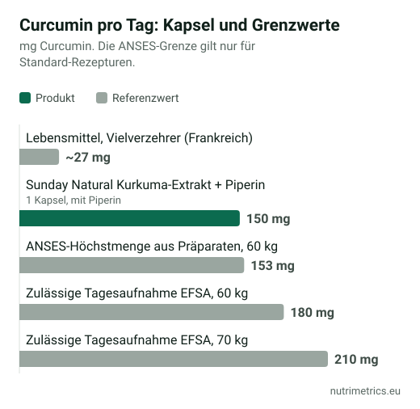

## Die kurze Antwort

Kurkuma beim Kochen ist unproblematisch. **Konzentrierte Kurkuma- und Curcumin-Präparate** wurden in Europa und darüber hinaus mit seltenen Leberschäden in Verbindung gebracht, und das Risiko scheint bei Rezepturen für eine bessere Aufnahme höher zu sein. Wenn du eines nimmst, bleib unter den Tagesmengen der Behörden, verzichte bei Leber- oder Gallenproblemen oder Blutverdünnern und setz es beim ersten Warnzeichen ab.

## Was passiert ist

| Wann | Wo | Was |
| --- | --- | --- |
| 2018–2019 | Italien | Rund 20 Hepatitis-Fälle in der Toskana und der Lombardei im Zusammenhang mit Kurkuma-Präparaten. Verunreinigungen und Zusatzstoffe wurden ausgeschlossen. |
| 2019 | Belgien | Rückruf eines Kurkuma-Produkts, das mit den italienischen Fällen in Verbindung stand. |
| 2020 | Deutschland | Das BfR fand erste Hinweise auf leberschädigende Wirkungen, vor allem bei Zubereitungen mit verbesserter Aufnahme. |
| 2022 | Frankreich | Die ANSES meldete über 100 Verdachtsfälle von Nebenwirkungen, darunter 15 Hepatitis-Fälle, und legte eine Tagesgrenze für Präparate fest. |
| 2022 | Italien | Ein Dekret schrieb ab 31. Dezember 2022 einen Leber-Warnhinweis vor und verbot Gesundheitsaussagen zu Kurkuma. |
| 2023 | Australien | Die Behörde meldete 18 Fälle von Leberproblemen, zwei schwer, einer tödlich. |
| 2024 | Großbritannien | Das Committee on Toxicity kam zu dem Schluss, dass hochdosierte Präparate die sichere Aufnahme überschreiten können und Leberschäden idiosynkratisch sein können: selten und unvorhersehbar. |

Gemessen an der Zahl der Anwender sind die Fälle selten. Weil aber niemand vorhersagen kann, wer reagiert, setzen die Behörden auf moderate Dosen und Warnhinweise für Risikogruppen.

## Die Tagesgrenzen

| Grenze | Menge | Hinweis |
| --- | --- | --- |
| Zulässige Tagesaufnahme der EFSA (Curcumin) | 3 mg pro kg Körpergewicht | 180 mg bei 60 kg, 210 mg bei 70 kg, aus allen Quellen |
| ANSES-Höchstmenge aus Präparaten (Frankreich) | 153 mg pro Tag bei 60 kg | Lässt Spielraum für Lebensmittel; nur Standard-Rezepturen |
| Aufnahme über Lebensmittel, Vielverzehrer (Frankreich) | Etwa 27 mg pro Tag | Menschen, die viel mit Kurkuma kochen |

Viele Präparate liefern mehr als 153 mg Curcumin am Tag. Prüfe sowohl die Extraktmenge als auch den Anteil an Curcuminoiden – nicht jedes Etikett macht das deutlich.

## Warum „besser aufgenommen" nicht automatisch besser ist

Curcumin allein wird schlecht aufgenommen. Hersteller setzen deshalb **Piperin** (Extrakt aus schwarzem Pfeffer) zu oder nutzen **Mizellen, Phytosomen, Nanopartikel oder Cyclodextrine**, um die Blutspiegel zu erhöhen. Das verändert die Sicherheitsbewertung:

- **Die ANSES** sagt, solche Rezepturen können die Wirkung von Curcumin verstärken, auch wenn die Dosis unter der Grenze bleibt; Etiketten nennen den Typ selten, und ihre 153 mg gelten nur für Standard-Rezepturen.
- **Das BfR** sagt, solche Produkte dürfen nicht als genauso sicher gelten wie gewöhnliches Curcumin, und die Gesamtaufnahme sollte die zulässige Tagesaufnahme der EFSA nicht überschreiten.
- **Das britische Committee on Toxicity** warnt, dass eine übliche mg-pro-Tag-Grenze ihre Sicherheit möglicherweise nicht abbildet.
- **Die US-amerikanischen NIH** schreiben, dass hochbioverfügbare Curcumin-Rezepturen der Leber schaden können.

Ein Beispiel aus unserer Datenbank: **Sunday Natural Kurkuma-Extrakt + Piperin** liefert 150 mg Curcuminoide und 5,3 mg Piperin pro Kapsel. Auf dem Papier liegt das knapp unter den 153 mg der ANSES. Weil Piperin enthalten ist, greift diese Grenze aber eigentlich nicht – die tatsächliche Belastung ist höher, als die Milligramm vermuten lassen.

## Wer auf Kurkuma-Präparate verzichten sollte

- Menschen mit **Lebererkrankungen** oder **Gallenwegs- und Gallenblasenproblemen** (ANSES und italienischer Pflicht-Warnhinweis).
- Wer **Gerinnungshemmer, Krebsmedikamente oder Immunsuppressiva** nimmt, außer nach ärztlicher Rücksprache (ANSES).
- **Schwangere**: Laut den NIH sind Kurkuma-Präparate in der Schwangerschaft möglicherweise nicht sicher.

**Warnzeichen**, bei denen du absetzen und zum Arzt gehen solltest: ungewöhnliche Müdigkeit, Übelkeit, Appetitlosigkeit, dunkler Urin oder gelbliche Haut oder Augen.

## Wirkt es?

Bei **Kniearthrose** fand eine Metaanalyse von 2022 mit 15 randomisierten Studien und 1.670 Patienten, dass Curcuminoide gegenüber Placebo Schmerzen und Steifigkeit verringerten und die Funktion verbesserten und nicht schlechter abschnitten als entzündungshemmende Schmerzmittel. Die Autoren bewerteten die Studien als qualitativ schwach und uneinheitlich und mahnten zur Vorsicht. Die NIH nennen die ersten Belege positiv, aber nicht abschließend.

Für die meisten anderen Anwendungen reicht die Datenlage nicht. **Für Kurkuma und Curcumin ist in der EU keine Gesundheitsaussage zugelassen** – Etiketten, die Vorteile für Gelenke, Leber oder Verdauung versprechen, nutzen keine zugelassene Formulierung.

Die geprüften Kurkuma-Produkte vergleichst du auf unserer [Kurkuma-Seite](/de/nahrungsergaenzung/kurkuma/). Wenn es dir um die Gelenke geht, lies auch [Glucosamin und Chondroitin: Wirken sie?](/de/ratgeber/glucosamin-chondroitin-wirkung/).
