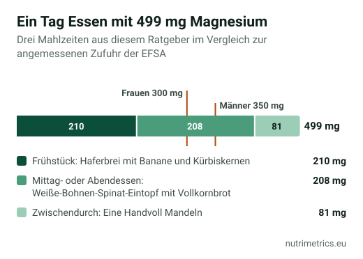

## Die kurze Antwort

Für die meisten gesunden Erwachsenen lässt sich Magnesium über das Essen decken. Laut NIH sind Hülsenfrüchte, Nüsse, Kerne, Vollkorn und Blattgemüse wie Spinat gute Quellen. Eine Handvoll Kürbiskerne und ein Teller Bohnen-Spinat-Eintopf ergeben zusammen schon **rund 385 mg**, mehr als die EFSA für Männer für angemessen hält. Ein Präparat ist sinnvoll, wenn Ihr Arzt einen Mangel feststellt, nicht als tägliche Versicherung.

## Wie viel Magnesium Sie brauchen

| Wert | Menge | Bedeutung |
| --- | --- | --- |
| Angemessene Zufuhr laut EFSA | 350 mg/Tag (Männer), 300 mg/Tag (Frauen) | Was aus Essen und Trinken zusammenkommen sollte |
| NRV auf Etiketten | 375 mg | EU-Bezugswert für die Angabe „% NRV“ |
| EFSA-Höchstmenge für Präparate | 250 mg/Tag | Zählt nur Magnesium aus Präparaten, Wasser und angereicherten Lebensmitteln |

## Wie viel jede Portion liefert

Die Tabelle ist nach Magnesium **pro Portion** sortiert, nicht pro 100 g, denn das ist, was Sie tatsächlich essen. Die Spalte „Portionen für 250 mg“ zeigt, wie viele Portionen einer Tablette mit der Menge entsprechen, die die EFSA bei Präparaten als sicher ansieht. Die letzte Spalte zeigt, ob das Lebensmittel die EU-Schwelle erreicht, um als „Magnesiumquelle“ (15 % des NRV pro 100 g) oder mit „hohem Magnesiumgehalt“ (30 %) beworben zu werden.

| Lebensmittel | Portion | Magnesium (mg) | % NRV | Portionen für 250 mg | EU-Schwelle (pro 100 g) |
| --- | --- | --- | --- | --- | --- |
| Kürbiskerne | eine Handvoll (30 g) | 178 | 47 % | 1,4 | hoher Gehalt |
| Spinat, gegart | 150 g | 130 | 35 % | 1,9 | Quelle |
| Sonnenblumenkerne | eine Handvoll (30 g) | 98 | 26 % | 2,6 | hoher Gehalt |
| Quinoa, gegart | 150 g | 96 | 26 % | 2,6 | Quelle |
| Weiße Bohnen, gegart | 150 g | 94 | 25 % | 2,6 | Quelle |
| Cashewkerne | eine Handvoll (30 g) | 88 | 23 % | 2,9 | hoher Gehalt |
| Mandeln | eine Handvoll (30 g) | 81 | 22 % | 3,1 | hoher Gehalt |
| Vollkornbrot | 2 Scheiben (100 g) | 75 | 20 % | 3,3 | Quelle |
| Kichererbsen, gegart | 150 g | 72 | 19 % | 3,5 | — |
| Haferflocken | 50 g | 69 | 18 % | 3,6 | hoher Gehalt |
| Naturreis, gegart | 150 g | 58 | 16 % | 4,3 | — |
| Tofu (fest) | 100 g | 58 | 15 % | 4,3 | Quelle |
| Linsen, gegart | 150 g | 54 | 14 % | 4,6 | — |
| Erdnüsse | eine Handvoll (30 g) | 50 | 13 % | 5,0 | hoher Gehalt |
| Zartbitterschokolade 70–85 % | 2 Stück (20 g) | 46 | 12 % | 5,5 | hoher Gehalt |
| Banane | 1 mittlere (120 g) | 32 | 9 % | 7,7 | — |
| Vollmilch | 1 Glas (250 ml) | 25 | 7 % | 10,0 | — |
| Naturjoghurt | 1 Becher (125 g) | 15 | 4 % | 16,7 | — |

**Was die Tabelle zeigt:**

- **Kerne und Nüsse** liefern am meisten pro Bissen. Eine halbe Handvoll Kürbiskerne bringt mehr als ein Joghurt, ein Glas Milch und eine Banane zusammen.
- **Gegarte Hülsenfrüchte** sind weniger konzentriert, weil sie Wasser aufnehmen, aber die große Portion gleicht das aus: 150 g weiße Bohnen liefern rund 94 mg.
- **Kichererbsen und Linsen** erreichen die Schwelle für „Quelle“ nicht, obwohl eine Portion 54–72 mg liefert. Die Schwelle gilt pro 100 g, nicht pro Portion.
- **Vollkornbrot** zählt: Zwei Scheiben liefern rund 75 mg.
- **Milchprodukte und Obst** liefern wenig Magnesium.

## Ein Tag mit fast 500 mg, ohne Tabletten

| Mahlzeit | Was | Magnesium |
| --- | --- | --- |
| Frühstück | Haferbrei mit Banane und Kürbiskernen (Rezept unten) | 210 mg |
| Mittag- oder Abendessen | Weiße-Bohnen-Spinat-Eintopf mit Vollkornbrot (Rezept unten) | 208 mg |
| Zwischendurch | Eine Handvoll Mandeln (30 g) | 81 mg |
| **Summe** | | **499 mg** |

So müssen Sie nicht jeden Tag essen. Das Beispiel zeigt aber, dass drei einfache Schritte die angemessene Zufuhr übertreffen, ohne an eine Grenze zu stoßen, denn die EFSA-Höchstmenge gilt nicht für das natürliche Magnesium im Essen.

## Auch Mineralwasser zählt

Ein Mineralwasser darf nur dann als **„magnesiumhaltig“** bezeichnet werden, wenn es **mehr als 50 mg pro Liter** enthält. Die Werte unterscheiden sich stark von Marke zu Marke, also lohnt sich ein Blick aufs Etikett: Ein Wasser mit 100 mg/l liefert 150 mg, wenn Sie anderthalb Liter am Tag trinken. Dieses Magnesium taucht in keiner Lebensmitteltabelle auf.

## Zwei Rezepte mit Zahlen

### Weiße-Bohnen-Spinat-Eintopf (4 Portionen)

**Zutaten:** 500 g gegarte weiße Bohnen (aus dem Glas, abgetropft), 400 g frischer Spinat, 1 Dose gehackte Tomaten (400 g), 1 Zwiebel (100 g), 2 Knoblauchzehen, 2 EL Olivenöl, Salz, Pfeffer, 4 Scheiben Vollkornbrot (je 50 g).

1. Zwiebel und Knoblauch im Öl glasig dünsten.
2. Tomaten und Bohnen dazugeben und 10 Minuten köcheln lassen.
3. Den Spinat unterheben, bis er zusammenfällt, abschmecken und mit dem Brot servieren.

**Pro Portion:** rund **208 mg Magnesium** (55 % des NRV) und 9,2 mg Eisen (66 %).

### Haferbrei mit Banane und Kürbiskernen (1 Portion)

**Zutaten:** 50 g Haferflocken, 250 ml Milch, 1 kleine Banane (100 g), 15 g Kürbiskerne, Zimt.

1. Die Haferflocken in der Milch bei mittlerer Hitze unter Rühren etwa 5 Minuten köcheln.
2. Mit Bananenscheiben, Kürbiskernen und Zimt servieren.

**Pro Portion:** rund **210 mg Magnesium** (56 % des NRV).

## Wenn das Essen nicht reicht

- **Wenn Ihr Arzt einen niedrigen Wert feststellt**, kann er ein Präparat empfehlen. Zu Form und Dosis lesen Sie [welches Magnesium das beste ist](/de/ratgeber/welches-magnesium-ist-das-beste/) und unsere Seite zu [Magnesium](/de/nahrungsergaenzung/magnesium/).
- **Bei Nierenerkrankungen** nehmen Sie Magnesiumpräparate nur nach ärztlicher Rücksprache.
- **Wenn Sie es zum Schlafen suchen**, lesen Sie zuerst [Magnesium zum Schlafen](/de/ratgeber/magnesium-zum-schlafen/): In der EU gibt es keine zugelassene Aussage zum Schlaf.

Dieser Ratgeber gehört zur Serie [Das beste Supplement liegt auf dem Teller](/de/ratgeber/bestes-supplement-auf-dem-teller/).

## So haben wir gerechnet

Die Werte pro 100 g stammen aus der Datenbank FoodData Central des USDA (SR Legacy), die gegarte Lebensmittel systematisch erfasst. Für Vollkornbrot haben wir den Wert für Weizenvollkornbrot verwendet; Roggenvollkornbrot kann abweichen. Portionen, Prozentwerte und Umrechnungen berechnet NutriMetrics. Der % NRV beruht auf dem Bezugswert von 375 mg aus der Verordnung (EU) 1169/2011. Die tatsächlichen Gehalte schwanken je nach Sorte, Herkunft und Zubereitung.
