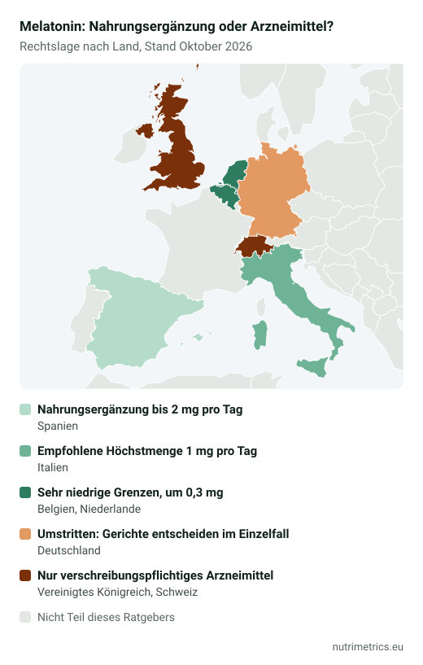

## Die kurze Antwort

Melatonin **hilft beim schnelleren Einschlafen**, nicht beim Durch- oder Tiefschlaf. Die einzige zugelassene EU-Angabe für den Schlaf beruht auf **1 mg kurz vor dem Schlafengehen**. In Deutschland ist umstritten, ob Melatonin überhaupt als Nahrungsergänzungsmittel verkauft werden darf. Wer seit Wochen schlecht schläft, findet in Melatonin keine Lösung des eigentlichen Problems – sprich mit deiner Ärztin oder deinem Arzt.

## Was die EU erlaubt

| Zugelassene Angabe | Bedingung |
| --- | --- |
| Melatonin trägt dazu bei, die Einschlafzeit zu verkürzen | 1 mg kurz vor dem Schlafengehen |
| Melatonin trägt zur Linderung der subjektiven Jetlag-Empfindung bei | Mindestens 0,5 mg kurz vor dem Schlafengehen am ersten Reisetag und an den ersten Tagen nach der Ankunft |

**Nicht** zugelassen: tieferer Schlaf, weniger nächtliches Aufwachen, weniger Angst oder „die innere Uhr stellen“ im Allgemeinen. Mehr in unserer [Tabelle der zugelassenen Health Claims](/de/ratgeber/zugelassene-health-claims-tabelle/).

## Die Rechtslage in Deutschland

- **Behörden:** Das BfArM hat Melatonin-Produkte 2011 als Arzneimittel eingestuft; Melatonin-haltige Arzneimittel sind verschreibungspflichtig. Das BfR sieht eine pharmakologische Wirkung.
- **Zuständigkeit:** Über einzelne Nahrungsergänzungsmittel entscheiden die Überwachungsbehörden der Bundesländer – im Streitfall die Gerichte.
- **Urteile:** Das VG Köln stufte 2014 Kapseln mit 0,5 bis 5 mg als Arzneimittel ein. Urteile des OLG Frankfurt (März 2021) und des OVG Münster (Oktober 2021) deuten dagegen darauf hin, dass niedrig dosierte Produkte als Lebensmittel verkauft werden können.

Deshalb findest du im Handel vor allem Sprays, Gummis und Tabletten mit niedriger Dosis. Rechtssicherheit gibt es für den einzelnen Käufer nicht – wohl aber eine klare Faustregel: Mehr als die 1 mg der zugelassenen Angabe braucht es für das anerkannte Einschlaf-Ziel nicht.

## Andere Länder

| Land | Melatonin in Nahrungsergänzungsmitteln |
| --- | --- |
| Spanien | Bis 2 mg pro Tag als Nahrungsergänzungsmittel, darüber Arzneimittel – deshalb viele 1,9-mg-Produkte |
| Italien | Empfohlene Höchstmenge 1 mg pro Tag seit 2013 (zuvor 5 mg) |
| Belgien und Niederlande | Sehr niedrige Grenzen (um 0,3 mg) |
| Großbritannien und Schweiz | Nur als verschreibungspflichtiges Arzneimittel |

Stand: Oktober 2026. Über die EU-Regel der gegenseitigen Anerkennung tauchen höher dosierte Produkte aus anderen Ländern online auch in Deutschland auf.

## Wer es meiden sollte

- **Kinder und Jugendliche**, außer auf ärztliche Verordnung. Die Deutsche Gesellschaft für Kinder- und Jugendmedizin fordert ein Verbot von Melatonin in Süßigkeitenform, und das BfR rät dringend davon ab, Kindern Melatonin-Präparate eigenmächtig zu geben. Manche Gummibärchen enthalten 0,5 bis 1 mg pro Stück – so viel wie oder mehr als die 0,25 bis 0,5 mg, die eine Leitlinie je nach Alter für ärztlich verordnetes Melatonin bei Kindern nennt.
- **Schwangere und Stillende.**
- Wer **Beruhigungsmittel, Gerinnungshemmer** oder andere schlafbeeinflussende Medikamente nimmt: vorher ärztlich oder in der Apotheke abklären.

Häufig berichtete Nebenwirkungen sind Müdigkeit am Morgen, Kopfschmerzen und Schwindel. Bei Benommenheit am nächsten Tag nicht Auto fahren.

## So setzt du es sinnvoll ein

1. **Mit der zugelassenen Dosis beginnen:** 1 mg kurz vor dem Schlafengehen.
2. **Für etwas Konkretes nutzen:** Einschlafprobleme in einer schwierigen Phase, Zeitumstellung oder Jetlag.
3. **Ein Enddatum setzen.** Wer es nach einigen Wochen noch braucht, löst das Problem nicht mit einem Präparat. Für chronische Schlafstörungen gibt es Behandlungen mit viel besseren Belegen, etwa die kognitive Verhaltenstherapie für Insomnie.
4. **Etikett lesen:** Viele Produkte enthalten zusätzlich Pflanzen (Passionsblume, Melisse, Baldrian) ohne zugelassene Angaben.

Eine hormonfreie Option erklärt unser Ratgeber [Magnesium zum Schlafen](/de/ratgeber/magnesium-zum-schlafen/), und unser [Zielfinder](/de/zielfinder/) vergleicht die Beleglage verschiedener Schlaf-Optionen.
