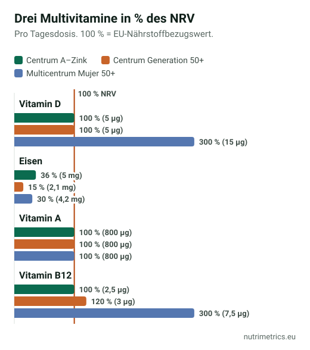

## Die kurze Antwort

Für die meisten Erwachsenen, die sich halbwegs ausgewogen ernähren, wird ein Multivitamin weder Herzerkrankungen noch Krebs vorbeugen oder das Leben verlängern. Sinnvoll kann es als günstiger Weg sein, eine **konkrete Lücke** zu schließen: B12 bei veganer Ernährung, Folsäure vor einer Schwangerschaft oder eine sehr eingeschränkte Ernährung. Wenn du eines nimmst, wähle eine moderate statt einer hochdosierten Rezeptur.

## Was die großen Studien zeigen

| Studie | Wer | Ergebnis |
| --- | --- | --- |
| NIH-Auswertung, 2024 | 390.124 US-Erwachsene, über 20 Jahre begleitet | Tägliche Multivitamin-Nutzer hatten **kein geringeres Sterberisiko** |
| Physicians' Health Study II, Krebs (2012) | Fast 15.000 US-Ärzte ab 50, über ein Jahrzehnt | **8 % weniger Krebsfälle**: 17,0 statt 18,3 pro 1.000 Männer und Jahr |
| Physicians' Health Study II, Herz (2012) | Dieselben Männer | **Keine Senkung** schwerer Herz-Kreislauf-Ereignisse |
| COSMOS-Studien, zusammengefasst (2024) | Rund 5.000 ältere US-Amerikaner, 2–3 Jahre | Langsamerer Abbau von Gedächtnis und Denkleistung, **entsprechend etwa zwei Jahren** Alterung |
| US Preventive Services Task Force (2022) | Auswertung aller Studien | **Unzureichende Belege** für Multivitamine; **rät ab** von Betacarotin und Vitamin E |

Drei Punkte solltest du im Kopf behalten:

- **Die meisten Daten stammen aus den USA**, wo viele Lebensmittel anders angereichert werden als in Europa.
- **PHS II und COSMOS testeten beide Centrum Silver.** Die Ergebnisse gelten nicht automatisch für andere Rezepturen.
- **Die Sterblichkeitsstudie ist eine Beobachtungsstudie.** Sie zeigt, dass Multivitamin-Nutzer nicht länger leben – aber nicht, warum.

Die Ergebnisse zu Krebs und Gedächtnis sind interessant, stammen aber jeweils aus nur einem Forschungsprogramm. Keines hat eine offizielle Stelle dazu gebracht, Multivitamine zur Vorbeugung zu empfehlen.

## Wem es nützen kann

Ein Multivitamin ist ein grobes Werkzeug, kann aber helfen, wenn du eine Lücke kennst:

- **Kinderwunsch oder Schwangerschaft:** Folsäure vor der Empfängnis und in der Frühschwangerschaft wird gesondert empfohlen, auch von der US Task Force. Wähle ein spezielles Schwangerschaftspräparat.
- **Veganer:** Vitamin B12 ist unverzichtbar; lies unseren [Vitamin-B12-Ratgeber](/de/ratgeber/vitamin-b12-wer-braucht-ein-praeparat/). Ein reines B12-Präparat ist oft einfacher als ein Multivitamin.
- **Menschen, die sehr wenig essen** – etwa nach einer Krankheit, im hohen Alter oder bei sehr einseitiger Ernährung: Frag deine Ärztin oder deinen Arzt, ob ein Test oder ein Multivitamin sinnvoll ist.

## Worauf du beim Etikett achtest

1. **Etwa 100 % des NRV.** Das EU-Recht erlaubt Werbeaussagen zu einem Nährstoff schon ab 15 % des NRV pro Tagesdosis. Rezepturen mit 500 % und mehr kosten mehr und erhöhen bei manchen Nährstoffen das Risiko, ohne belegten Nutzen.
2. **Eisen nur bei Bedarf.** Männer und Frauen nach den Wechseljahren brauchen es meist nicht. Das BfR empfiehlt ihnen Eisen nur nach ärztlicher Rücksprache. Unser [Eisen-Ratgeber](/de/ratgeber/eisen-muedigkeit/) erklärt den Ferritin-Test.
3. **Kein Betacarotin, wenn du rauchst.** Die US Task Force rät von Betacarotin-Präparaten ab, die bei Rauchern das Lungenkrebsrisiko erhöht haben.
4. **Vitamin A als Retinol.** Die sichere Höchstmenge der EFSA für vorgeformtes Vitamin A liegt bei 3.000 µg pro Tag aus allen Quellen. Schwangere sollten ein spezielles Schwangerschaftspräparat nutzen.
5. **Vitamin B6 unter 12 mg** pro Tag insgesamt, der sicheren Höchstmenge der EFSA.
6. **Vitamin D:** Viele Multivitamine liefern 5 µg – 100 % des NRV, aber nur ein Drittel des EFSA-Schätzwerts. Siehe [Vitamin D im Winter](/de/ratgeber/vitamin-d-im-winter/).

## Drei Etiketten im Vergleich

| Produkt (unsere Datenbank) | Vitamin D | Eisen | Vitamin A | B12 |
| --- | --- | --- | --- | --- |
| Centrum A–Zink (Deutschland) | 5 µg | 5 mg | 800 µg (25 % als Betacarotin) | 2,5 µg |
| Centrum Generation 50+ (Deutschland) | 5 µg | 2,1 mg | 800 µg | 3 µg |
| Multicentrum Mujer 50+ (Spanien) | 15 µg | 4,2 mg | 800 µg (50 % als Betacarotin) | 7,5 µg |

Alle drei bleiben bei den meisten Nährstoffen nahe 100 % des NRV. Die spanische Frauen-Rezeptur liefert dreimal so viel Vitamin D wie die deutschen. Die beiden 50+-Rezepturen enthalten weiterhin etwas Eisen, das viele Frauen nach den Wechseljahren nicht brauchen, und Raucher sollten auf das Betacarotin in Centrum A–Zink und Multicentrum Mujer 50+ achten.

Alle geprüften Multivitamine vergleichst du auf unserer [Multivitamin-Seite](/de/nahrungsergaenzung/multivitamine/); die Höchstmengen nach Land findest du in [Supplement maximum levels in Europe](/en/guides/supplement-maximum-levels-europe/) (englisch).

