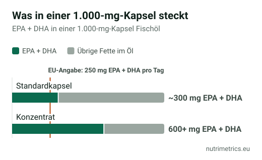

## Die kurze Antwort

Wer ein- bis zweimal pro Woche fetten Seefisch isst, erreicht die Referenzmenge für Omega-3 wahrscheinlich schon. Wenn nicht, entspricht ein Präparat mit **mindestens 250 mg EPA + DHA pro Tag** dem, worauf EFSA und die zugelassenen Angaben beruhen. **Fischöl** liefert meist mehr EPA pro Euro, **Algenöl** ist die vegane Option und erhöht den DHA-Spiegel vergleichbar. Entscheide nach **mg EPA + DHA pro Dosis**, nicht nach Kapselgröße.

## Was Omega-3 in der EU versprechen darf

| Zugelassene Angabe | Bedingung |
| --- | --- |
| EPA und DHA tragen zu einer normalen Herzfunktion bei | 250 mg EPA + DHA täglich |
| DHA trägt zur Erhaltung einer normalen Gehirnfunktion bei | 250 mg DHA täglich |
| DHA trägt zur Erhaltung normaler Sehkraft bei | 250 mg DHA täglich |

Für Gedächtnis, Stimmung, Gelenke oder das Vorbeugen von Herzkrankheiten gibt es keine zugelassenen Angaben. Mehr in unserer [Tabelle der zugelassenen Health Claims](/de/ratgeber/zugelassene-health-claims-tabelle/).

## Fischöl oder Algenöl

| | Fischöl | Algenöl |
| --- | --- | --- |
| Herkunft | Fetter Seefisch (Sardelle, Sardine, Makrele), Lebertran | Kultivierte Mikroalgen |
| EPA und DHA | Beides, oft mehr EPA als DHA | Vor allem DHA; manche Produkte mit zusätzlichem EPA |
| Vegan | Nein | Ja |
| Schadstoffe | Raffiniert; EU-Höchstgehalte für Dioxine und PCB in Meeresölen | Kontrollierte Kultivierung, kein Kontakt mit dem Meer |
| Aufnahme | Referenz | Eine Studie von 2013 fand ähnliche DHA-Spiegel |
| Preis pro Gramm EPA + DHA | Meist niedriger | Meist höher |

Das DHA im Fisch stammt übrigens aus den Algen, die die Fische fressen. In einer Studie von 2013 nahmen 31 Erwachsene zwei Wochen lang 600 mg DHA täglich: Algen- und Fischöl hoben den DHA-Spiegel auf ähnliche Werte, auch bei Vegetariern und Veganern, die niedriger starteten.

## Der Etikett-Trick: „1.000 mg Fischöl“

Viele Kapseln werben groß mit „1.000 mg“ – das ist aber das **gesamte Öl**. Entscheidend sind die Milligramm **EPA und DHA**: in einer Standardkapsel oft 300 mg, in einem Konzentrat über 600 mg. Suche in der Nährwerttabelle die Zeilen „davon EPA“ und „davon DHA“ pro Tagesdosis.

Ein Beispiel aus unserer Datenbank: **Norsan Omega-3 Total** flüssig liefert pro 8 ml **1.040 mg EPA und 600 mg DHA**, dazu 20 µg Vitamin D. Das sind 1.640 mg EPA + DHA täglich – mehr als das Sechsfache der Referenzmenge und deutlich unter dem sicheren Wert der EFSA.

## Wie viel ist zu viel?

- **EFSA:** Bis zu **5 g EPA + DHA pro Tag** aus Nahrungsergänzungsmitteln sind für Erwachsene unbedenklich.
- **BfR (2023):** Omega-3-Präparate können bei Menschen mit bestehender oder drohender Herzerkrankung das Risiko für **Vorhofflimmern** erhöhen; am höchsten war es bei der höchsten untersuchten Dosis von 4 g täglich. Diese Menschen sollten Omega-3-Präparate nur nach ärztlicher Rücksprache nehmen.

**Sprich vorher mit deiner Ärztin oder deinem Arzt**, wenn du eine Herzerkrankung hast, Blutverdünner nimmst oder eine Operation ansteht.

## So vergleichst du den Preis

Berechne die **Kosten pro Gramm EPA + DHA**:

**Packungspreis ÷ Tagesdosen ÷ g EPA + DHA pro Dosis = Kosten pro Gramm**

Ein günstiges Algenöl mit wenig DHA pro Kapsel kann pro Gramm Omega-3 teurer sein als ein teureres Fischöl-Konzentrat. Bewahre die Packung verschlossen, kühl und dunkel auf und entsorge Kapseln, die ranzig riechen.

Unser [Zielfinder](/de/zielfinder/) zeigt die Omega-3-Produkte aus unserer Datenbank für Deutschland und Spanien.
