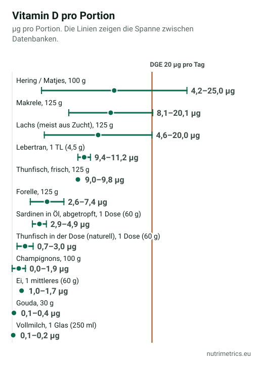

## Die kurze Antwort

Nur zum Teil. Das NIH bringt es auf den Punkt: „Nur wenige Lebensmittel enthalten von Natur aus Vitamin D.“ Fetter Seefisch ist die große Ausnahme. Eine Portion Hering oder Makrele kann den Tageswert erreichen, aber so isst kaum jemand jeden Tag. Laut Verbraucherzentrale deckt die übliche Ernährung nur 10–20 % des Bedarfs; den Rest bildet die Haut mit Sonnenlicht. Wer im Winter kaum Sonne abbekommt, erreicht den Wert mit Essen allein selten. Mehr dazu in [Vitamin D im Winter](/de/ratgeber/vitamin-d-im-winter/).

## Wie viel Vitamin D Sie brauchen

Die DGE schätzt **20 µg (800 IE) pro Tag** für Erwachsene, und zwar für den Fall, dass der Körper selbst kein Vitamin D bildet. Die EFSA nennt unter derselben Annahme 15 µg. In unserer Tabelle rechnen wir mit den 20 µg der DGE. Auf Etiketten steht ein NRV von 5 µg, der deutlich niedriger liegt.

## Wie viel jede Portion liefert

Die Lebensmitteldatenbanken sind sich beim Vitamin D in Fisch nicht einig. Wir geben die Spanne aus den Quellen an, die das Lebensmittel führen: CIQUAL (Frankreich), BEDCA (Spanien), USDA (USA) und die Werte der Verbraucherzentrale.

| Lebensmittel | Portion | Vitamin D (µg) | % von 20 µg | Datenbanken |
| --- | --- | --- | --- | --- |
| Hering / Matjes | 100 g | 4,2–25,0 | 21–125 % | USDA, Verbraucherzentrale |
| Makrele | 125 g | 8,1–20,1 | 40–101 % | CIQUAL, BEDCA, USDA |
| Lachs (meist aus Zucht) | 125 g | 4,6–20,0 | 23–100 % | CIQUAL, BEDCA, USDA, Verbraucherzentrale |
| Lebertran | 1 TL (4,5 g) | 9,4–11,2 | 47–56 % | BEDCA, CIQUAL, USDA |
| Thunfisch, frisch | 125 g | 9,0–9,8 | 45–49 % | BEDCA, CIQUAL |
| Forelle | 125 g | 2,6–7,4 | 13–37 % | BEDCA, CIQUAL |
| Sardinen in Öl, abgetropft | 1 Dose (60 g) | 2,9–4,9 | 14–25 % | BEDCA, USDA |
| Thunfisch in der Dose (naturell) | 1 Dose (60 g) | 0,7–3,0 | 4–15 % | BEDCA, CIQUAL, USDA |
| Champignons | 100 g | 0,0–1,9 | 0–10 % | BEDCA, USDA, Verbraucherzentrale |
| Ei | 1 mittleres (60 g) | 1,0–1,7 | 5–9 % | BEDCA, CIQUAL, USDA, Verbraucherzentrale |
| Gouda | 30 g | 0,1–0,4 | 1–2 % | USDA, Verbraucherzentrale |
| Vollmilch | 1 Glas (250 ml) | 0,1–0,2 | 0–1 % | BEDCA, Verbraucherzentrale |

**Was die Tabelle zeigt:**

- **Fetter Seefisch** ist das einzige Alltagslebensmittel, das mit einer Portion den Tag decken kann: Hering, Matjes, Makrele und Lachs stehen oben.
- **Die Spannen sind groß.** Für Hering nennt das USDA 4,2 µg pro 100 g, die Verbraucherzentrale 25 µg.
- **Konserven liefern weniger.** Eine Dose Sardinen bringt 3–5 µg, eine Dose Thunfisch naturell 1–3 µg.
- **Ein Ei** liefert etwa 1–1,7 µg: hilfreich, aber nicht genug.
- **Normale Champignons und Milch** tragen kaum bei. Laut NIH werden manche Pilze mit UV-Licht behandelt, um mehr Vitamin D2 zu enthalten; das steht dann auf der Packung.

## Eine Woche mit fettem Fisch: Reicht das?

Wir haben eine Woche mit drei Portionen fettem Fisch und einem Ei pro Tag durchgerechnet:

| Mahlzeit | Pro Woche | Vitamin D |
| --- | --- | --- |
| Lachs (125 g) | 1 | 4,6–20,0 µg |
| Makrele (125 g) | 1 | 8,1–20,1 µg |
| Hering oder Matjes (100 g) | 1 | 4,2–25,0 µg |
| Ei (60 g) | 7 | 7,1–12,2 µg |
| **Durchschnitt pro Tag** | | **3,4–11,0 µg (17–55 % von 20 µg)** |

Das ist besser als der Durchschnitt und erreicht trotzdem höchstens gut die Hälfte des DGE-Schätzwerts. Den Rest muss die Sonne liefern, oder ein Präparat, wenn ein Bluttest einen Mangel zeigt.

## Zwei Rezepte mit fettem Fisch

### Matjes mit Pellkartoffeln und Apfel-Zwiebel-Quark (2 Portionen)

**Zutaten:** 4 Matjesfilets (200 g), 500 g festkochende Kartoffeln, 250 g Magerquark, 1 Apfel, 1 kleine rote Zwiebel, 1 Bund Dill, Salz und Pfeffer.

1. Die Kartoffeln mit Schale etwa 20 Minuten kochen.
2. Apfel und Zwiebel fein würfeln, mit Quark und gehacktem Dill verrühren und abschmecken.
3. Die Matjesfilets mit den Pellkartoffeln und dem Quark servieren.

**Pro Portion:** zwischen **4,2 und 25 µg Vitamin D** (21–125 % von 20 µg), je nach Datenbank.

### Ofenlachs mit Kartoffeln und Brokkoli (2 Portionen)

**Zutaten:** 2 Lachsfilets à 125 g, 400 g Kartoffeln, 300 g Brokkoli, 1 Zitrone, 2 EL Rapsöl, Salz und Pfeffer.

1. Die Kartoffeln in Spalten schneiden, mit Öl und Salz mischen und bei 200 °C 20 Minuten backen.
2. Lachs und Brokkoliröschen dazulegen, mit Zitrone beträufeln und 12 Minuten weiterbacken.

**Pro Portion:** zwischen **4,6 und 20 µg Vitamin D** (23–100 % von 20 µg).

## Wenn das Essen nicht reicht

- **Wenn Sie wenig Sonne abbekommen**, wegen der Arbeit, der Jahreszeit oder bedeckter Haut, deckt das Essen den Bedarf kaum.
- **Gewissheit bringt nur ein Bluttest** auf 25(OH)D. Ist der Wert niedrig, legt Ihr Arzt die Dosis fest. Produkte vergleichen Sie auf unserer Seite zu [Vitamin D](/de/nahrungsergaenzung/vitamin-d/).
- **Lebertran** ist reich an Vitamin D, aber auch an Vitamin A. Der NHS rät, ihn in der Schwangerschaft nicht zu nehmen.

Dieser Ratgeber gehört zur Serie [Das beste Supplement liegt auf dem Teller](/de/ratgeber/bestes-supplement-auf-dem-teller/).

## So haben wir gerechnet

Für jedes Lebensmittel haben wir den Wert pro 100 g in drei amtlichen Datenbanken gesucht: CIQUAL (ANSES, Frankreich), BEDCA (AESAN, Spanien) und FoodData Central SR Legacy (USDA, USA), ergänzt um die Werte aus dem Vitamin-D-Flyer der Verbraucherzentrale. Weichen sie voneinander ab, nennen wir Minimum und Maximum; führt nur eine Quelle das Lebensmittel, nennen wir diesen Wert. Portionen, Prozentwerte und die Beispielwoche berechnet NutriMetrics. Der tatsächliche Vitamin-D-Gehalt schwankt von Fisch zu Fisch.
