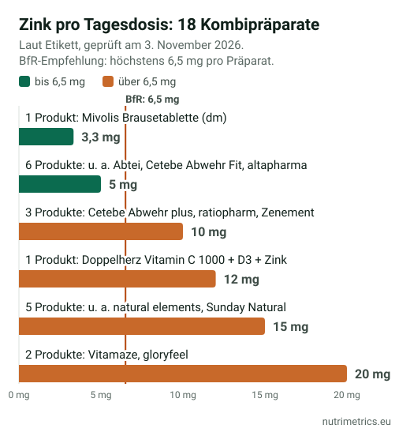

## Die kurze Antwort

Kombipräparate aus Zink und Vitamin C sind in der Erkältungszeit Bestseller. Viele sind aber **höher dosiert, als das Bundesinstitut für Risikobewertung (BfR) für Nahrungsergänzungsmittel empfiehlt**. Öko-Test hat im November-Heft 21 Produkte geprüft: 16 fallen durch, das beste ist „befriedigend“.

Wir haben 18 Präparate aus Drogerie, Apotheke und Onlinehandel anhand ihrer Etiketten nachgerechnet. **11 liefern mehr als 6,5 mg Zink pro Tag, 16 mehr als 250 mg Vitamin C.** Wenn du ein Kombipräparat nehmen willst, such eines mit **höchstens 6,5 mg Zink und 250 mg Vitamin C**. Vorher lohnt sich aber die Frage, ob du überhaupt eines brauchst.

## Was Öko-Test geprüft hat

- **21 Nahrungsergänzungsmittel** mit Vitamin C und Zink: Kapseln, Tabletten, Lutsch- und Brausetabletten sowie ein Flüssigkonzentrat, gekauft im März und April 2026. Pro höchster empfohlener Tagesdosis kosteten sie zwischen 3 Cent und 1,93 Euro.
- Im Labor wurden die **Gehalte an Vitamin C und Zink gemessen** und mit der Deklaration verglichen.
- **Abgewertet** wurde unter anderem, wenn eine Tagesdosis **mehr als 250 mg Vitamin C oder mehr als 6,5 mg Zink** enthält, in Anlehnung an die BfR-Empfehlungen. Vier Produkte enthalten 15 mg Zink.
- **Ergebnis:** 16 von 21 fallen durch. Bestes Produkt ist mit „befriedigend“ die Lutschtablette Cetebe Abwehr Fit.
- Einen echten Mehrwert für die gesunde Allgemeinbevölkerung sieht Öko-Test in den Kombipräparaten nicht.

Alle Produkte und Einzelurteile findest du im [Test bei Öko-Test](https://www.oekotest.de/602073). Wir übernehmen die Noten nicht, sondern prüfen unten eine eigene Auswahl an Etiketten.

## Was als „zu viel“ gilt

In Deutschland gibt es **keine gesetzlichen Höchstmengen** für Vitamine und Mineralstoffe in Nahrungsergänzungsmitteln. Die Werte des BfR sind Empfehlungen, an denen sich Behörden und Tester orientieren. Mehr zur Lage in Europa steht in unserem Ratgeber [Höchstmengen für Nahrungsergänzungsmittel](/de/ratgeber/hoechstmengen-nahrungsergaenzungsmittel-europa/).

| | Zink | Vitamin C |
| --- | --- | --- |
| Referenzwert auf dem Etikett (100 % NRV) | 10 mg | 80 mg |
| **BfR-Empfehlung pro Tagesdosis eines Präparats** | **6,5 mg**, ab 3,5 mg mit Hinweis | **250 mg** |
| EFSA-Höchstmenge (UL) für Erwachsene | 25 mg pro Tag, Lebensmittel und Präparate zusammen | nicht festgelegt |
| Ab dieser Menge ist die Angabe „trägt zu einer normalen Funktion des Immunsystems bei“ erlaubt | 1,5 mg | 12 mg |

**Warum beim Zink so wenig?** Das BfR hat die 6,5 mg aus der Lücke zwischen sehr niedriger Zinkzufuhr (6,5 mg pro Tag bei Männern im unteren Bereich) und der EFSA-Zufuhrempfehlung für Männer (13 mg) abgeleitet. Wer schon sehr viel Zink über die Nahrung aufnimmt, kann laut BfR die EFSA-Höchstmenge bereits erreichen. Weil manche Menschen mehrere zinkhaltige Präparate kombinieren, empfiehlt das BfR bei **mehr als 3,5 mg Zink** pro Tagesdosis den Hinweis, auf weitere zinkhaltige Nahrungsergänzungsmittel zu verzichten ([BfR, Höchstmengenvorschläge Zink](https://www.bfr.bund.de/cm/343/hoechstmengenvorschlaege-fuer-zink-in-lebensmitteln-inklusive-nahrungsergaenzungsmitteln.pdf)).

Zu viel Zink über lange Zeit kann laut NIH die **Kupferaufnahme hemmen** und zu einem Kupfermangel führen. Beim Vitamin C hat die EFSA mangels Daten keine Höchstmenge festgelegt. Grammdosen können aber den Magen belasten.

## Unser Etiketten-Check: 18 Kombipräparate

Wir haben 18 verbreitete Zink-Vitamin-C-Präparate ausgewählt: Eigenmarken von dm und Rossmann, Marken aus Drogerie und Apotheke sowie verbreitete Online-Marken, die vor allem über Amazon und Online-Apotheken verkauft werden. Gezählt haben wir die **Menge pro empfohlener Tagesdosis**, also bei zwei Kapseln täglich beide zusammen.

| Produkt (Link zur Quelle) | Tagesdosis | Zink (mg) | Vitamin C (mg) | Außerdem |
| --- | --- | --- | --- | --- |
| [Mivolis Zink + C Brausetabletten (dm)](https://www.dm.de/p/d/3104291/) | 1 Brausetablette | 3,33 | 400 | – |
| [Mivolis Zink + C Depot Kapseln (dm)](https://www.dm.de/p/d/3104237/) | 1 Kapsel | 5 | 300 | – |
| [altapharma Brausetabletten Zink + Vitamin C (Rossmann)](https://www.rossmann.de/gesundheit-altapharma-brausetabletten-zink--vitamin-c/p/4305615614458) | 1 Brausetablette | 5 | 300 | – |
| [Abtei Vitamin C + Zink Lutschtabletten](https://www.docmorris.de/abtei-vitamin-c-plus-zink-lutschtablette/03550712) | 1 Lutschtablette | 5 | 250 | – |
| [Cetebe Abwehr Fit Lutschtabletten](https://www.medikamente-per-klick.de/cetebe-abwehr-fit-lutschtabletten-20st-09123997) | 1 Lutschtablette | 5 | 250 | – |
| [Doppelherz Vitamin C + Zink Brausetabletten](https://www.rossmann.de/de/gesundheit-doppelherz-vitamin-c-zink/p/4009932009132) | 1 Brausetablette | 5 | 600 | – |
| [Doppelherz aktiv Vitamin C 500 + Zink Depot DIRECT](https://das.docmorris.de/catalog/leaflets/11174312-lmiv.pdf) | 1 Beutel | 5 | 500 | – |
| [Cetebe Abwehr plus Kapseln](https://www.shop-apotheke.com/marken/cetebe/cetebe-abwehr-plus/) | 1 Kapsel | **10** | 300 | Vitamin D 10 µg |
| [Vitamin C plus Zink-ratiopharm Brausetabletten](https://das.medpex.de/catalog/leaflets/16120924-lmiv.pdf) | 1 Brausetablette | **10** | 1.000 | – |
| [Zenement Vitamin C gepuffert + Zink](https://www.shop-apotheke.com/arzneimittel/upmTY7XPH/zenement-vitamin-c-gepuffert-zink.htm) | 2 Kapseln | **10** | 1.000 | – |
| [Doppelherz Vitamin C 1000 + D3 + Zink Depot](https://www.dm.de/p/d/1541003/) | 1 Tablette | **12** | 1.000 | Vitamin D 25 µg |
| [Doppelherz aktiv Zink + Histidin + Vitamin C Depot](https://www.dm.de/p/d/1711502/) | 1 Tablette | **15** | 300 | L-Histidin 100 mg |
| [natural elements Vitamin C gepuffert + Zink](https://www.dm.de/p/d/3151659/) | Tagesdosis laut Etikett | **15** | 1.000 | – |
| [NATURE LOVE Vitamin C Gepuffert & Zink](https://www.shop-apotheke.com/arzneimittel/upmD473EG/nature-love-vitamin-c-gepuffert-zink.htm) | 2 Kapseln | **15** | 1.000 | – |
| [Sunday Natural Vitamin C 500 Gepuffert + Zink](https://www.sunday.de/vitamin-c-500mg-gepuffert-zink.html) | 2 Kapseln | **15** | 1.000 | Citrus-Bioflavonoide |
| [Bloom Naturals Vitamin C Zink](https://www.shop-apotheke.com/arzneimittel/upmCGRL7L/bloom-naturals-vitamin-c-zink-tabletten.htm) | 1 Tablette | **15** | 500 | – |
| [Vitamaze Vitamin C gepuffert + Zink](https://www.shop-apotheke.com/arzneimittel/8131017/vitamin-c-gepuffert-zink.htm) | 2 Tabletten | **20** | 1.000 | – |
| [gloryfeel Vitamin C + Zink](https://www.shop-apotheke.com/arzneimittel/upmYPPYWD/gloryfeel-vitamin-c-hochdosiert-mit-1-000-mg-zink-20-mg-pro-vitamin-c-zink-kapsel.htm) | 2 Kapseln | **20** | 1.000 | – |

**Fett:** mehr Zink als die 6,5 mg, die das BfR pro Präparat empfiehlt. Stand der Angaben: 3. November 2026, aus den Pflichtangaben der verlinkten Händler- und Herstellerseiten. Rezepturen ändern sich, maßgeblich ist immer die Packung. Diese Liste ist kein Ranking, sondern sortiert nach Zinkmenge.

**Was auffällt:**

1. **Drogerie und Apotheke gegen Onlinehandel.** Die 7 Produkte bis 6,5 mg Zink sind Eigenmarken von dm und Rossmann sowie klassische Marken aus Drogerie und Apotheke, fast alle mit 5 mg. **Alle 7 Online-Marken liefern 10 bis 20 mg**, also das Anderthalb- bis Dreifache der BfR-Empfehlung. „Hochdosiert“ ist dort das Verkaufsargument.
2. **150 % NRV klingt nach mehr Schutz**, bedeutet hier aber 15 mg Zink. Für die zugelassene Angabe zum Immunsystem reichen 1,5 mg.
3. **Vitamin C fast immer über 250 mg.** Nur Abtei und Cetebe Abwehr Fit bleiben bei 250 mg, 8 Produkte liefern 1.000 mg. Damit sind diese beiden Lutschtabletten die einzigen im Check, die beide BfR-Werte einhalten.
4. **Versteckte Extras mitrechnen.** Doppelherz Vitamin C 1000 + D3 + Zink enthält 25 µg Vitamin D, mehr als die 20 µg, die das BfR pro Präparat empfiehlt. Wer zusätzlich Vitamin D nimmt, sollte die Mengen addieren. Mehr dazu in [Vitamin D im Winter](/de/ratgeber/vitamin-d-im-winter/).
5. **Zwei Marken, ein Absender.** natural elements und NATURE LOVE nennen dieselbe Firma (Tauron Ventures GmbH, Düsseldorf), dieselben Zutaten und dieselben Mengen: 1.000 mg Vitamin C aus Calcium-L-Ascorbat und 15 mg Zink aus Zinkbisglycinat.

## Was Öko-Test außerdem bemängelt

- **Fehlende Hinweise.** Öko-Test bemängelt fehlende Zink-Hinweise ab 3,5 mg. Kein Produkt riet dazu, bei Einnahme von Medikamenten ärztlichen Rat einzuholen, und keines empfahl, Zink mit Abstand zu phytatreichen Mahlzeiten zu nehmen. Bei Doppelherz steht der Zink-Hinweis in den Pflichtangaben, zum Beispiel bei den Brausetabletten. Bei anderen Produkten lohnt der Blick auf die Packung.
- **Werbeaussagen.** Erlaubt sind nur die EU-zugelassenen Angaben im zugelassenen Wortlaut, etwa „Zink trägt zu einer normalen Funktion des Immunsystems bei“. „Stärkt die Abwehr“ oder „hilft gegen Erkältung“ gehören nicht dazu. Öko-Test fand abgewandelte oder nicht zugelassene Aussagen. Die erlaubten Formulierungen stehen in unserer [Tabelle der zugelassenen Health Claims](/de/ratgeber/zugelassene-health-claims-tabelle/).
- **Zusatzstoffe.** Öko-Test wertet unter anderem Talkum, Phosphate und bestimmte Süßstoffe ab. Talkum ist als Lebensmittelzusatzstoff (E 553b) zugelassen. Der Risikobewertungsausschuss der ECHA hat 2025 jedoch empfohlen, es als vermutlich krebserzeugend einzustufen, und die EFSA bewertet es als Zusatzstoff neu ([EFSA](https://www.efsa.europa.eu/en/call/call-data-talc-e-553b)). In unserem Check steht Talkum zum Beispiel in den Zutatenlisten von Mivolis Zink + C Depot und Doppelherz Zink + Histidin + Vitamin C. Alle vier Brausetabletten im Check sind als „mit Süßungsmitteln“ gekennzeichnet.
- **Verpackung und Umweltaussagen.** Öko-Test kritisiert unnötige Umverpackungen und nicht belegte Umweltaussagen. Seit dem 27. September 2026 gelten dafür in der EU strengere Regeln ([NutraIngredients, englisch](https://www.nutraingredients.com/Article/2026/10/28/environmental-claims-on-food-supplements-are-we-getting-them-right/)).

## So prüfst du ein Kombipräparat in einer Minute

1. **Tagesdosis finden.** Steht die Menge pro Kapsel oder pro Tagesdosis? Bei zwei Kapseln täglich zählt die Summe.
2. **Zink: höchstens 6,5 mg.** Ab 3,5 mg sollte der Hinweis stehen, keine weiteren zinkhaltigen Präparate zu nehmen.
3. **Vitamin C: höchstens 250 mg.** Mehr bringt Gesunden keinen erkennbaren Zusatznutzen.
4. **Alles zusammenzählen.** Multivitamine und Präparate für Haut, Haare und Nägel enthalten oft ebenfalls Zink, manche 10 mg. Mehr dazu in [Biotin bei Haarausfall](/de/ratgeber/biotin-haarausfall/).
5. **Werbeaussagen prüfen.** Nur der EU-Wortlaut ist erlaubt, Versprechen gegen Erkältungen sind es nicht.
6. **Für wen?** Viele Präparate sind nicht für Kinder gedacht. Mivolis Zink + C Depot ist laut dm für unter 18-Jährige nicht geeignet, die Doppelherz-Brausetabletten nicht für Kinder unter 12 und Menschen mit eingeschränkter Nierenfunktion.

Mehr Tipps zu Etiketten findest du in [Etikett von Nahrungsergänzungsmitteln lesen](/de/ratgeber/etikett-nahrungsergaenzungsmittel-lesen/).

## Brauchst du überhaupt ein Kombipräparat?

- **Vitamin C:** Eine halbe rote Paprika liefert rund 96 mg und deckt damit den Referenzwert von 80 mg. Mehr Beispiele stehen in [Vitamin C und Zink: die besten Lebensmittel](/de/ratgeber/vitamin-c-und-zink-lebensmittel/).
- **Zink:** Wie viel du brauchst, hängt vom Phytat in deiner Ernährung ab. Die EFSA nennt 9,4 bis 16,3 mg pro Tag für Männer und 7,5 bis 12,7 mg für Frauen. Der hohe Wert gilt für Kost mit viel Vollkorn und Hülsenfrüchten, weil Phytat die Aufnahme bremst. Fleisch, Meeresfrüchte, Käse und Kürbiskerne liefern viel Zink.
- **Erkältungen:** Tägliches Vitamin C beugt Erkältungen in der Allgemeinbevölkerung nicht vor und verkürzt sie nur leicht. Früh genommenes Zink könnte eine Erkältung um etwa zwei Tage verkürzen, bei geringer Aussagesicherheit. Die Details stehen in [Zink und Vitamin C bei Erkältung](/de/ratgeber/zink-vitamin-c-erkaeltung/).
- **Medikamente:** Zink kann laut NIH die Aufnahme bestimmter Antibiotika (Tetracycline und Chinolone) verringern. Wenn du Medikamente nimmst, frag vorher in der Apotheke.
- **Verdacht auf Mangel:** Lass ihn ärztlich abklären. Zur Behandlung gibt es Zink-Arzneimittel. Laut Verbraucherzentrale sind sie ab 25 mg pro Tag verschreibungspflichtig.

Formen, Mengen und Produkte mit geprüften Etiketten findest du auf unseren Seiten zu [Zink](/de/nahrungsergaenzung/zink/) und [Vitamin C](/de/nahrungsergaenzung/vitamin-c/).
