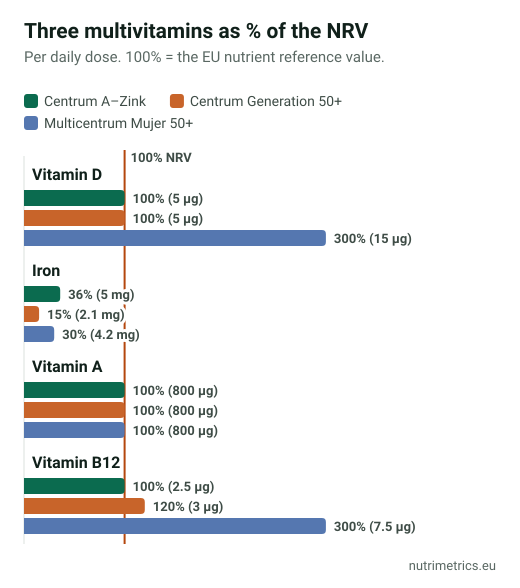

## The short answer

For most adults who eat reasonably well, a multivitamin is unlikely to prevent heart disease or cancer or help you live longer. It can make sense as a cheap way to fill a **specific gap**: B12 on a vegan diet, folic acid before pregnancy, or a very limited diet. If you take one, choose a modest formula rather than a high-dose one.

## What the big studies found

| Study | Who | What it found |
| --- | --- | --- |
| NIH analysis, 2024 | 390,124 US adults, followed for over 20 years | Daily multivitamin users **did not have a lower risk of death** from any cause |
| Physicians' Health Study II, cancer (2012) | Nearly 15,000 male US doctors aged 50+, for over a decade | **8% fewer cancers**: 17.0 vs 18.3 per 1,000 men per year |
| Physicians' Health Study II, heart (2012) | Same men | **No reduction** in major cardiovascular events |
| COSMOS trials, combined (2024) | About 5,000 older US adults, 2–3 years | Slower decline in memory and overall thinking, **equal to about two years** of cognitive ageing |
| US Preventive Services Task Force (2022) | Review of all trials | **Insufficient evidence** for multivitamins; **recommends against** beta-carotene and vitamin E |

Three things to keep in mind:

- **Most of the data is American**, where many foods are fortified differently from Europe.
- **PHS II and COSMOS both tested Centrum Silver.** The results may not apply to other formulas.
- **The mortality study is observational.** It can show that multivitamin users don't live longer, but not why.

The cancer and memory findings are interesting, but each comes from a single research programme. Neither has led an official body to recommend multivitamins for prevention.

## Who may benefit

A multivitamin is a blunt tool, but it can help when you know there is a gap:

- **Planning a pregnancy or pregnant:** folic acid before conception and in early pregnancy is recommended separately, including by the US Task Force. Choose a pregnancy-specific product, which is designed around that.
- **Vegans:** vitamin B12 is essential; see our [vitamin B12 guide](/en/guides/vitamin-b12-who-needs-supplement/). A targeted B12 supplement is often simpler than a multivitamin.
- **People eating very little**, for example after illness or in older age, or on very restrictive diets: ask your doctor whether a test or a multivitamin makes sense.

## What to check on the label

1. **About 100% of the NRV.** EU law lets a product claim benefits for a nutrient from just 15% of the NRV per daily dose. Formulas with 500% or more cost more and add risk for some nutrients, without proven benefit.
2. **Iron only if you need it.** Men and post-menopausal women usually don't. Germany's BfR recommends they take iron only after medical advice. Our [iron guide](/en/guides/iron-supplements-tiredness/) explains the ferritin test.
3. **No beta-carotene if you smoke.** The US Task Force recommends against beta-carotene supplements, which raised lung cancer risk in people who smoke.
4. **Vitamin A as retinol.** EFSA's safe upper level for preformed vitamin A is 3,000 µg a day from all sources. Pregnant women should use a pregnancy-specific product.
5. **Vitamin B6 below 12 mg** a day in total, EFSA's safe upper level.
6. **Vitamin D:** many multivitamins give 5 µg, which is 100% of the NRV but only a third of EFSA's adequate intake. See [vitamin D in winter](/en/guides/vitamin-d-winter-europe/).

## Three labels compared

| Product (our database) | Vitamin D | Iron | Vitamin A | B12 |
| --- | --- | --- | --- | --- |
| Centrum A–Zink (Germany) | 5 µg | 5 mg | 800 µg (25% as beta-carotene) | 2.5 µg |
| Centrum Generation 50+ (Germany) | 5 µg | 2.1 mg | 800 µg | 3 µg |
| Multicentrum Mujer 50+ (Spain) | 15 µg | 4.2 mg | 800 µg (50% as beta-carotene) | 7.5 µg |

All three stay close to 100% of the NRV for most nutrients. The Spanish women's formula gives three times more vitamin D than the German ones. The two 50+ formulas still contain some iron, which many post-menopausal women don't need, and smokers should note the beta-carotene in both Centrum A–Zink and Multicentrum Mujer 50+.

Compare all the multivitamins we have checked on our [multivitamins page](/en/supplements/multivitamins/), and see the legal limits by country in [supplement maximum levels in Europe](/en/guides/supplement-maximum-levels-europe/).

