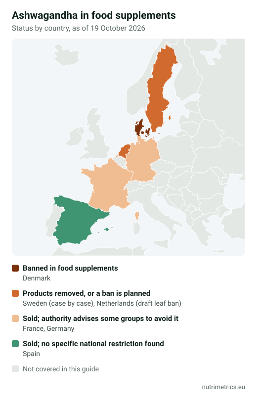

## The short answer

Ashwagandha (*Withania somnifera*) is **legal in most of the EU but not everywhere**. There is no common EU rule, so each country decides: Denmark has banned it in food supplements, the Netherlands plans to ban the leaf, and Germany's risk assessment body advises several groups not to take it. The evidence for stress and sleep is **real but modest**. If you are pregnant, breastfeeding, have liver or thyroid problems, or take medication, talk to your doctor first.

## Status by country (October 2026)

| Country     | Status                                                                                                                                        | Since                                 |
| ----------- | --------------------------------------------------------------------------------------------------------------------------------------------- | ------------------------------------- |
| Denmark     | Banned in food supplements                                                                                                                    | 2023                                  |
| Sweden      | Several high-dose products removed, decided case by case                                                                                      | Reported in 2023                      |
| Netherlands | RIVM advises avoiding it. Draft rule bans the **leaf** and requires a warning on **root** products; open for comments until 7 Dec 2026        | Advice March 2024; draft October 2026 |
| France      | ANSES recommends that certain groups, including pregnant and breastfeeding women, avoid it                                                    | 2024                                  |
| Germany     | Sold legally; BfR advises children, pregnant and breastfeeding women and people with liver disease not to take it                             | September 2024                        |
| Spain       | Sold as a food supplement; we found no specific national restriction                                                                          | —                                     |
| EU level    | No harmonised rule. Regulators are discussing a review under Article 8 of Regulation 1925/2006, which can restrict or ban a substance EU-wide | Not started                           |

This table reflects public measures as of 19 October 2026 and will be updated as rules change. Because of EU **mutual recognition**, a product lawful in one country can often be sold in another, but a country can block it on health grounds if the measure is justified. Our guide to [supplement maximum levels in Europe](/en/guides/supplement-maximum-levels-europe/) explains how this works.

## Why authorities are cautious

Germany's **BfR** published its assessment in September 2024. It concluded that **no safe daily amount** can be derived from the available data, based on:

* case reports of **liver injury**, including acute liver failure;
* evidence of effects on the **thyroid**, **sex hormones**, cortisol and blood sugar;
* missing safety data in **pregnancy and breastfeeding**, and a traditional use as an abortifacient;
* possible interactions with **antidiabetic, blood-pressure and immunosuppressant** drugs.

The Dutch **RIVM** reached a similar conclusion in 2024: harmful effects can occur in sensitive people, it is unknown who they are, and avoiding it is the precautionary advice.

## What the evidence shows

| Use                 | Finding                                                                                                                                  | Quality                                           |
| ------------------- | ---------------------------------------------------------------------------------------------------------------------------------------- | ------------------------------------------------- |
| Perceived stress    | A 2021 review of 7 trials (491 adults, 6–8 weeks) found lower stress, anxiety and cortisol than placebo                                  | Small, short trials, all in India                 |
| Sleep               | A 2021 meta-analysis of 5 trials found a **small but significant** effect, larger at ≥600 mg a day, ≥8 weeks and in people with insomnia | Moderate for overall sleep, low for sleep quality |
| Generalised anxiety | An international expert taskforce gives a provisional recommendation (300–600 mg root extract) and calls for more research               | Limited                                           |

According to the NIH, two problems run through the research: **extracts differ widely** (root vs leaf, withanolide content) and there is almost no safety data **beyond three months**.

There is **no EU-authorised health claim** for ashwagandha. Claims for botanicals have been "on hold" at EU level for years, so "reduces stress" or "improves sleep" on a pack goes beyond what EU law allows.

## How to choose, if you decide to take it

1. **Root only.** The most recent restrictions, in the Netherlands and India, target the leaf. KSM-66 is root-only; Sensoril and Shoden combine root and leaf.
2. **Study doses.** Most trials use 300–600 mg of standardised extract a day. More has not been shown to be better.
3. **Withanolides stated.** A good label states the withanolide percentage (for example 5%).
4. **Check the manufacturer's label, not the shop listing.** In our database, one retailer listed 500 mg of KSM-66 per capsule, an unusual figure for that extract (normally 300 or 600 mg).
5. **Set an end date.** Use it for a limited period, around 8–12 weeks as in the trials. Stop and see a doctor if you notice dark urine, itching, unusual tiredness or yellowing of the skin or eyes.

Our [goal finder](/en/finder/) compares the evidence for ashwagandha with other options for stress and sleep, such as L-theanine and magnesium.
