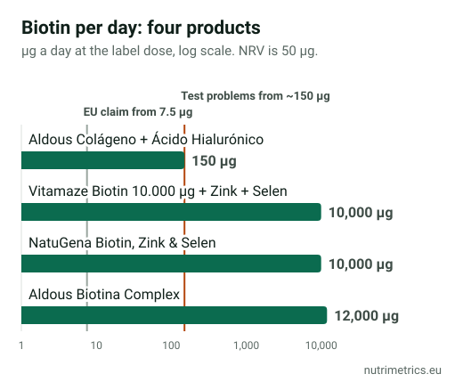

## The short answer

Biotin helps hair if you are short of biotin, and that is rare: according to the US National Institutes of Health, severe deficiency has never been reported in healthy people eating a normal diet. If your hair is thinning, the useful first step is finding out **why**, not buying a 10,000 µg tablet. And if you do take biotin, tell your doctor before any blood test.

## What the evidence shows

A 2017 review in *Skin Appendage Disorders* went through the published research on biotin for hair and nails. It found **18 reported cases** in which biotin helped. **All of them had an underlying condition affecting hair or nail growth.** The authors concluded that there is limited research to support biotin in healthy people.

There are no good-quality trials showing that high-dose biotin thickens hair or slows hair loss in people with normal biotin levels. And because many types of hair loss are temporary, before-and-after stories can't show whether biotin made the difference.

## Rule out the usual causes first

The NHS notes that losing **50 to 100 hairs a day** is normal. It separates hair loss into:

- **Permanent**, such as male and female pattern hair loss, which often runs in families.
- **Temporary**, caused by things like **illness, stress, cancer treatment, weight loss and iron deficiency**.

The NHS advises seeing a GP if you are worried, and before paying for a commercial hair clinic. Sudden, patchy or heavy hair loss needs a doctor rather than a supplement. Low iron is one of the causes a simple blood test can find: see [iron and tiredness](/en/guides/iron-supplements-tiredness/) for which test to ask for.

## The blood-test problem

Many lab tests use a biotin–streptavidin reaction to measure hormones and other markers. Biotin in your blood can interfere with it. Germany's Federal Institute for Risk Assessment (BfR) updated its warning in May 2026:

- Problems were seen mostly from **150 µg of biotin a day**.
- **Thyroid tests** can show falsely high T3 and T4 and falsely low TSH, which can look like an overactive thyroid.
- **Troponin**, used to diagnose heart attacks, can be falsely low. The US FDA has warned clinicians about this more than once.

The BfR advises telling your doctor or lab staff about current or **recently stopped** biotin. In the UK, the makers of levothyroxine (a thyroid medicine), in agreement with the MHRA, have warned doctors about the same problem with thyroid tests. The lab can tell you whether your test is affected.

| Product (our database, Spain and Germany) | Biotin a day | Compared with the 150 µg test-problem level | Compared with the NHS 900 µg figure |
| --- | --- | --- | --- |
| Vitamaze Biotin 10.000 µg + Zink + Selen | 10,000 µg | About 67 times | About 11 times |
| NatuGena Biotin, Zink & Selen | 10,000 µg | About 67 times | About 11 times |
| Aldous Biotina Complex | 12,000 µg | 80 times | About 13 times |
| Aldous Colágeno + Ácido Hialurónico | 150 µg | At the level | Below |

## If you still want to try biotin

- **A modest dose is enough for the legal claim.** The authorised claim that biotin contributes to the maintenance of normal hair and skin applies from **7.5 µg** a day. A higher dose doesn't earn a stronger claim.
- **Stay near the NHS figure.** If you take biotin anyway, a product with 900 µg or less a day stays within what the NHS considers unlikely to cause harm.
- **Check the zinc in combinations.** The NHS says not to take more than **25 mg of zinc** a day from supplements; Germany's BfR recommends no more than **6.5 mg** per daily dose. The Vitamaze and NatuGena tablets give 10 mg; Aldous Biotina Complex gives 15 mg.
- **Check the extras.** Aldous Biotina Complex also contains 50 µg of vitamin D: half the NHS daily maximum and well above the BfR's recommended 20 µg per daily dose. Count it if you already take vitamin D.
- **Give it a time limit.** If nothing has changed after three to six months, stop paying for it.

## What the label may claim

Biotin may claim that it contributes to the maintenance of normal hair, skin and mucous membranes, normal energy-yielding and macronutrient metabolism, and normal nervous system and psychological function. Zinc and selenium may claim maintenance of normal hair and nails. No authorised claim says any of them **makes hair grow, thickens it or stops hair loss**. If a product says so, it is using a claim that is not authorised in the UK or the EU.

Compare every biotin product we have checked, with doses and flags, on our [biotin page](/en/supplements/biotin/). Our guide to [approved health claims](/en/guides/eu-approved-health-claims-supplements/) explains what labels may legally say.
