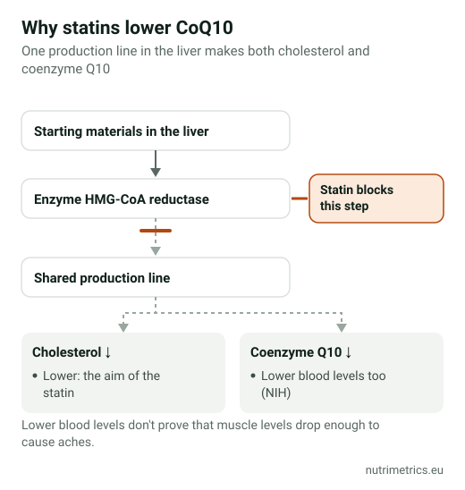

## The short answer

Statins lower the body's CoQ10, so it seems logical that topping it up would ease statin-related muscle aches. The trials don't settle it: the larger, more recent analysis found no benefit, and European and UK guidance doesn't recommend it. CoQ10 is unlikely to harm you, but it is not a substitute for telling your doctor about the pain.

## Why the idea makes sense

Statins lower cholesterol by blocking an enzyme in the liver. The same production line also makes **coenzyme Q10**, which cells use to produce energy, and the US NIH confirms that statins lower CoQ10 levels in the blood. The theory is that less CoQ10 in muscle cells causes aches and weakness, and that a supplement could restore it. Lower blood levels, however, don't prove that muscle levels drop enough to matter.

## What the trials show

| Analysis | Trials and people | Result |
| --- | --- | --- |
| Qu et al., *J Am Heart Assoc*, 2018 | 12 trials, 575 people | Less muscle pain, weakness, cramps and tiredness with CoQ10. Results varied widely between trials; no change in CK, a marker of muscle damage |
| Kennedy et al., *Atherosclerosis*, 2020 | 7 trials, 321 people with statin muscle pain | **No benefit** on muscle pain, and people taking CoQ10 were no more likely to keep taking their statin |

The trials were small and short, typically one to three months, and used different doses. When two careful analyses of similar studies reach opposite conclusions, the honest summary is that any benefit is uncertain and likely small.

## What guidelines say

- **European Atherosclerosis Society (2015):** advises against CoQ10 for statin muscle symptoms because the evidence for it is lacking.
- **NICE (England):** "Do not recommend coenzyme Q10 supplements for the management and prevention of statin-induced muscle symptoms."
- **EU health claims:** EFSA assessed claims for CoQ10 on energy, blood pressure, cholesterol, physical performance and more in 2010. **None was authorised.**

## If you want to try it anyway

Discuss it with your doctor first, especially if you take other medicines. If they agree:

- **Dose:** supplements usually provide 100–200 mg a day. There is no agreed dose for statin symptoms.
- **Form:** **ubiquinone** is the standard form; **ubiquinol** is marketed as "active" and costs more, with no good evidence it works better for this.
- **With food:** take it with a meal that contains fat.
- **Time limit:** trials ran for one to three months. If nothing has changed after that, stop.

| Product (our database) | Form | CoQ10 a day at label dose |
| --- | --- | --- |
| Vitamaze Coenzym Q10 200 mg | Ubiquinone | 200 mg |
| natural elements Coenzym Q10 | Ubiquinone (fermented) | 200 mg (2 capsules) |
| Solgar Ubiquinol 100 mg | Ubiquinol | 100 mg |
| Vitabay Coenzym Q10 Ubiquinol 200 mg | Ubiquinol | 400 mg (2 capsules) |

Note the Vitabay label: two capsules a day give 400 mg, double the usual range.

## Safety

The US NIH reports no serious side effects from CoQ10, but it **may interact with warfarin**, a blood thinner. Tell your doctor or pharmacist before combining it with any prescribed medicine.

## What to do about statin muscle pain

Report it to your doctor rather than stopping your statin on your own. Muscle pain has many possible causes, and your doctor can check for them and adjust your treatment. Statins are prescribed to lower the risk of heart attacks and strokes, and stopping them without advice removes that protection.

Compare all the CoQ10 products we have checked on our [CoQ10 page](/en/supplements/coq10/), and see which claims are legal in our guide to [EU-approved health claims](/en/guides/eu-approved-health-claims-supplements/).
