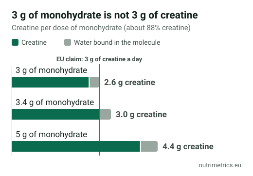

## The short answer

If you do strength training, sports with short intense efforts (sprints, football, padel, HIIT), or you are over 55 and lift weights, creatine monohydrate is the supplement with the most evidence behind it. Take **3–5 g a day**, every day, with or without a loading phase. Buy **monohydrate**: it is the most studied and the cheapest form. "Advanced" versions have not been shown to work better.

## What creatine is allowed to claim in the EU

Creatine is one of the few sports supplements with EU-authorised health claims:

| Authorised claim                                                                                    | For whom                                         | Condition                                                               |
| --------------------------------------------------------------------------------------------------- | ------------------------------------------------ | ----------------------------------------------------------------------- |
| Creatine increases physical performance in successive bursts of short-term, high-intensity exercise | Adults doing high-intensity exercise             | 3 g of creatine a day                                                   |
| Daily creatine consumption can enhance the effect of resistance training on muscle strength         | Adults over 55 doing regular resistance training | 3 g a day, with training at least 3 times a week at increasing workload |

The second claim was authorised in 2017 after an EFSA assessment. EFSA found that taking creatine **only on training days did not have the same effect**: daily intake is what counts.

Building muscle mass, "burning fat", memory and hormone health are **not** authorised claims. A tub that promises them is going beyond what EU law allows.

## The 3 g detail most labels skip

The authorised claim refers to **3 g of creatine**, but monohydrate is not pure creatine. It carries a water molecule and is about **88% creatine**. So:

* 3 g of monohydrate gives about **2.6 g of creatine**;
* reaching 3 g of creatine takes about **3.4 g of monohydrate**;
* the common 5 g serving of monohydrate gives about 4.4 g.

Many products use a 3 g scoop. Myprotein's unflavoured creatine monohydrate, for example, lists one 3 g scoop a day. It works, but to match the EU claim exactly, use 3.5–5 g.

## How much to take

The **International Society of Sports Nutrition (ISSN)** 2017 position stand is the reference review:

* **No loading:** 3–5 g a day. Muscles are saturated in about 4 weeks.
* **With loading (optional):** about 0.3 g per kg of body weight a day (about 20 g for 70 kg) in four doses for 5–7 days, then 3–5 g a day.
* **How:** in water, juice or a protein shake. Taking it with a meal containing carbohydrates may help muscle uptake.

**Vegetarians and vegans** usually have lower muscle creatine, because dietary creatine comes mainly from meat and fish, and tend to respond more strongly in studies.

## Monohydrate, Creapure and other forms

| Form                   | What it is                                        | Verdict from the evidence                        |
| ---------------------- | ------------------------------------------------- | ------------------------------------------------ |
| Monohydrate            | The standard form used in almost all studies      | The benchmark; cheapest per gram                 |
| Micronised monohydrate | Monohydrate with smaller particles                | Mixes better; same effect                        |
| Creapure               | A brand of monohydrate made in Germany by AlzChem | Same compound, with documented purity testing    |
| Hydrochloride (HCl)    | Creatine bound to hydrochloric acid               | Few studies; no proven advantage                 |
| Kre-Alkalyn (buffered) | Creatine with altered pH                          | A 2012 trial found no advantage over monohydrate |

**Is Creapure worth the premium?** It is not more effective; it is the same monohydrate. You pay for a European manufacturer with published quality testing. If a generic brand publishes batch purity tests, the difference comes down to price.

## Myths and side effects

**"It makes you bloated."** In the first days, especially with loading, a gain of around 1–2 kg is common. That is water held **inside** the muscle, not under the skin. Without loading, the change is gradual.

**"It causes hair loss."** This traces to a single 2009 study of 20 rugby players that saw a rise in the hormone DHT. It did not measure hair loss, it has not been replicated, and other studies found no DHT change.

**"It damages your kidneys."** No kidney damage has been found in healthy people at normal doses. Creatine does raise **blood creatinine**, a kidney marker, so mention it before a blood test. If you have kidney disease, do not take it without medical advice.

**Stomach upset** mostly happens with large single doses. Splitting a loading dose usually avoids it.

## Creatine for women

The EU claim does not distinguish between men and women. There is less research in women, but a 2021 review found similar effects on strength and performance and good tolerance across life stages. Interest in menopause and bone health is growing, but there are **no authorised claims** for those uses yet.

**Talk to your doctor** if you are pregnant or breastfeeding, or have kidney or liver disease.

## How to compare prices

Compare the **price per 5 g of monohydrate**, not the price of the tub:

**tub price ÷ grams in the tub × 5 = cost per 5 g serving**

A 250 g tub holds 50 servings of 5 g; a 1 kg tub holds 200. Larger tubs are almost always cheaper per serving, and creatine powder keeps well if stored closed and dry.

Our [goal finder](/en/finder/) lists the creatine products in our database for Spain and Germany.
