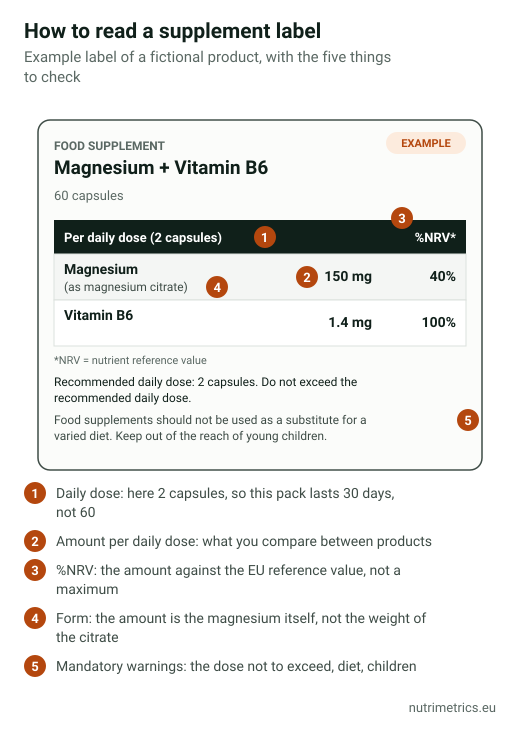

## The short answer

Check three things in the nutrition table: **the amount of each ingredient per daily dose**, **how many daily doses the pack contains**, and **whether any amount exceeds EFSA's safety limits**. Then read the promises on the pack: only claims in the EU register are legal, and none may mention diseases.

## What EU law requires on the label

Under Directive 2002/46/EC, a food supplement label must show:

| Required | Why it helps you |
| --- | --- |
| The name **"food supplement"** | Tells it apart from a medicine |
| The **nutrients or substances** that characterise the product | Shows what you are buying |
| The **amount of each per recommended daily dose** | Lets you compare products and check limits |
| For vitamins and minerals, the **%NRV** | Shows the amount against the reference value |
| The **recommended daily dose** and a warning **not to exceed it** | Tells you how many units make one dose |
| A statement that it **should not replace a varied diet** | — |
| A statement to **keep it out of reach of young children** | — |

Plus, as for any food: ingredients list, allergens, net quantity, best-before date, batch number and the name and address of the business responsible.

## Step 1: find the daily dose, not the capsule

Many products need **2, 3 or even 6 capsules** to reach the amount shown in large print. Check how many units make the "daily dose" and divide the pack by that number: a 120-capsule tub with a 3-capsule dose lasts **40 days**, not 120.

## Step 2: read the mineral, not the compound

For minerals, what counts is the **elemental** amount. "1,000 mg magnesium bisglycinate" usually provides about 140 mg of magnesium. The table must show the magnesium; if the front of the pack highlights the weight of the compound, ignore the big number. More in our guide to [magnesium forms](/en/guides/magnesium-forms-compared/).

## Step 3: understand %NRV

The **nutrient reference value (NRV)** is an EU reference figure, not a maximum or a personal recommendation. Some examples from Regulation 1169/2011:

| Nutrient | NRV (100%) | EFSA upper level for adults |
| --- | --- | --- |
| Vitamin D | 5 µg | 100 µg a day |
| Vitamin B6 | 1.4 mg | 12 mg a day |
| Zinc | 10 mg | 25 mg a day |
| Magnesium | 375 mg | 250 mg a day from supplements |
| Iron | 14 mg | No upper level; safe level 40 mg a day |
| Vitamin C | 80 mg | No upper level set |

Look at magnesium: 100% of the NRV (375 mg) already **exceeds** the 250 mg EFSA considers the upper level from supplements. A high %NRV is not a quality mark; sometimes it is a reason to read more carefully.

## Step 4: spot the common tricks

- **Doses that rise if you follow the label's maximum.** From our database: Berocca Energía recommends 1 tablet a day but the label allows 2. At 2 tablets, vitamin B6 reaches **16.4 mg**, above EFSA's upper level of 12 mg.
- **"Blends" without amounts.** EU law requires the amount of each substance with a nutritional or physiological effect. If only a "proprietary blend" total is shown, you cannot know how much of each you get.
- **Unstandardised extracts.** For herbs, look for the extract type and concentration (for example "5% withanolides" for ashwagandha). Without it, "500 mg extract" says little.
- **Front-of-pack numbers that don't match the table.** The table always wins.

## Step 5: check the promises

A supplement may only use [EU-authorised health claims](/en/guides/eu-approved-health-claims-supplements/), in their wording and above the minimum dose. EU law also forbids attributing to it the property of **preventing, treating or curing** a disease. "Goodbye insomnia", "detox" or "boosts your defences against viruses" are signs a label goes beyond what is allowed.

To check that a product is legally on the market: in Spain, AESAN has a public search of notified supplements; in Germany, supplements must be notified to the federal food safety office (BVL). Notification is not an approval and does not prove that a product works.

Our [goal finder](/en/finder/) shows, for each product in our database, the real dose per day and whether it reaches the amount considered effective.
