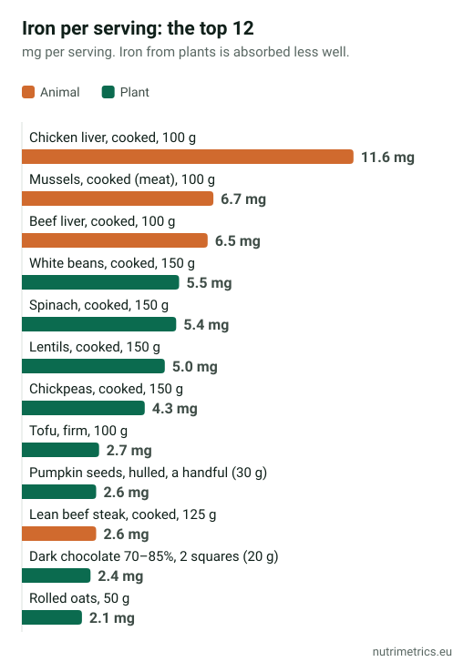
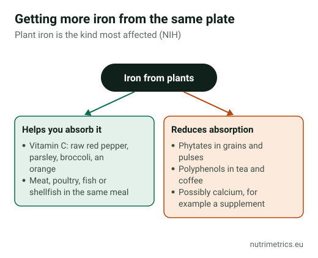

## The short answer

Most adults can cover their iron with food, but no other nutrient depends so much on **how** you eat. According to the NIH, the body absorbs 14–18% of the iron from a mixed diet and 5–12% from a vegetarian diet. A lentil stew with raw red pepper gives you more usable iron than the same stew without it. Take a supplement only if a blood test confirms a deficiency.

## How much iron you need

| Who | EFSA reference intake |
| --- | --- |
| Adult men | 11 mg/day |
| Women after the menopause | 11 mg/day |
| Women of childbearing age | 16 mg/day |

The NRV on labels is **14 mg**. The NIH estimates that people on a vegetarian diet need **1.8 times more** iron, because they absorb it less well.

## How much each serving gives you

Sorted by iron **per serving**. The "Origin" column matters: part of the iron in meat, fish and shellfish is haem iron, which is absorbed better; how much plant iron you absorb depends on what you eat with it. The last column shows whether the food meets the EU threshold to be advertised as a "source of" iron (15% of the NRV per 100 g) or "high in" iron (30%).

| Food | Serving | Iron (mg) | % NRV | Origin | EU threshold (per 100 g) |
| --- | --- | --- | --- | --- | --- |
| Chicken liver, cooked | 100 g | 11.6 | 83% | animal | high |
| Mussels, cooked (meat) | 100 g | 6.7 | 48% | animal | high |
| Beef liver, cooked | 100 g | 6.5 | 47% | animal | high |
| White beans, cooked | 150 g | 5.5 | 40% | plant | source |
| Spinach, cooked | 150 g | 5.4 | 38% | plant | source |
| Lentils, cooked | 150 g | 5.0 | 36% | plant | source |
| Chickpeas, cooked | 150 g | 4.3 | 31% | plant | source |
| Tofu, firm | 100 g | 2.7 | 19% | plant | source |
| Pumpkin seeds, hulled | a handful (30 g) | 2.6 | 19% | plant | high |
| Lean beef steak, cooked | 125 g | 2.6 | 18% | animal | — |
| Dark chocolate 70–85% | 2 squares (20 g) | 2.4 | 17% | plant | high |
| Rolled oats | 50 g | 2.1 | 15% | plant | high |
| Sardines in oil, drained | 1 tin (60 g) | 1.8 | 13% | animal | source |
| Wholemeal bread | 2 slices (60 g) | 1.5 | 11% | plant | source |
| Pork tenderloin, cooked | 125 g | 1.4 | 10% | animal | — |
| Chicken breast, cooked | 125 g | 1.3 | 9% | animal | — |
| Egg | 1 medium (60 g) | 1.1 | 8% | animal | — |

**What the table shows:**

- **Liver** tops the list, but it is also very rich in vitamin A. The NHS advises avoiding it during pregnancy.
- **Pulses beat meat on quantity.** 150 g of cooked white beans or lentils gives about 5 mg; a 125 g beef steak, 2.6 mg. Meat wins on absorption.
- **Spinach** gives 5.4 mg per serving, but the NIH notes that its iron is poorly absorbed.
- **Mussels** are the animal food with the most iron after liver: 6.7 mg per 100 g of meat.
- **Black pudding** is left out because the databases disagree widely: between about 6 and 18 mg per 100 g.

## How to absorb more iron from the same plate

According to the NIH:

1. **Vitamin C helps** you absorb iron from plants. Add raw red pepper, parsley, broccoli or an orange to your pulses.
2. **Meat, poultry, fish and shellfish** also increase how much plant iron you absorb from the same meal. Lentils with a little beef, or beans with clams, are good combinations.
3. **Phytates** in grains and pulses and **some polyphenols**, such as those in tea and coffee, reduce absorption. If you drink tea or coffee, have it away from iron-rich meals.
4. **Calcium** might reduce it too. If you take a calcium supplement, don't take it with your most iron-rich meal.

## Two recipes with the numbers

One comes from our Spanish edition, one from our German edition.

### Spanish lentil stew with red pepper (lentejas, 4 servings)

**Ingredients:** 300 g dried brown lentils, 1 carrot (150 g), 1 onion (100 g), 1 large red pepper (150 g), 2 garlic cloves, 1 bay leaf, 1 tsp paprika, 2 tbsp extra virgin olive oil and salt.

1. Gently fry the chopped onion, garlic, carrot and **half the pepper**.
2. Add the paprika, lentils and bay leaf, cover with water and simmer for 35–40 minutes.
3. Finely dice **the other half of the pepper raw** and scatter it over each plate: that way it keeps its vitamin C.

**Per serving:** about **5.2 mg iron** (37% of the NRV) and at least 24 mg vitamin C from the raw pepper alone.

### Beef, red pepper and broccoli pan (2 servings)

**Ingredients:** 300 g lean beef (rump) in strips, 1 red pepper (150 g), 200 g broccoli florets, 1 onion (100 g), 2 tbsp rapeseed oil, a dash of soy sauce and pepper.

1. Steam the broccoli for 4 minutes.
2. Sear the beef over a very high heat for 2 minutes and take it out.
3. Fry the onion and pepper strips for 3 minutes, return the beef and broccoli, add the soy sauce and serve.

**Per serving:** about **3.4 mg iron** (24%), **7.2 mg zinc** (72%) and at least 65 mg vitamin C from the broccoli alone.

## Who should keep an eye on iron

The NIH lists **pregnant women**, **infants and young children**, **women with heavy periods**, **frequent blood donors** and people with **certain digestive conditions, cancer or heart failure** as more likely to run low on iron. If you are in one of these groups and feel tired, have your ferritin checked before you buy anything. We explain how in [iron supplements and tiredness](/en/guides/iron-supplements-tiredness/).

## When food isn't enough

- **If the blood test confirms a deficiency**, your doctor will tell you what dose to take and for how long. Compare products on our [iron](/en/supplements/iron/) page.
- **If you have haemochromatosis**, don't take iron supplements.
- **Keep iron supplements out of children's reach.**

This guide is part of the series [The best supplement is on your plate](/en/guides/best-supplement-is-on-your-plate/).

## How we calculated the numbers

Values per 100 g come from the USDA's FoodData Central database (SR Legacy), checked against Spain's BEDCA database. For black pudding we compared the USDA value (about 6 mg per 100 g) with BEDCA's figure for Spanish morcilla (18 mg). NutriMetrics calculates the servings, percentages and recipe values. The % NRV uses the 14 mg reference from Regulation (EU) 1169/2011. Real amounts vary with the variety, origin and cooking method.
