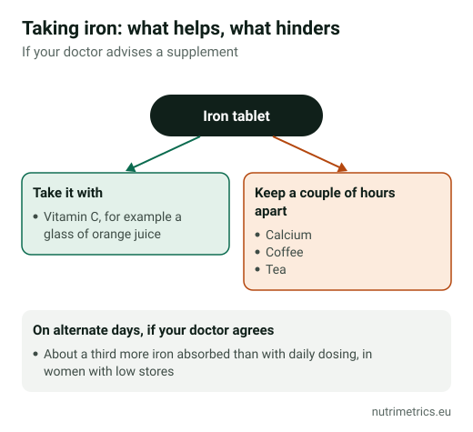

## The short answer

If you feel tired for no clear reason, iron **only helps if you are low in it**. Before buying anything, ask your doctor for a **ferritin test**: it is cheap and it is how you find out. If you are deficient, iron has some of the clearest evidence of any supplement for tiredness. If you are not, it adds nothing, and the excess builds up in your body.

## Who is most at risk

According to the NIH, the groups most at risk of iron deficiency are:

- women with **heavy periods**;
- **pregnant** women;
- frequent **blood donors**;
- people with **gut conditions** (such as coeliac disease) or gut surgery;
- people with heart failure or cancer.

**Vegetarian and vegan** diets provide only non-haem iron, which is less well absorbed, so they need planning.

## Reading the blood test

| Ferritin | What it usually indicates (NIH) |
| --- | --- |
| Below 10 µg/l | Iron deficiency anaemia |
| Below 30 µg/l | Iron deficiency |
| Above 30 µg/l | Deficiency unlikely, though inflammation can raise ferritin |

Your doctor reads it together with **haemoglobin**. You can be iron deficient **without being anaemic**: haemoglobin is normal, but stores are low.

## How much it really helps

In a trial published in *CMAJ* in 2012, 198 women aged 18–53 with **unexplained fatigue, no anaemia and ferritin below 50 µg/l** took 80 mg of iron a day or a placebo for 12 weeks. Fatigue scores fell **47.7%** with iron and **28.8%** with placebo. A real effect — in people with low stores, at a high dose, under trial conditions.

EU law allows iron to claim that it **contributes to the reduction of tiredness and fatigue**, normal formation of red blood cells and haemoglobin, and normal oxygen transport. No claim says it gives energy to people whose stores are fine.

## Why not take it "just in case"

- **EFSA** could not set a tolerable upper level for iron and in 2024 set a **safe level of 40 mg a day** of total iron for adults.
- **Germany's BfR** recommends no more than **6 mg** of iron per daily dose in over-the-counter supplements, and that men, postmenopausal women and pregnant women only take them after medical advice.
- **Excess builds up:** the body has no efficient way to get rid of iron. People with **haemochromatosis**, an inherited condition, must not take it.
- **Children:** according to the NIH, accidental overdose of iron products is a leading cause of fatal poisoning in children under 6. Keep it out of reach.

An example from our database: **Solgar Gentle Iron** provides **25 mg** of iron (bisglycinate) per capsule. That is a dose for treating deficiency, four times the BfR's recommendation for a freely sold supplement. Use it only with a test result and medical advice.

## How to take it if advised to

1. **On an empty stomach or with a light meal** if you tolerate it; with food if it upsets you.
2. **With vitamin C** (for example orange juice), which improves absorption of non-haem iron.
3. **Away from calcium, coffee and tea** by at least a couple of hours.
4. **On alternate days**, if your doctor agrees: in a study of women with low iron stores, absorption was about a third higher than with daily dosing.
5. **Re-test after a few months** to check ferritin is rising and avoid taking it longer than needed.

Common side effects: constipation, nausea and dark stools. Black stools are normal on iron, but abdominal pain or black stools when you are not taking iron need a doctor.

**Interactions:** ask your doctor or pharmacist if you take levothyroxine, levodopa or proton pump inhibitors such as omeprazole.

Our [goal finder](/en/finder/) shows other ingredients with tiredness claims, such as vitamin B12 and magnesium, and when they make sense.
