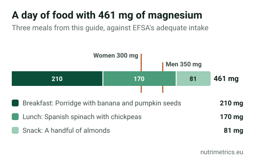

## The short answer

Most healthy adults can cover their magnesium with food. According to the NIH, pulses, nuts, seeds, whole grains and leafy greens such as spinach are good sources. A handful of pumpkin seeds and a plate of Spanish spinach with chickpeas already add up to about **350 mg**, the amount EFSA considers adequate for men. A supplement makes sense if your doctor finds a deficiency, not as daily insurance.

## How much magnesium you need

| Figure | Value | What it means |
| --- | --- | --- |
| EFSA adequate intake | 350 mg/day (men), 300 mg/day (women) | What food and drink together should add up to |
| NRV on labels | 375 mg | The EU reference used for "% NRV" |
| EFSA upper limit for supplements | 250 mg/day | Counts only magnesium from supplements, water and fortified foods |

## How much each serving gives you

The table is sorted by magnesium **per serving**, not per 100 g, because that is what you actually eat. "Servings for 250 mg" shows how many servings match one tablet at the amount EFSA considers safe from supplements. The last column shows whether the food meets the EU threshold to be advertised as a "source of" magnesium (15% of the NRV per 100 g) or "high in" magnesium (30%).

| Food | Serving | Magnesium (mg) | % NRV | Servings for 250 mg | EU threshold (per 100 g) |
| --- | --- | --- | --- | --- | --- |
| Pumpkin seeds, hulled | a handful (30 g) | 178 | 47% | 1.4 | high |
| Spinach, cooked | 150 g | 130 | 35% | 1.9 | source |
| Sunflower seeds, hulled | a handful (30 g) | 98 | 26% | 2.6 | high |
| Quinoa, cooked | 150 g | 96 | 26% | 2.6 | source |
| White beans, cooked | 150 g | 94 | 25% | 2.6 | source |
| Cashews | a handful (30 g) | 88 | 23% | 2.9 | high |
| Almonds | a handful (30 g) | 81 | 22% | 3.1 | high |
| Chickpeas, cooked | 150 g | 72 | 19% | 3.5 | — |
| Rolled oats | 50 g | 69 | 18% | 3.6 | high |
| Brown rice, cooked | 150 g | 58 | 16% | 4.3 | — |
| Tofu, firm | 100 g | 58 | 15% | 4.3 | source |
| Lentils, cooked | 150 g | 54 | 14% | 4.6 | — |
| Peanuts | a handful (30 g) | 50 | 13% | 5.0 | high |
| Dark chocolate 70–85% | 2 squares (20 g) | 46 | 12% | 5.5 | high |
| Wholemeal bread | 2 slices (60 g) | 45 | 12% | 5.6 | source |
| Banana | 1 medium (120 g) | 32 | 9% | 7.7 | — |
| Whole milk | 1 glass (250 ml) | 25 | 7% | 10.0 | — |
| Plain yogurt | 1 pot (125 g) | 15 | 4% | 16.7 | — |

**What the table shows:**

- **Seeds and nuts** give the most per bite. Half a handful of pumpkin seeds gives more than a yogurt, a glass of milk and a banana together.
- **Cooked pulses** are less concentrated because they absorb water, but the large serving makes up for it: 150 g of white beans gives about 94 mg.
- **Chickpeas and lentils** don't reach the "source of" threshold, although a serving gives 54–72 mg. The threshold is measured per 100 g, not per serving.
- **Dairy and fruit** give little magnesium; they are not the foods to build on.

## A day with more than 450 mg, without pills

| Meal | What | Magnesium |
| --- | --- | --- |
| Breakfast | Porridge with banana and pumpkin seeds (recipe below) | 210 mg |
| Lunch | Spanish spinach with chickpeas (recipe below) | 170 mg |
| Snack | A handful of almonds (30 g) | 81 mg |
| **Total** | | **461 mg** |

You don't need to eat like this every day. The example shows that three simple steps take you past the adequate intake without getting near any limit, because EFSA's upper limit does not apply to the magnesium naturally in food.

## Water counts too

In the EU, a mineral water may only say that it **contains magnesium** if it has **more than 50 mg per litre**. The amount varies a lot between brands, so check the label: a water with 100 mg/l gives you 150 mg if you drink a litre and a half a day. That is magnesium no food table shows.

## Two recipes with the numbers

One comes from our Spanish edition, one from our German edition.

### Spanish spinach with chickpeas (espinacas con garbanzos, 4 servings)

**Ingredients:** 500 g cooked chickpeas (drained), 500 g fresh spinach, 60 g wholemeal bread, 3 garlic cloves, 4 tbsp extra virgin olive oil, 1 tsp ground cumin, 1 tsp sweet paprika, 1 tbsp sherry vinegar and salt.

1. Wilt the spinach in a wide pan with a splash of oil. Set aside.
2. Fry the torn bread and sliced garlic in the rest of the oil until golden.
3. Pound them in a mortar with the cumin, paprika, vinegar and a little water to a paste.
4. Put the chickpeas, spinach and paste in the pan, add a glass of water and simmer gently for 10 minutes.

**Per serving:** about **170 mg magnesium** (45% of the NRV) and 7.4 mg iron (53%).

### Porridge with banana and pumpkin seeds (1 serving)

**Ingredients:** 50 g rolled oats, 250 ml milk, 1 small banana (100 g), 15 g hulled pumpkin seeds and cinnamon.

1. Simmer the oats in the milk over a medium heat, stirring, for about 5 minutes.
2. Top with sliced banana, pumpkin seeds and cinnamon.

**Per serving:** about **210 mg magnesium** (56% of the NRV).

## When food isn't enough

- **If your doctor finds a low level**, they may recommend a supplement. To choose the form and dose, see [magnesium forms compared](/en/guides/magnesium-forms-compared/) and our [magnesium](/en/supplements/magnesium/) page.
- **If you have kidney disease**, don't take magnesium supplements without medical advice.
- **If you're looking at it for sleep**, read [magnesium for sleep](/en/guides/magnesium-for-sleep/) first: there is no EU-authorised claim about sleep.

This guide is part of the series [The best supplement is on your plate](/en/guides/best-supplement-is-on-your-plate/).

## How we calculated the numbers

Values per 100 g come from the USDA's FoodData Central database (SR Legacy), which systematically covers cooked foods, checked against Spain's BEDCA database. NutriMetrics calculates the servings, percentages and equivalents. The % NRV uses the 375 mg reference from Regulation (EU) 1169/2011. Real amounts vary with the variety, origin and cooking method.
