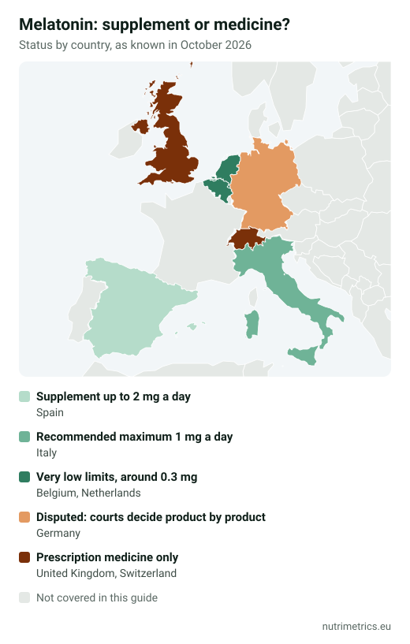

## The short answer

Melatonin **helps you fall asleep sooner**; it does not make you sleep longer or deeper. The only EU-authorised sleep claim is based on **1 mg shortly before bedtime**. Whether you can buy it as a supplement — and at what dose — depends on where you are in Europe. If you have slept badly for weeks, melatonin is not the underlying fix: talk to a doctor.

## What EU law allows

| Authorised claim | Condition |
| --- | --- |
| Melatonin contributes to the reduction of time taken to fall asleep | 1 mg taken close to bedtime |
| Melatonin contributes to the alleviation of subjective feelings of jet lag | At least 0.5 mg close to bedtime on the first day of travel and the first few days after arrival |

**Not** authorised: deeper sleep, fewer awakenings, less anxiety or "resetting your body clock" in general. See our [table of EU-approved health claims](/en/guides/eu-approved-health-claims-supplements/).

## Legal status by country

| Country | Melatonin in supplements |
| --- | --- |
| Spain | Supplement up to 2 mg a day; above that, a medicine (AEMPS criterion) — hence the many 1.9 mg products |
| Italy | Recommended maximum 1 mg a day since 2013 (previously 5 mg) |
| Germany | Legally disputed: authorities have classed it as a medicine and courts decide product by product; melatonin medicines are prescription-only |
| Belgium and Netherlands | Very low limits (around 0.3 mg) |
| United Kingdom and Switzerland | Prescription medicine only |

Status as known in October 2026; national rules change. Under EU mutual recognition, a product legal in one country can often be sold in another, which is why higher-dose products appear online across borders. Our guide to [supplement maximum levels in Europe](/en/guides/supplement-maximum-levels-europe/) compares more countries and nutrients.

## Why more is not better

The authorised claim is based on **1 mg**. No claim exists for higher doses, so a 1.9 mg tablet gives almost twice the amount behind the recognised effect, and imported 5 or 10 mg products far more. If 1 mg does not help you fall asleep sooner, a higher dose is not the logical next step — a conversation with a doctor is.

## Who should avoid it

- **Children and teenagers**, unless prescribed. German paediatricians want melatonin gummies banned, and the BfR advises against giving melatonin supplements to children on parents' own initiative.
- **Pregnant and breastfeeding women.**
- People taking **sedatives, blood thinners** or other medicines that affect sleep: check with a doctor or pharmacist first.

Commonly reported effects include morning drowsiness, headache and dizziness. Don't drive if you feel drowsy the next day.

## How to use it sensibly

1. **Start with the authorised dose:** 1 mg shortly before bed.
2. **Use it for something specific:** falling asleep during a bad patch, a time-zone change or jet lag.
3. **Set an end date.** If you still need it after a few weeks, a supplement is not the answer. Chronic insomnia has treatments with far stronger evidence, such as cognitive behavioural therapy for insomnia.
4. **Read the label:** many products add herbs (passionflower, lemon balm, valerian) that have no authorised claims.

For a hormone-free option, our guide to [magnesium for sleep](/en/guides/magnesium-for-sleep/) explains what the trials show, and our [goal finder](/en/finder/) compares the evidence for different sleep options.
