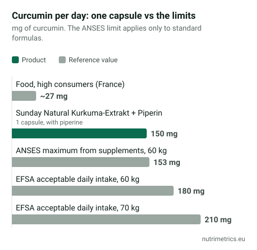

## The short answer

Turmeric in your cooking is fine. **Concentrated turmeric and curcumin supplements** have been linked to rare cases of liver injury across Europe and beyond, and the risk seems higher with formulas built to boost absorption. If you take one, stay within the daily limits regulators use, avoid it if you have liver or gallbladder problems or take blood thinners, and stop at the first sign of trouble.

## What happened

| When | Where | What |
| --- | --- | --- |
| 2018–2019 | Italy | About 20 cases of hepatitis linked to turmeric supplements in Tuscany and Lombardy. Contamination and added substances were ruled out. |
| 2019 | Belgium | A turmeric product linked to the Italian cases was recalled. |
| 2020 | Germany | The BfR found first signs of liver-damaging effects, particularly for preparations with enhanced absorption. |
| 2022 | France | ANSES reported over 100 suspected side effects, including 15 cases of hepatitis, and set a daily limit for supplements. |
| 2022 | Italy | A decree required a liver warning on labels from 31 December 2022 and banned health claims for turmeric. |
| 2023 | Australia | The regulator reported 18 cases of liver problems, two severe and one fatal. |
| 2024 | United Kingdom | The Committee on Toxicity (COT), which advises the Food Standards Agency, concluded that there is reasonable evidence of a link between turmeric and liver toxicity, that rare cases occurred even below the acceptable daily intake, and that liver effects may be idiosyncratic: rare and unpredictable. In an FSA survey of 15 supplements, 2 would exceed the acceptable daily intake if taken as the label says. |

Cases are rare compared with the number of people who take turmeric. But because nobody can predict who will react, regulators focus on keeping doses moderate and warning the people most at risk.

## In the UK

* Turmeric supplements are **legal and widely sold**, but the COT's 2024 statement is the most detailed official UK assessment: it found reasonable evidence of a link with liver injury and warned that "better absorbed" formulas make simple dose limits unreliable.
* The FSA's novel foods team considers food supplements made from **turmeric oleoresin extract or pure curcumin powder** to be **novel foods**, because they were not significantly consumed before May 1997. On that view such extracts would need authorisation before sale in Great Britain; plain turmeric powder would not. Products are on sale regardless, which is one more reason to read the label carefully.
* There is **no UK maximum dose**; the EFSA acceptable daily intake below is the figure the COT works with.

## The daily limits

| Limit | Amount | Notes |
| --- | --- | --- |
| EFSA acceptable daily intake (curcumin) | 3 mg per kg body weight | 180 mg at 60 kg, 210 mg at 70 kg, from all sources |
| ANSES maximum from supplements (France) | 153 mg a day for a 60 kg adult | Leaves room for food; standard formulas only |
| Intake from food, high consumers (France) | About 27 mg a day | People who eat a lot of turmeric-rich food |

Many supplements give more than 153 mg of curcumin a day. Check both the extract amount and the percentage of curcuminoids; not every label makes this clear.

## How to compare turmeric supplements by milligrams

You can, but only by one number: **milligrams of curcuminoids per daily dose**. The weight of "turmeric" on the front says very little. In the US Dietary Supplement Ingredient Database programme (NIH and USDA), products labelled 500 mg of turmeric a day contained anything from **16 to 554 mg of curcuminoids** when tested. Products that stated their curcuminoid content were mostly close to the label.

How to work it out:

1. Find the **extract per capsule** and its **% curcuminoids** (often 95%), and multiply them: 500 mg × 95% = 475 mg.
2. Multiply by the **capsules per day** on the label.
3. If the label only gives turmeric **root powder**, count on a few per cent: curcuminoids make up about 3% of the dried root.
4. If it gives a **ratio** ("10:1, equivalent to 10,000 mg"), you can't work it out: the ratio says how much root went in, not how much curcumin came out.
5. Compare the result with **153 mg a day** (ANSES, for a 60 kg adult) or **3 mg per kg** of your body weight (EFSA, from all sources).

| Example label | Curcuminoids per day | Compared with 153 mg (ANSES, 60 kg) |
| --- | --- | --- |
| 3 × 500 mg turmeric root powder | About 45 mg (about 3%) | Well below |
| 1 × 500 mg extract, 95% curcuminoids | 475 mg | About three times as much |
| 2 × 250 mg extract, 95% curcuminoids | 475 mg | The same dose in smaller capsules |
| 1 × 1,000 mg 10:1 extract ("equivalent to 10,000 mg") | Not stated | Can't tell from the label |
| 1 × 500 mg phytosome, 20% curcuminoids | 100 mg, absorbed better | Not comparable: the 153 mg figure is for standard formulas |

These are example labels to show the arithmetic, not products we tested. **Only compare like with like:** a milligram of a standard extract and a milligram of an enhanced-absorption formula do not mean the same exposure, as the next section explains.

## Why "better absorbed" is not automatically better

Curcumin on its own is poorly absorbed, so manufacturers add **piperine** (black pepper extract) or use **micelles, phytosomes, nanoparticles or cyclodextrins** to raise blood levels. That changes the safety picture:

- **ANSES** says these formulas can raise curcumin's effects even when the dose stays under the limit, that labels rarely say which type you are buying, and that its 153 mg figure applies only to standard formulas.
- **Germany's BfR** says such products should not be assumed to be as safe as ordinary curcumin.
- **The UK Committee on Toxicity** warns that a standard mg-per-day limit may not reflect their safety.
- **The US NIH** states that highly bioavailable curcumin formulas may harm the liver.

An example from our database: **Sunday Natural Kurkuma-Extrakt + Piperin** gives 150 mg of curcuminoids and 5.3 mg of piperine per capsule. On paper that is just under ANSES's 153 mg. But because it contains piperine, ANSES's figure doesn't really apply, and the actual exposure is higher than the milligrams suggest.

## Who should avoid turmeric supplements

- People with **liver disease** or **bile duct or gallbladder problems** (ANSES and Italy's label warning).
- People taking **anticoagulants, cancer medicines or immunosuppressants**, unless their GP or specialist agrees (ANSES).
- **Pregnant women**: the US NIH says turmeric supplements may be unsafe in pregnancy.

**Warning signs** to stop and see a doctor (GP, or NHS 111 if it is urgent): unusual tiredness, nausea, loss of appetite, dark urine, or yellowing of the skin or eyes.

## Does it work?

For **knee osteoarthritis**, a 2022 meta-analysis of 15 randomised trials with 1,670 patients found that curcuminoids reduced pain and stiffness and improved function compared with placebo, and seemed no worse than anti-inflammatory painkillers. The authors called the studies low quality and varied, and urged caution. The US NIH describes the early evidence as positive but not definitive.

For most other uses, there isn't enough evidence to say. **No health claim for turmeric or curcumin is authorised in the UK or the EU** (botanical claims are on hold on both registers), so labels promising joint, liver or digestive benefits are not using approved wording.

Compare the turmeric products we have checked on our [turmeric page](/en/supplements/turmeric/). If joint pain is your reason for buying, see also [glucosamine and chondroitin: do they work?](/en/guides/glucosamine-chondroitin-do-they-work/).
