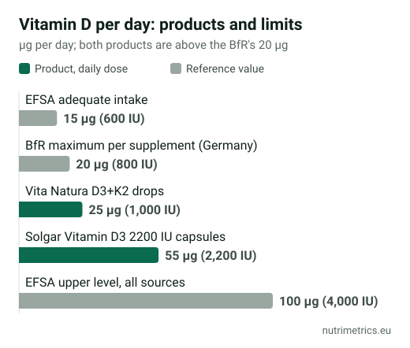

## The short answer

Most vitamin D comes from your skin when it is exposed to sunlight, not from food. In the UK the sun is too weak to make vitamin D from about October to March, so the **NHS advises everyone to consider 10 µg (400 IU) a day in autumn and winter**, and all year if you are in a higher-risk group. If you think you are low, ask your GP whether a **25(OH)D blood test** makes sense. **10–25 µg (400–1,000 IU) of vitamin D3 a day** sits within official advice and well below the 100 µg maximum.

## How low do levels get?

Three official or peer-reviewed data points:

| Country | Data                                                                      | Result                                                     |
| ------- | ------------------------------------------------------------------------- | ---------------------------------------------------------- |
| UK      | National Diet and Nutrition Survey, 2016–2019, blood samples January–March | 29% of adults and 37% of 11–18-year-olds below 25 nmol/l   |
| Germany | National health survey of adults (DEGS1, Robert Koch Institute)           | 61.6% below 50 nmol/l; 30.2% below 30 nmol/l               |
| Spain   | 206 healthy blood donors in Burgos and Valencia (2022)                    | Average levels 18–27% lower after winter than after summer |

The thresholds differ. The UK's advisory committee SACN uses **25 nmol/l** as the level below which the risk of poor bone and muscle health rises, and set the UK intake of 10 µg a day so that almost everyone stays above it in winter. EFSA set its adequate intake so that most people reach **50 nmol/l (20 ng/ml)**. A UK result between 25 and 50 nmol/l is therefore "not low" by NHS standards but below the EFSA target.

## Who is at higher risk

The NHS advises a daily 10 µg supplement **all year** for:

* people who are not often outdoors, for example frail or housebound people, or people in a care home;
* people who usually wear clothes that cover most of their skin when outdoors;
* people with dark skin, for example of African, African-Caribbean or south Asian background, who need more sunlight to make the same amount;
* all children aged 1 to 4, and breastfed babies from birth (8.5–10 µg).

Older age, obesity, gut conditions that affect absorption and some medicines can also lower levels.

## How much, and the safe maximum

| Authority                         | Figure                                       | What it means                                         |
| --------------------------------- | -------------------------------------------- | ----------------------------------------------------- |
| NHS / SACN (UK)                   | 10 µg (400 IU) a day from age 1              | Daily need; supplement advised October to March       |
| NHS (UK)                          | No more than 100 µg (4,000 IU) a day         | Maximum for adults and children aged 11 to 17         |
| NHS (UK)                          | 50 µg (ages 1–10) · 25 µg (under 1)          | Maximum for children                                  |
| EFSA (EU)                         | 15 µg (600 IU) a day                         | Adequate intake, assuming little skin production      |
| EFSA (EU), reconfirmed 2023       | 100 µg (4,000 IU) a day                      | Tolerable upper level, food and supplements combined  |
| BfR (Germany)                     | 20 µg (800 IU) per daily dose                | Recommended maximum in a supplement                   |
| Spain                             | No national maximum                          | EU rules apply                                        |

Taking more than 100 µg a day for long periods can raise blood calcium. Doses above that belong under medical supervision, and if your GP has prescribed a different amount, follow their advice. Our guide to [supplement maximum levels](/en/guides/supplement-maximum-levels-europe/) compares vitamin D limits in the UK and 13 European markets.

## What vitamin D can claim in the UK and EU

The Great Britain claims register uses the same wording as the EU register here. Authorised claims say vitamin D contributes to:

* the normal **function of the immune system**;
* the maintenance of normal **bones** and teeth;
* the maintenance of normal **muscle function**;
* normal absorption and use of **calcium and phosphorus**.

There is no authorised claim for mood, winter blues, tiredness or preventing colds. The NHS also says there is not enough evidence to take vitamin D only to prevent or treat COVID-19.

## D3 or D2, drops or capsules

* **D3 vs D2:** a 2012 meta-analysis found that **D3 raises blood levels** more effectively than D2. Most supplements already use D3.
* **Drops vs capsules:** both work; pick the one you will take every day. Drops are usually cheaper per dose. Check the µg **per drop**, not per millilitre.
* **Strength:** products from 10 µg up to 100 µg (4,000 IU) per tablet are widely sold. 10 µg is what the NHS advises for most people; higher doses only make sense if a test or your GP says so, and they count towards the 100 µg maximum together with any multivitamin.
* **With K2:** there is no authorised claim for the combination, and vitamin D does not need K2 to work.

## Examples from our database

These two products were checked for our Spanish and German editions; UK product checks are next.

| Product                                            | Vitamin D per daily dose | Indicative price                      | Cost per day |
| -------------------------------------------------- | ------------------------ | ------------------------------------- | ------------ |
| Vita Natura D3+K2 drops, 50 ml (about 1,700 drops) | 25 µg (1,000 IU)         | €23.99 (docmorris.de)                 | \~€0.01      |
| Solgar Vitamin D3 2200 IU, 50 capsules             | 55 µg (2,200 IU)         | €17.95 (mccabespharmacy.com, Ireland) | \~€0.36      |

Prices checked 15 October 2026. Both are below the NHS and EFSA maximum of 100 µg but above the BfR's recommended maximum per supplement. In this case the drops cost about 25 times less per day, which is why cost per day is the number to compare.

Our [goal finder](/en/finder/) lists the vitamin D products we have checked so far.

**Talk to your GP or pharmacist** before taking vitamin D if you have kidney disease, sarcoidosis or high calcium levels, or take thiazide diuretics or blood thinners.
