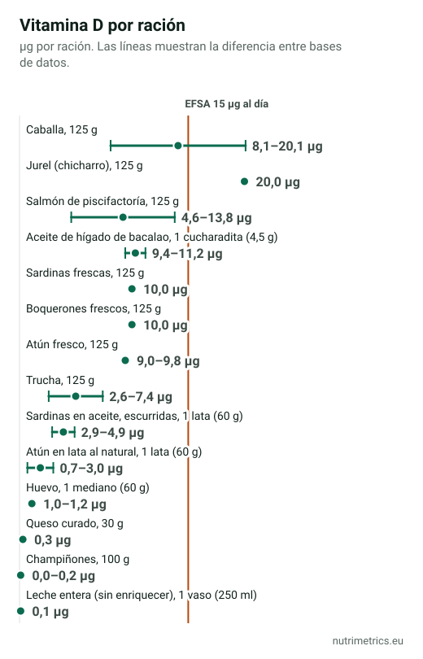

## La respuesta corta

Solo en parte. El NIH lo resume así: «pocos alimentos contienen vitamina D de forma natural». El pescado azul es la gran excepción, y una ración de caballa o jurel puede cubrir los 15 µg diarios que la EFSA considera adecuados. Pero comer así a diario no es realista. Según el NIH, la mayoría de la gente cubre al menos parte de su vitamina D con el sol. Si en invierno no tomas el sol, la comida rara vez basta; lo explicamos en [vitamina D en invierno](/es/guias/vitamina-d-invierno/).

## Cuánta vitamina D necesitas

La EFSA fija una ingesta adecuada de **15 µg (600 UI) al día** para adultos. Ojo: la calcula suponiendo que la piel apenas fabrica vitamina D, es decir, para quien casi no toma el sol. En las etiquetas verás un VRN de 5 µg, bastante más bajo; por eso en la tabla usamos los 15 µg de la EFSA como referencia.

## Cuánto aporta cada ración

Las bases de datos de composición no coinciden en la vitamina D del pescado. Damos el rango entre las bases que tienen el alimento: CIQUAL (Francia), BEDCA (España) y USDA (EE. UU.).

| Alimento | Ración | Vitamina D (µg) | % de 15 µg | Bases de datos |
| --- | --- | --- | --- | --- |
| Caballa | 125 g | 8,1–20,1 | 54–134 % | CIQUAL, BEDCA, USDA |
| Jurel (chicharro) | 125 g | 20,0 | 133 % | BEDCA |
| Salmón de piscifactoría | 125 g | 4,6–13,8 | 31–92 % | CIQUAL, BEDCA, USDA |
| Aceite de hígado de bacalao | 1 cucharadita (4,5 g) | 9,4–11,2 | 63–75 % | BEDCA, CIQUAL, USDA |
| Sardinas frescas | 125 g | 10,0 | 67 % | BEDCA |
| Boquerones frescos | 125 g | 10,0 | 67 % | BEDCA |
| Atún fresco | 125 g | 9,0–9,8 | 60–65 % | BEDCA, CIQUAL |
| Trucha | 125 g | 2,6–7,4 | 18–49 % | BEDCA, CIQUAL |
| Sardinas en aceite, escurridas | 1 lata (60 g) | 2,9–4,9 | 19–33 % | BEDCA, USDA |
| Atún en lata al natural | 1 lata (60 g) | 0,7–3,0 | 5–20 % | BEDCA, CIQUAL, USDA |
| Huevo | 1 mediano (60 g) | 1,0–1,2 | 7–8 % | BEDCA, CIQUAL, USDA |
| Queso curado | 30 g | 0,3 | 2 % | BEDCA |
| Champiñones | 100 g | 0,0–0,2 | 0–1 % | BEDCA, USDA |
| Leche entera (sin enriquecer) | 1 vaso (250 ml) | 0,1 | 0 % | BEDCA |

**Lo que dice la tabla:**

- **El pescado azul fresco** es la única comida corriente que puede cubrir el día con una ración. La caballa, el jurel, las sardinas y los boquerones están en lo alto de la tabla.
- **Las conservas aportan menos.** Una lata de sardinas da 3–5 µg y una de atún al natural, 1–3 µg.
- **El huevo** suma alrededor de 1 µg por unidad: ayuda, pero no basta.
- **Los champiñones normales y la leche sin enriquecer** apenas aportan. El NIH señala que algunos champiñones se tratan con luz ultravioleta para aumentar su vitamina D2, y algunas leches y cereales llevan vitamina D añadida: lo verás en la etiqueta.

## Una semana con pescado azul: ¿llega?

Hemos calculado una semana con tres raciones de pescado azul y un huevo al día:

| Comida | Veces por semana | Vitamina D |
| --- | --- | --- |
| Salmón de piscifactoría (125 g) | 1 | 4,6–13,8 µg |
| Caballa (125 g) | 1 | 8,1–20,1 µg |
| Sardinas frescas (125 g) | 1 | 10,0 µg |
| Huevo (60 g) | 7 | 7,1–8,4 µg |
| **Media al día** | | **4,3–7,5 µg (28–50 % de 15 µg)** |

Es una dieta mejor que la media y aun así se queda en la mitad de la ingesta adecuada como mucho. La diferencia la tiene que poner el sol, o un suplemento si el análisis muestra que te falta.

## Dos recetas con pescado azul

### Salmón al horno con patatas y limón (2 raciones)

**Ingredientes:** 2 lomos de salmón de 125 g, 400 g de patatas, 1 limón, 2 dientes de ajo, perejil, 2 cucharadas de aceite de oliva virgen extra y sal.

1. Hornea las patatas en rodajas finas con aceite y sal a 200 °C durante 20 minutos.
2. Pon encima el salmón con el ajo picado, unas rodajas de limón y el perejil, y hornea 10–12 minutos más.

**Por ración:** entre **4,6 y 13,8 µg de vitamina D** (31–92 % de 15 µg), según la base de datos.

### Caballa a la plancha con pimientos asados (2 raciones)

**Ingredientes:** 2 caballas limpias en lomos (unos 250 g de pescado), 2 pimientos rojos asados, aceite de oliva, ajo, sal y unas gotas de vinagre de Jerez.

1. Seca bien los lomos y hazlos a la plancha muy caliente, primero por la piel, 2–3 minutos por lado.
2. Sirve con los pimientos asados en tiras, aliñados con aceite, ajo picado y vinagre.

**Por ración:** entre **8,1 y 20,1 µg de vitamina D** (54–134 % de 15 µg).

## Cuándo la comida no basta

- **Si apenas tomas el sol**, por trabajo, por la época del año o porque te cubres la piel, es poco probable que la comida cubra la vitamina D.
- **La única forma de saberlo** es un análisis de 25(OH)D. Si el resultado es bajo, tu médico te dirá qué dosis tomar. Compara productos en nuestra página de [vitamina D](/es/suplementos/vitamina-d/).
- **El aceite de hígado de bacalao** es muy rico en vitamina D, pero también en vitamina A. El NHS aconseja no tomarlo durante el embarazo.

Esta guía forma parte de la serie [El mejor suplemento está en tu plato](/es/guias/mejor-suplemento-esta-en-tu-plato/).

## Cómo hemos calculado las cifras

Para cada alimento hemos buscado el valor por 100 g en tres bases oficiales: CIQUAL (ANSES, Francia), BEDCA (AESAN, España) y FoodData Central SR Legacy (USDA, EE. UU.). Cuando no coinciden, damos el mínimo y el máximo; si solo una base tiene el alimento, damos ese valor. Las raciones, los porcentajes y la semana de ejemplo los calcula NutriMetrics. El contenido real de vitamina D del pescado varía de un ejemplar a otro.
