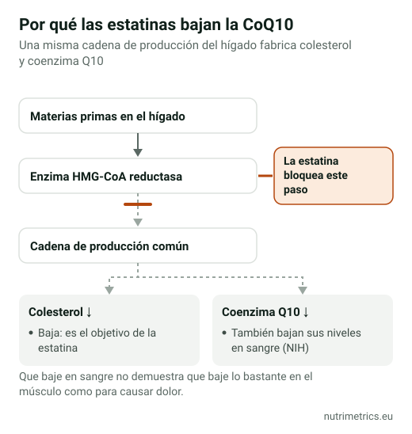

## La respuesta corta

Las estatinas bajan la coenzima Q10 del cuerpo, así que parece lógico que reponerla alivie los dolores musculares que causan. Los ensayos no lo aclaran: el análisis más reciente y amplio no encontró beneficio, y las guías europeas y británicas no la recomiendan. Es poco probable que te haga daño, pero no sustituye a contarle el dolor a tu médico.

## Por qué la idea tiene sentido

Las estatinas bajan el colesterol bloqueando una enzima del hígado. La misma cadena de producción fabrica también la **coenzima Q10**, que las células usan para producir energía, y los NIH de EE. UU. confirman que las estatinas bajan sus niveles en sangre. La teoría es que menos coenzima Q10 en el músculo causa dolor y debilidad, y que un suplemento podría reponerla. Pero que bajen los niveles en sangre no demuestra que bajen lo suficiente en el músculo como para importar.

## Qué muestran los ensayos

| Análisis | Ensayos y personas | Resultado |
| --- | --- | --- |
| Qu et al., *J Am Heart Assoc*, 2018 | 12 ensayos, 575 personas | Menos dolor, debilidad, calambres y cansancio muscular con coenzima Q10. Resultados muy distintos entre ensayos; sin cambios en la CK, un marcador de daño muscular |
| Kennedy et al., *Atherosclerosis*, 2020 | 7 ensayos, 321 personas con dolor muscular por estatinas | **Ningún beneficio** en el dolor, y quienes tomaban coenzima Q10 no siguieron más con su estatina |

Los ensayos eran pequeños y cortos, normalmente de uno a tres meses, y usaron dosis distintas. Cuando dos análisis cuidadosos de estudios parecidos llegan a conclusiones opuestas, lo honesto es decir que cualquier beneficio es incierto y probablemente pequeño.

## Qué dicen las guías

- **Sociedad Europea de Aterosclerosis (2015):** desaconseja la coenzima Q10 para los síntomas musculares por estatinas porque falta evidencia.
- **NICE (Inglaterra):** «No recomiende suplementos de coenzima Q10 para tratar y prevenir los síntomas musculares inducidos por estatinas».
- **Declaraciones de salud en la UE:** la EFSA evaluó en 2010 declaraciones de la coenzima Q10 sobre energía, tensión arterial, colesterol, rendimiento físico y otras. **No se autorizó ninguna.**

## Si aun así quieres probarla

Coméntalo antes con tu médico, sobre todo si tomas otros medicamentos. Si está de acuerdo:

- **Dosis:** los suplementos suelen dar 100–200 mg al día. No hay una dosis acordada para los síntomas por estatinas.
- **Forma:** la **ubiquinona** es la forma estándar; el **ubiquinol** se vende como «activo» y cuesta más, sin buena evidencia de que funcione mejor para esto.
- **Con comida:** tómala con una comida que lleve grasa.
- **Plazo:** los ensayos duraron de uno a tres meses. Si no ha cambiado nada para entonces, déjala.

| Producto (nuestra base de datos) | Forma | Coenzima Q10 al día según la etiqueta |
| --- | --- | --- |
| Vitamaze Coenzym Q10 200 mg | Ubiquinona | 200 mg |
| natural elements Coenzym Q10 | Ubiquinona (fermentación) | 200 mg (2 cápsulas) |
| Solgar Ubiquinol 100 mg | Ubiquinol | 100 mg |
| Vitabay Coenzym Q10 Ubiquinol 200 mg | Ubiquinol | 400 mg (2 cápsulas) |

Ojo con la etiqueta de Vitabay: las dos cápsulas diarias dan 400 mg, el doble de lo habitual.

## Seguridad

Los NIH de EE. UU. no describen efectos secundarios graves, pero la coenzima Q10 **puede interactuar con la warfarina**, un anticoagulante. Si tomas Sintrom u otro anticoagulante, o cualquier medicamento con receta, consulta antes a tu médico o farmacéutico.

## Qué hacer con el dolor muscular por estatinas

Cuéntaselo a tu médico en vez de dejar la estatina por tu cuenta. El dolor muscular tiene muchas causas posibles, y tu médico puede descartarlas y ajustar el tratamiento. Las estatinas se recetan para reducir el riesgo de infarto e ictus, y dejarlas sin consejo médico elimina esa protección.

Compara todos los productos de coenzima Q10 que hemos revisado en nuestra [página de coenzima Q10](/es/suplementos/coenzima-q10/), y consulta qué declaraciones son legales en nuestra guía de [declaraciones de salud autorizadas en la UE](/es/guias/declaraciones-salud-autorizadas-ue/).
