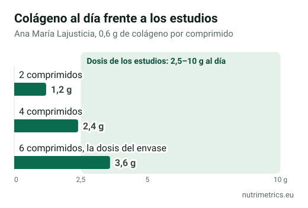

## La respuesta corta

El colágeno con magnesio y el colágeno con ácido hialurónico son productos muy populares en España, pero **ninguno de los ingredientes estrella tiene una declaración de salud autorizada** en la UE. Lo que el envase puede prometer legalmente viene del **magnesio** (huesos, músculos, cansancio) o de la **vitamina C** que a veces se añade (formación de colágeno). La evidencia sobre el colágeno para la piel es discutida y la del ácido hialurónico oral, escasa. Si los tomas, hazlo sabiendo que pagas sobre todo por el magnesio y por una apuesta en lo demás.

## Qué puede prometer cada uno

| Producto                       | Ingrediente con declaración autorizada                  | Qué puede decir el envase                                                                                                  |
| ------------------------------ | ------------------------------------------------------- | -------------------------------------------------------------------------------------------------------------------------- |
| Colágeno con magnesio          | Magnesio                                                | Contribuye al mantenimiento de los huesos, al funcionamiento normal de los músculos y a disminuir el cansancio y la fatiga |
| Colágeno con ácido hialurónico | Ninguno, salvo que lleve vitaminas o minerales añadidos | Nada sobre la piel o las articulaciones, salvo lo que aporte la vitamina C u otro nutriente añadido                        |
| Colágeno con vitamina C        | Vitamina C                                              | Contribuye a la formación normal de colágeno para el funcionamiento normal de la piel, los cartílagos y los huesos         |

La EFSA evaluó una declaración del colágeno hidrolizado para la salud de las articulaciones y concluyó que no se había demostrado la relación causa-efecto; la UE la rechazó en 2012. Por eso tantos productos de colágeno añaden magnesio o vitamina C: es la única forma de poner una promesa legal en el envase. Lo explicamos en nuestra [tabla de declaraciones autorizadas](/es/guias/declaraciones-salud-autorizadas-ue/).

## Qué dice la evidencia

| Ingrediente                   | Estudio más relevante                                 | Resultado                                                                                                                                                                                                            |
| ----------------------------- | ----------------------------------------------------- | -------------------------------------------------------------------------------------------------------------------------------------------------------------------------------------------------------------------- |
| Colágeno (piel)               | Metaanálisis de 2025, 23 ensayos, 1.474 participantes | En conjunto parecía mejorar hidratación y elasticidad, pero **solo en los estudios financiados por la industria**. Los independientes y los de mejor calidad no encontraron efecto. La industria discute el análisis |
| Ácido hialurónico oral (piel) | Metaanálisis de 2025, 7 ensayos                       | Mejoras en hidratación, elasticidad y profundidad de arrugas, con estudios **pocos, pequeños y heterogéneos**                                                                                                        |
| Colágeno (articulaciones)     | Ensayos con 5–10 g al día                             | Resultados mixtos; posible beneficio pequeño                                                                                                                                                                         |

Conclusión honesta: el colágeno para la piel es, hoy, una **apuesta discutida**. Los críticos del metaanálisis tienen algo de razón: «colágeno» agrupa ingredientes y dosis muy distintos. Pero cuando solo los estudios pagados por los fabricantes salen positivos, conviene ser prudente.

## El detalle que casi nadie mira: la dosis

Muchos productos de colágeno en comprimidos llevan **pocos gramos de colágeno** por dosis diaria, mientras que los estudios suelen usar entre **2,5 y 10 g**. Un ejemplo de nuestra base de datos: el *Colágeno con magnesio* de Ana María Lajusticia en comprimidos indica **6 comprimidos al día** para aportar **3,6 g de colágeno y 185 mg de magnesio**.

Dos consecuencias prácticas:

1. **Si tomas menos comprimidos de los indicados**, tomas muy poco colágeno.
2. **Si además tomas otro magnesio**, suma ambos. La EFSA fija en **250 mg al día** el máximo de magnesio procedente de suplementos; con 185 mg de este producto, te quedan solo 65 mg de margen. Por encima, aumenta el riesgo de diarrea.

## Entonces, ¿cuál tiene sentido?

| Si lo que buscas es…                | Lo más razonable                                                                                            |
| ----------------------------------- | ----------------------------------------------------------------------------------------------------------- |
| Magnesio, y el colágeno es un extra | Colágeno con magnesio, contando el magnesio total del día                                                   |
| Piel más hidratada                  | Ninguno tiene promesa autorizada. El ácido hialurónico oral tiene algo de evidencia; el colágeno, discutida |
| Articulaciones                      | Evidencia débil para el colágeno. Habla con tu médico si tienes dolor persistente                           |
| El mejor precio                     | Compara el **coste por gramo de colágeno** y por mg de magnesio, no el precio del bote                      |

Nuestras guías sobre [formas de magnesio](/es/guias/que-magnesio-es-mejor/) y [magnesio para dormir](/es/guias/magnesio-para-dormir/) explican qué aporta el magnesio y cuánto tomar.

**Consulta a tu médico** antes de tomar magnesio si tienes una enfermedad renal o tomas antibióticos, bifosfonatos o protectores de estómago durante mucho tiempo.
