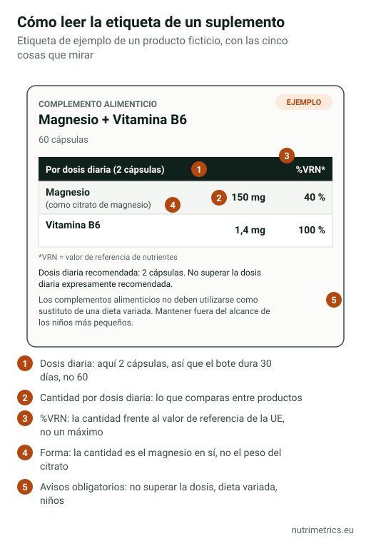

## La respuesta corta

Mira tres cosas en la tabla nutricional: **la cantidad de cada ingrediente por dosis diaria**, **el número de dosis del envase** y **si alguna cantidad supera los máximos de seguridad** de la EFSA. Luego lee las promesas del envase: solo son legales las que figuran en el registro de la UE, y ninguna puede hablar de enfermedades.

## Lo que la ley obliga a poner

Según la Directiva 2002/46/CE, que en España aplica el Real Decreto 1487/2009, la etiqueta de un complemento alimenticio debe incluir:

| Obligatorio | Para qué te sirve |
| --- | --- |
| La denominación **«complemento alimenticio»** | Distinguirlo de un medicamento |
| Los **nutrientes o sustancias** que caracterizan el producto | Saber qué estás comprando |
| La **cantidad de cada uno por dosis diaria** recomendada | Comparar productos y comprobar los límites |
| En vitaminas y minerales, el **%VRN** | Ver cuánto aporta respecto a la referencia |
| La **dosis diaria recomendada** y la advertencia de **no superarla** | Saber cuántas cápsulas son una dosis |
| Que **no debe usarse como sustituto de una dieta variada** | — |
| Que debe **mantenerse fuera del alcance de los niños** | — |

Además, como cualquier alimento: lista de ingredientes, alérgenos, cantidad neta, fecha de consumo preferente, lote y nombre y dirección del responsable.

## Paso 1: busca la dosis diaria, no la cápsula

Muchos productos necesitan **2, 3 o hasta 6 cápsulas** para llegar a la cantidad que anuncian en grande. Comprueba en la tabla a cuántas unidades corresponde la «dosis diaria» y divide el contenido del envase entre esa cifra: un bote de 120 cápsulas con una dosis de 3 cápsulas dura **40 días**, no 120.

## Paso 2: lee el mineral, no el compuesto

En los minerales, lo que cuenta es la cantidad **elemental**. «1.000 mg de bisglicinato de magnesio» suele aportar unos 140 mg de magnesio. La tabla debe indicar el magnesio; si el frente del envase destaca el peso del compuesto, no te dejes llevar por la cifra grande. Lo explicamos con detalle en [¿Qué magnesio es mejor?](/es/guias/que-magnesio-es-mejor/).

## Paso 3: entiende el %VRN

El **valor de referencia de nutrientes (VRN)** es una cifra de referencia de la UE, no un máximo ni una recomendación personal. Algunos ejemplos del Reglamento 1169/2011:

| Nutriente | VRN (100 %) | Máximo tolerable de la EFSA para adultos |
| --- | --- | --- |
| Vitamina D | 5 µg | 100 µg al día |
| Vitamina B6 | 1,4 mg | 12 mg al día |
| Zinc | 10 mg | 25 mg al día |
| Magnesio | 375 mg | 250 mg al día procedentes de suplementos |
| Hierro | 14 mg | Sin máximo; nivel seguro de 40 mg al día |
| Vitamina C | 80 mg | Sin máximo establecido |

Fíjate en el magnesio: un 100 % del VRN (375 mg) ya **supera** los 250 mg que la EFSA considera el máximo tolerable desde suplementos. Un %VRN alto no es una garantía de calidad; a veces es una señal para leer con más cuidado.

## Paso 4: detecta las trampas habituales

- **Dosis que suben si sigues la etiqueta al máximo.** Ejemplo de nuestra base de datos: Berocca Energía recomienda 1 comprimido al día, pero la etiqueta permite 2. Con 2 comprimidos, la vitamina B6 llega a **16,4 mg**, por encima del máximo tolerable de 12 mg de la EFSA.
- **«Mezclas» sin cantidades.** La ley exige indicar la cantidad de cada sustancia con efecto nutricional o fisiológico. Si solo aparece el total de una «mezcla exclusiva», no puedes saber cuánto llevas de cada cosa.
- **Extractos sin estandarizar.** En plantas, busca el tipo de extracto y su concentración (por ejemplo, «5 % de withanólidos» en la ashwagandha). Sin eso, «500 mg de extracto» dice poco.
- **Cifras en el frente que no coinciden con la tabla.** Manda siempre la tabla.

## Paso 5: comprueba las promesas

Un complemento solo puede usar las [declaraciones de salud autorizadas](/es/guias/declaraciones-salud-autorizadas-ue/) en la UE, con su redacción y a partir de la dosis mínima. Y la ley prohíbe atribuirle la propiedad de **prevenir, tratar o curar** una enfermedad. Frases como «adiós al insomnio», «detox» o «refuerza tus defensas contra los virus» son una señal de que la etiqueta va más allá de lo permitido.

En España puedes comprobar si un producto ha sido **notificado** en el buscador de complementos alimenticios de la AESAN. La notificación no es una autorización ni prueba que funcione, pero un producto sin notificar no debería estar a la venta.

Nuestro [buscador por objetivo](/es/buscador/) muestra, para cada producto registrado, la dosis real por día y si alcanza la cantidad que se considera eficaz.
