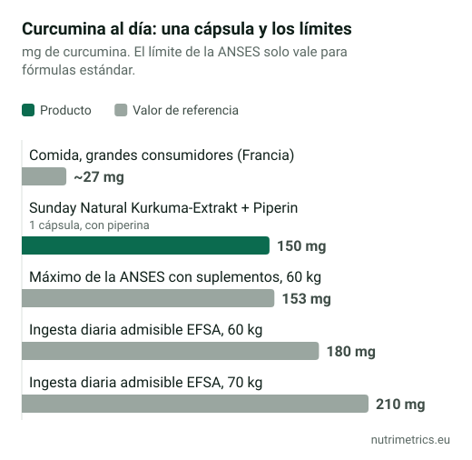

## La respuesta corta

La cúrcuma en la cocina está bien. Los **suplementos concentrados de cúrcuma y curcumina** se han relacionado con casos raros de daño hepático en Europa y fuera de ella, y el riesgo parece mayor con las fórmulas pensadas para absorberse más. Si tomas uno, respeta los límites diarios que usan las autoridades, evítalo si tienes problemas de hígado o vesícula o tomas anticoagulantes, y déjalo a la primera señal de alarma.

## Qué pasó

| Cuándo | Dónde | Qué |
| --- | --- | --- |
| 2018–2019 | Italia | Unos 20 casos de hepatitis relacionados con suplementos de cúrcuma en la Toscana y Lombardía. Se descartaron contaminantes y sustancias añadidas. |
| 2019 | Bélgica | Se retiró un producto de cúrcuma vinculado a los casos italianos. |
| 2020 | Alemania | El BfR encontró los primeros indicios de efectos dañinos para el hígado, sobre todo en preparados de absorción mejorada. |
| 2022 | Francia | La ANSES informó de más de 100 sospechas de efectos adversos, 15 de ellas hepatitis, y fijó un límite diario para los suplementos. |
| 2022 | Italia | Un decreto exigió un aviso sobre el hígado en la etiqueta desde el 31 de diciembre de 2022 y prohibió las declaraciones de salud de la cúrcuma. |
| 2023 | Australia | El regulador comunicó 18 casos de problemas hepáticos, dos graves y uno mortal. |
| 2024 | Reino Unido | El Comité de Toxicidad concluyó que los suplementos en dosis altas pueden superar la ingesta segura y que los efectos sobre el hígado pueden ser idiosincrásicos: raros e imprevisibles. |

Los casos son raros comparados con la cantidad de personas que toman cúrcuma. Pero como nadie puede predecir quién reaccionará, las autoridades se centran en mantener dosis moderadas y avisar a los grupos de más riesgo.

## Los límites diarios

| Límite | Cantidad | Notas |
| --- | --- | --- |
| Ingesta diaria admisible de la EFSA (curcumina) | 3 mg por kg de peso | 180 mg con 60 kg, 210 mg con 70 kg, sumando todas las fuentes |
| Máximo de la ANSES con suplementos (Francia) | 153 mg al día para un adulto de 60 kg | Deja margen para la comida; solo fórmulas estándar |
| Ingesta con la comida, grandes consumidores (Francia) | Unos 27 mg al día | Personas que comen mucha comida con cúrcuma |

Muchos suplementos dan más de 153 mg de curcumina al día. Revisa tanto la cantidad de extracto como el porcentaje de curcuminoides; no todas las etiquetas lo dejan claro.

## Por qué «se absorbe mejor» no significa automáticamente «mejor»

La curcumina sola se absorbe mal, así que los fabricantes añaden **piperina** (extracto de pimienta negra) o usan **micelas, fitosomas, nanopartículas o ciclodextrinas** para subir los niveles en sangre. Eso cambia la seguridad:

- **La ANSES** dice que estas fórmulas pueden aumentar los efectos de la curcumina aunque la dosis quede por debajo del límite, que las etiquetas casi nunca indican de qué tipo es el producto y que su cifra de 153 mg solo vale para fórmulas estándar.
- **El BfR alemán** dice que estos productos no deben considerarse tan seguros como la curcumina normal.
- **El Comité de Toxicidad británico** advierte de que un límite estándar en mg al día puede no reflejar su seguridad.
- **Los NIH de EE. UU.** afirman que las fórmulas de curcumina muy biodisponibles pueden dañar el hígado.

Un ejemplo de nuestra base de datos: **Sunday Natural Kurkuma-Extrakt + Piperin** da 150 mg de curcuminoides y 5,3 mg de piperina por cápsula. Sobre el papel está justo por debajo de los 153 mg de la ANSES. Pero como lleva piperina, la cifra de la ANSES no se aplica de verdad, y la exposición real es mayor de lo que sugieren los miligramos.

## Quién debe evitar los suplementos de cúrcuma

- Personas con **enfermedad hepática** o **problemas de vías biliares o vesícula** (ANSES y el aviso obligatorio en Italia).
- Quienes toman **anticoagulantes, medicamentos contra el cáncer o inmunosupresores**, salvo que su médico lo apruebe (ANSES).
- **Embarazadas**: los NIH de EE. UU. dicen que los suplementos de cúrcuma pueden no ser seguros en el embarazo.

**Señales de alarma** para dejarlos y ver a un médico: cansancio inusual, náuseas, falta de apetito, orina oscura o color amarillento en la piel o los ojos.

## ¿Funciona?

En la **artrosis de rodilla**, un metaanálisis de 2022 con 15 ensayos aleatorizados y 1.670 pacientes vio que los curcuminoides reducían el dolor y la rigidez y mejoraban la función frente a placebo, y no parecían peores que los antiinflamatorios. Los autores calificaron los estudios de baja calidad y muy distintos entre sí, y pidieron prudencia. Los NIH de EE. UU. describen la evidencia inicial como positiva, pero no definitiva.

Para casi todos los demás usos no hay evidencia suficiente. **En la UE no hay ninguna declaración de salud autorizada para la cúrcuma ni la curcumina**, así que las etiquetas que prometen beneficios para articulaciones, hígado o digestión no usan una redacción aprobada.

Compara los productos de cúrcuma que hemos revisado en nuestra [página de cúrcuma](/es/suplementos/curcuma/). Si lo que buscas es aliviar las articulaciones, lee también [glucosamina y condroitina: ¿funcionan?](/es/guias/glucosamina-condroitina-funcionan/).
