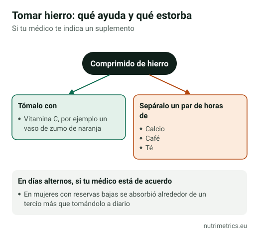

## La respuesta corta

Si estás cansada o cansado sin motivo claro, el hierro **solo ayuda si te falta**. Antes de comprar nada, pide a tu médico un **análisis con ferritina**: es barato y es la forma de saberlo. Si tienes déficit, el hierro tiene una de las evidencias más claras de todos los suplementos para el cansancio. Si no lo tienes, tomarlo no aporta nada y el exceso se acumula en el cuerpo.

## Quién tiene más riesgo

Según el NIH, los grupos con más riesgo de déficit de hierro son:

- mujeres con **reglas abundantes**;
- **embarazadas**;
- **donantes de sangre** frecuentes;
- personas con **enfermedades digestivas** (como la celiaquía) o cirugía digestiva;
- personas con insuficiencia cardiaca o cáncer.

Las dietas **vegetarianas y veganas** aportan solo hierro no hemo, que se absorbe peor, así que conviene planificarlas.

## Qué dice el análisis

| Ferritina | Qué suele indicar (según el NIH) |
| --- | --- |
| Menos de 10 µg/l | Anemia por falta de hierro |
| Menos de 30 µg/l | Déficit de hierro |
| Más de 30 µg/l | Déficit poco probable, aunque una inflamación puede elevar la ferritina |

Tu médico la interpreta junto con la **hemoglobina**. Puedes tener déficit de hierro **sin anemia**: la hemoglobina es normal, pero las reservas están bajas.

## Cuánto ayuda de verdad

En un ensayo publicado en 2012 en la revista *CMAJ*, 198 mujeres de 18 a 53 años con **cansancio sin explicación, sin anemia y con ferritina por debajo de 50 µg/l** tomaron 80 mg de hierro al día o placebo durante 12 semanas. La fatiga bajó un **47,7 %** con hierro y un **28,8 %** con placebo. Es un efecto real, pero en personas con reservas bajas, con dosis altas y bajo un protocolo de estudio.

La UE autoriza decir que el hierro **contribuye a disminuir el cansancio y la fatiga**, a la formación normal de glóbulos rojos y hemoglobina y al transporte normal de oxígeno. Ninguna declaración dice que dé energía a quien tiene sus reservas bien.

## Por qué no tomarlo «por si acaso»

- **La EFSA** no ha podido fijar un máximo tolerable para el hierro y en 2024 estableció un **nivel seguro de 40 mg al día** de hierro total para adultos.
- **El BfR alemán** recomienda no más de **6 mg** de hierro por dosis diaria en complementos de venta libre, y que hombres, mujeres posmenopáusicas y embarazadas solo los tomen tras consultar al médico.
- **El exceso se acumula:** el cuerpo no tiene una vía eficaz para eliminar hierro. Las personas con **hemocromatosis**, una enfermedad hereditaria, no deben tomarlo.
- **Niños:** según el NIH, la ingestión accidental de productos con hierro es una de las principales causas de intoxicación mortal en menores de 6 años. Guárdalo fuera de su alcance.

Un ejemplo de nuestra base de datos: el **Gentle Iron de Solgar** aporta **25 mg** de hierro (bisglicinato) por cápsula. Es una dosis pensada para tratar un déficit, cuatro veces la recomendada por el BfR para un complemento de uso libre. Úsalo solo con un análisis y el consejo de tu médico.

## Cómo tomarlo si te lo indican

1. **En ayunas o con poca comida**, si lo toleras; con comida si te sienta mal.
2. **Con vitamina C** (por ejemplo, un zumo de naranja), que mejora la absorción del hierro no hemo.
3. **Separado del calcio, el café y el té** al menos un par de horas.
4. **En días alternos**, si tu médico está de acuerdo: en un estudio con mujeres con reservas bajas, la absorción fue alrededor de un tercio mayor que tomándolo a diario.
5. **Vuelve a hacer un análisis** a los pocos meses para comprobar que la ferritina sube y no tomarlo más tiempo del necesario.

Efectos habituales: estreñimiento, náuseas y heces oscuras. Las heces negras son normales con hierro, pero si tienes dolor abdominal o heces negras sin tomar hierro, consulta al médico.

**Interacciones:** pregunta a tu médico o farmacéutico si tomas levotiroxina, levodopa o protectores de estómago como el omeprazol.

Nuestro [buscador por objetivo](/es/buscador/) muestra otros ingredientes con declaraciones sobre el cansancio, como la vitamina B12 o el magnesio, y explica cuándo tienen sentido.
