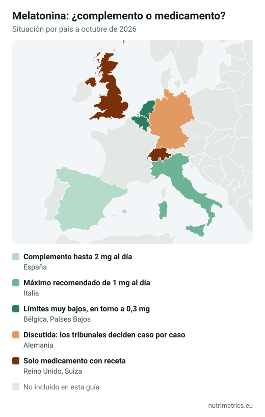

## La respuesta corta

La melatonina **ayuda a dormirse antes**, no a dormir más horas ni más profundo. La única declaración de salud autorizada en la UE para el sueño se basa en **1 mg tomado poco antes de acostarse**. En España los complementos llegan como mucho a **1,9 mg** porque por encima de 2 mg al día se consideran medicamento. Si llevas semanas durmiendo mal, la melatonina no es la solución de fondo: habla con tu médico.

## Lo que permite decir la UE

| Declaración autorizada | Condición |
| --- | --- |
| La melatonina contribuye a reducir el tiempo necesario para conciliar el sueño | 1 mg tomado poco antes de acostarse |
| La melatonina contribuye a aliviar la sensación subjetiva de jet lag | Al menos 0,5 mg el primer día del viaje, poco antes de acostarse, y los primeros días tras la llegada |

Fíjate en lo que **no** está autorizado: dormir más profundo, despertarse menos, reducir la ansiedad o «regular el reloj biológico» en general. Más información en nuestra [tabla de declaraciones autorizadas](/es/guias/declaraciones-salud-autorizadas-ue/).

## ¿Por qué 1,9 mg?

En España, la Agencia Española de Medicamentos y Productos Sanitarios (AEMPS) considera **medicamento** la melatonina por encima de **2 mg al día**. Por eso tantos complementos que se venden en farmacias, herbolarios y supermercados llevan exactamente 1,9 mg: es lo máximo que se puede vender como complemento.

Que se pueda vender no significa que haga falta: la declaración autorizada se basa en **1 mg**, y no hay ninguna declaración para dosis mayores. Un producto de 1,9 mg aporta casi el doble de lo necesario para el efecto reconocido.

## Cada país, una regla

| País | Situación de la melatonina en complementos |
| --- | --- |
| España | Complemento hasta 2 mg al día; por encima, medicamento (criterio de la AEMPS) |
| Italia | Máximo recomendado de 1 mg al día desde 2013 (antes, 5 mg) |
| Alemania | Situación jurídica discutida: las autoridades la han considerado medicamento y los tribunales deciden caso por caso; los medicamentos con melatonina necesitan receta |
| Bélgica y Países Bajos | Límites muy bajos (en torno a 0,3 mg) |
| Reino Unido y Suiza | Solo como medicamento con receta |

Esta tabla resume la situación conocida a octubre de 2026; las normas nacionales cambian. Nuestra guía de [límites máximos de suplementos en Europa](/en/guides/supplement-maximum-levels-europe/) (en inglés) compara más países y nutrientes.

## Quién no debería tomarla

- **Niños y adolescentes**, salvo indicación médica. En Alemania, los pediatras piden prohibir las gominolas de melatonina y el BfR desaconseja dárselas a niños por su cuenta.
- **Embarazadas y mujeres que dan el pecho**.
- Personas que toman **sedantes, anticoagulantes** u otros medicamentos que actúan sobre el sueño: consulta antes a tu médico o farmacéutico.

Efectos que se describen con frecuencia: somnolencia por la mañana, dolor de cabeza y mareo. No conduzcas si notas somnolencia al día siguiente.

## Cómo usarla con sentido

1. **Empieza por la dosis autorizada:** 1 mg poco antes de acostarse.
2. **Úsala para algo concreto:** dormirte antes en una racha mala o adaptarte a un cambio de horario o un viaje.
3. **Ponle fecha de fin.** Si después de unas semanas sigues necesitándola, el problema no se resuelve con un suplemento. El insomnio crónico tiene tratamientos con mucha más evidencia, como la terapia cognitivo-conductual.
4. **Lee la etiqueta:** muchos productos combinan melatonina con plantas (pasiflora, melisa, valeriana) que no tienen declaraciones autorizadas.

Si buscas alternativas sin hormona, nuestra guía de [magnesio para dormir](/es/guias/magnesio-para-dormir/) explica qué dicen los estudios, y el [buscador por objetivo](/es/buscador/) compara la evidencia de las distintas opciones para el sueño.
